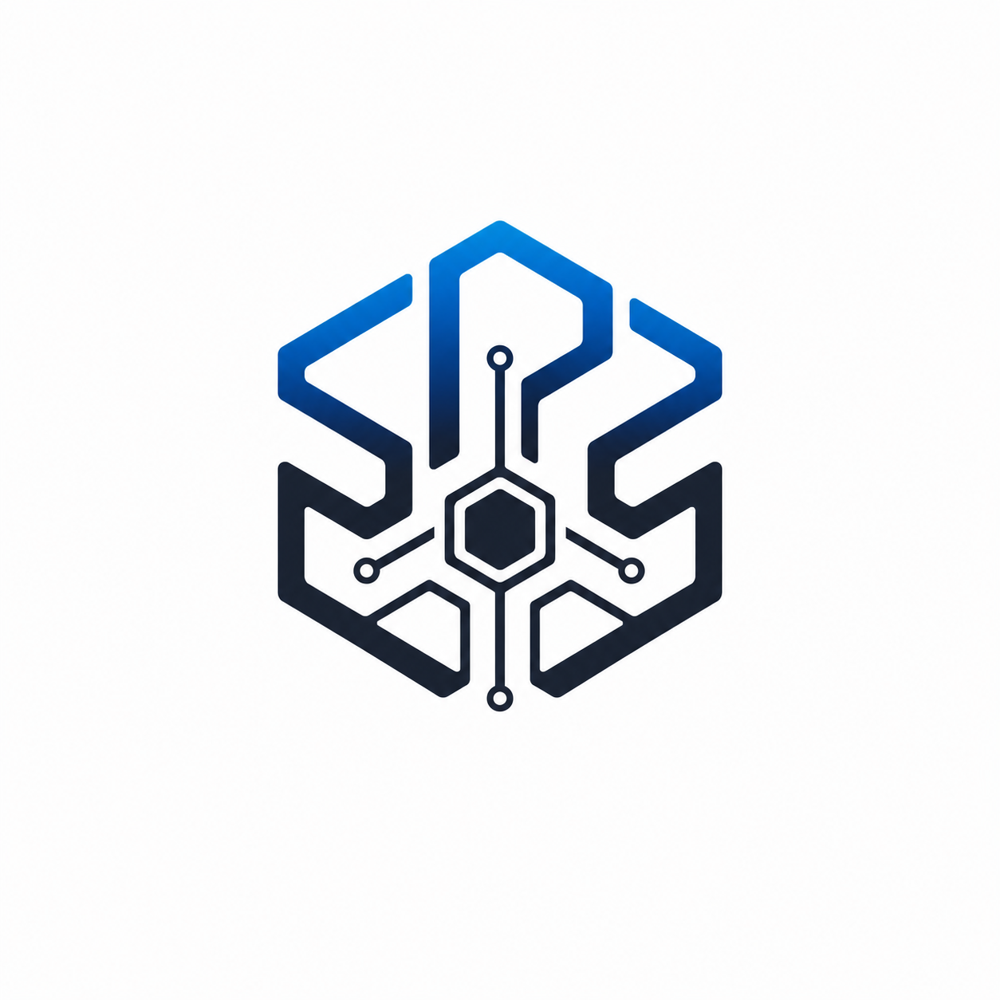
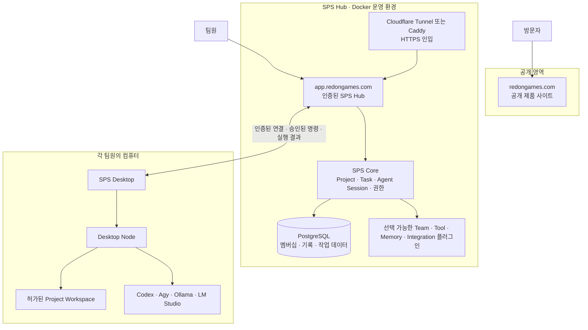

<p align="center">
  
</p>

<h1 align="center">SPS</h1>

<p align="center"><strong>현실의 컴퓨터 위에서 움직이는 AI 팀.</strong></p>

<p align="center">
  SPS(SonParkServer)는 역할별 AI Agent, 프로젝트, 작업, 권한, 로컬 실행 환경을<br />
  하나의 흐름으로 운영하는 <strong>로컬 중심 멀티에이전트 제작 플랫폼</strong>입니다.
</p>

<p align="center">
  <a href="https://redongames.com">제품 사이트</a> ·
  <a href="https://app.redongames.com">SPS Hub 열기</a> ·
  <a href="#시작하기">시작하기</a> ·
  <a href="#개발자를-위한-안내">개발 안내</a>
</p>

> **현재 단계 — Pilot**: Hub·Project·Task·Agent Session·Desktop Node의 핵심 작업 루프를 검증하고 있습니다. 첫 출시의 플러그인 플랫폼과 공식 Team 플러그인은 확정된 제품 범위이며, 각 기능의 구현 상태는 문서에서 명확히 구분합니다.

---

## 하나의 워크스페이스, 여러 대의 컴퓨터

SPS는 채팅창을 늘리는 도구가 아닙니다. 사람과 AI가 목표를 합의하고, 유한한 작업을 만들고, 승인된 컴퓨터에서 실행한 뒤, 변경과 검증 결과를 남기게 하는 운영 공간입니다.

| 제품 기반 | 하는 일 |
| --- | --- |
| **Hub / Core** | Project, Task, Agent, Agent Session, 권한, 실행 기록을 관리합니다. |
| **Desktop Node** | 각 사용자의 PC에서 승인된 AI 실행기와 Workspace를 안전하게 연결합니다. |
| **Plugin Platform** | 팀의 역할, Room 경험, 기억, 외부 도구, 자동화를 필요한 방식으로 구성합니다. |
| **Work Product** | 댓글, 문서, 첨부 파일, 변경, 테스트와 결과를 같은 Task에 연결합니다. |

```text
프로젝트 생성 → 팀 플러그인 선택 → Agent Room에서 방향 논의
→ Task 생성·할당 → 승인된 Workspace와 Desktop Node에서 실행
→ 변경·검증·결과 기록 → Owner의 완료 판단
```

## 제품 구조



### 역할과 책임

| 계층 | 책임 | 보관하지 않는 것 |
| --- | --- | --- |
| **공개 사이트** | 제품 소개, 문서, 다운로드 진입점 | 프로젝트 데이터, Hub 쿠키, 관리자 화면 |
| **SPS Hub** | 로그인, 초대, Project·Task·Agent, Node 승인, 실행 권한과 감사 기록 | CLI 로그인 정보, API 키, 로컬 모델, 절대 경로 |
| **Desktop Node** | 로컬 실행기 상태 확인, 허가된 명령 실행, 결과 반환 | 다른 컴퓨터의 자격 증명과 작업 폴더 |
| **플러그인** | Team 경험, UI, Tool, Automation, Integration, Memory Provider 확장 | 선언하지 않은 권한과 Core 소유 데이터의 임의 변경 |

Node는 Hub에 아웃바운드 연결만 만들고, 실제 자격 증명과 로컬 모델은 언제나 그 컴퓨터 안에 남습니다.

## SPS로 일하는 방식

### 1. 방향을 맞춥니다

Agent Session 또는 Team 플러그인이 제공하는 Agent Room에서 목표, 우선순위, 제약을 논의합니다. 장기 대화의 맥락은 프로젝트에 남고, 실제 실행은 별도의 Task로 분리됩니다.

### 2. 한 번에 끝낼 수 있는 Task를 만듭니다

Task에는 목표, 범위, 담당 Agent, 연결된 Workspace, 첨부 파일, 검증 방법을 기록합니다. 작업은 작고 명확할수록 검토와 재시도가 쉬워집니다.

### 3. 권한 있는 Node에서 실행합니다

Owner 또는 Admin이 승인한 **Node · Runner Profile · Agent** 조합만 실행할 수 있습니다. Node는 등록된 Workspace 내부에서만 동작하며, 허가되지 않은 경로나 실행기는 거절합니다.

### 4. 결과를 검토하고 기록합니다

표준 출력, 오류, 변경, 테스트 결과와 완료 상태가 같은 Task 실행 기록으로 돌아옵니다. 기억은 후보로 제안될 수 있지만, Task를 자동으로 만들거나 배정·완료하지 않습니다.

## 첫 출시 제품 범위

SPS는 범용 Core 위에 팀별 경험을 설치하는 구조를 지향합니다. 기본 SPS는 특정 역할 조직이나 특정 Memory 전략을 고정하지 않습니다.

| 층 | 첫 출시 목표 |
| --- | --- |
| **SPS Core Product** | Hub, Project·Task·Agent·Agent Session, Workspace, Desktop Node, Runner Profile, Availability, 실행 기록, 권한과 복구 |
| **SPS Extension Profile + Plugin Kit** | 기존 Core SDK와 호환되는 manifest, 권한, lifecycle, 테스트, 패키징, 로컬 설치·업데이트 계약 |
| **Bundled Team Plugins** | Plugin Studio, Development Core, Indie Game Team, App Product Team, Web Product Team |

공식 Team 플러그인은 제품 배포본에 포함될 수 있지만 자동 활성화되지 않습니다. 사용자는 필요한 팀 경험만 명시적으로 설치·검토·활성화합니다.

### 플러그인 플랫폼

SPS Plugin Kit은 플러그인을 만들고 공유하기 위한 개발자 제품입니다. 목표 흐름은 다음과 같습니다.

```text
Plugin source
→ SPS Plugin Kit 검사·테스트·패키징
→ immutable .spsplugin release
→ Registry release record
→ Desktop의 출처·호환성·권한 검토
→ 사용자의 명시적 설치·활성화
```

Registry는 `local`, `git`, `official` 배포 경로를 우선 지원합니다. 유료 Marketplace, 판매자 정산, 기업 SSO·SAML, 최종 라이선스 정책은 첫 출시 범위에 포함하지 않습니다.

## 시작하기

### 팀원으로 참여하기

1. 초대받은 SPS Hub 주소를 엽니다.
2. Google 로그인 후 초대 코드를 입력합니다.
3. Project에 들어가 Team 플러그인 또는 Agent Room에서 목표를 공유합니다.
4. Lead가 Task를 만들고, 실행할 Agent와 Node 권한을 확인합니다.
5. 진행 상황, 첨부 파일, 테스트, 결과는 Task에서 확인합니다.

처음에는 이렇게 요청해 보세요.

> “현재 프로젝트 상태를 정리하고, 우선순위가 높은 일을 검증 가능한 작은 Task로 나눠 제안해줘.”

### 내 컴퓨터를 Desktop Node로 연결하기

SPS Desktop은 로컬 서버를 자동으로 여는 앱이 아닙니다. HTTPS Hub에 연결하고, 명시적으로 승인된 경우에만 이 컴퓨터의 AI 실행기와 Workspace를 Node로 제공합니다.

1. SPS Desktop에서 Hub 주소를 저장합니다.
2. 기본 브라우저에서 Google 로그인을 승인합니다.
3. 필요할 때만 이 컴퓨터를 Node로 등록합니다.
4. Owner/Admin이 Node를 승인하고 Agent별 Runner 권한을 부여합니다.
5. 설치·로그인된 Codex CLI, Agy CLI, Ollama 또는 LM Studio가 허가된 Task에서만 실행됩니다.

Node 등록만으로는 작업이 실행되지 않습니다. **Node 승인과 Agent Runner Grant가 모두 필요합니다.**

## 자체 Hub 운영

자체 Hub를 운영하려면 Docker, HTTPS 도메인, Google OAuth Web Client가 필요합니다. 집이나 사설 네트워크에서는 Cloudflare Tunnel로 인바운드 포트 공개 없이 운영할 수 있습니다.

```powershell
git clone --recurse-submodules https://github.com/Powerpunch777/SPS.git
cd SPS\sps-server\deploy\hub

.\Initialize-SPSHubDeployment.ps1 `
  -Domain "app.example.com" `
  -GoogleClientId "<Google OAuth client ID>" `
  -PromptForGoogleClientSecret
```

초기화는 비밀 값이 담긴 로컬 `.env`를 생성합니다. 이 파일은 절대 Git에 커밋하지 마세요. 전체 절차는 [Public Hub Docker 배포 안내](sps-server/105-sps-public-hub-docker-deployment-ko.md)를 따릅니다.

## 개발자를 위한 안내

### 저장소 받기

SPS Core는 고정 버전 Git submodule로 연결되어 있습니다. 반드시 submodule까지 함께 받으세요.

```powershell
git clone --recurse-submodules https://github.com/Powerpunch777/SPS.git
cd SPS
```

이미 복제했다면 다음 한 번으로 Core를 초기화합니다.

```powershell
git submodule update --init --recursive
```

### 로컬 Workplane 검사

```powershell
cd .\sps-server\sps-room-chat
npm ci

cd ..\sps-memory
npm ci

cd ..\..
.\sps-server\scripts\Start-SPS.ps1
.\sps-server\scripts\Test-SPSWorkplaneReadiness.ps1 | Format-List
```

기본 로컬 주소는 [http://127.0.0.1:3100](http://127.0.0.1:3100)입니다.

### 저장소 구조

```text
sps-server/
├─ deploy/hub/                # Docker Hub 배포와 사전 점검
├─ desktop/                   # Electron SPS Desktop UI·패키징
├─ desktop-node/              # 승인된 로컬 Node 실행 런타임
├─ plugin-platform/           # Extension Profile, Registry, Plugin Kit 기반
├─ sps-room-chat/             # 기존 Room·Task 협업 플러그인
├─ sps-memory/                # 기존 Memory 검색·후보 제안 플러그인
├─ sps-default-memory/        # 기본 Memory Provider
├─ memory-sidecar/            # 로컬 기억 보조 서비스
├─ direct-task-*/             # 선택적 로컬 Direct Task 경로
├─ codex-room-adapter/        # Codex app-server 프로토콜 어댑터
├─ agent-instructions/        # 역할·권한·Task 운영 규칙
├─ config/                    # 모델과 Workplane 설정
├─ scripts/                   # 시작, 복구, E2E·보안 검사

external/sps-core/            # 고정 커밋 SPS Core submodule

Public website source          # github.com/Powerpunch777/redon-games-website
```

### 주요 검사

```powershell
# Workplane 준비 상태
.\sps-server\scripts\Test-SPSWorkplaneReadiness.ps1 | Format-List

# Room Chat 플러그인
cd .\sps-server\sps-room-chat
npm run check

# Memory 플러그인
cd ..\sps-memory
npm run check

# 공개 사이트
# 별도 Public repository에서 검사·배포합니다.
git -C ..\redon-games-website status
```

## 문서

| 알고 싶은 내용 | 문서 |
| --- | --- |
| 제품 정의와 첫 출시 계약 | [제품 및 플러그인 플랫폼 계약](sps-server/114-sps-product-and-plugin-platform-contract-ko.md) |
| Plugin Kit과 공식 Team 플러그인 구현 순서 | [구현 계획](sps-server/115-sps-plugin-kit-and-bundled-teams-implementation-plan-ko.md) |
| Plugin Registry와 Marketplace 경계 | [Registry·Marketplace 계약](sps-server/120-sps-plugin-registry-and-marketplace-contract-ko.md) |
| MCP 상호운용성 | [MCP 계약](sps-server/117-sps-mcp-interoperability-contract-ko.md) |
| 현재 문서의 기준과 우선순위 | [문서 지도](sps-server/DOCUMENTATION.md) |
| Desktop과 Hosted Hub 운영 | [Hosted Hub 모드](sps-server/110-sps-desktop-host-mode-ko.md) |
| 다중 컴퓨터 Node 준비 상태 | [Multi-Node 준비 상태](sps-server/109-sps-multi-node-readiness-audit-ko.md) |
| Docker 기반 자체 Hub 배포 | [Public Hub Docker 배포](sps-server/105-sps-public-hub-docker-deployment-ko.md) |

## 보안과 개인 정보

GitHub에 포함하지 않는 항목:

- API 키, OAuth 비밀 값, 로그인 정보, `config.local.json`
- `node_modules`, 로그, 실행 상태, Memory 데이터, 첨부 파일 캐시
- Docker `.env`와 데이터베이스 데이터
- Desktop 빌드 산출물과 개인 컴퓨터의 Node 런타임

플러그인은 권한을 선언해야 하며, Workspace 쓰기·Node 명령·로컬 CLI·MCP 실행처럼 위험한 권한은 플러그인 설치 승인만으로 자동 허용되지 않습니다. 대상 Node 소유자의 별도 승인과 기존 Agent Runner Grant를 계속 요구합니다.
