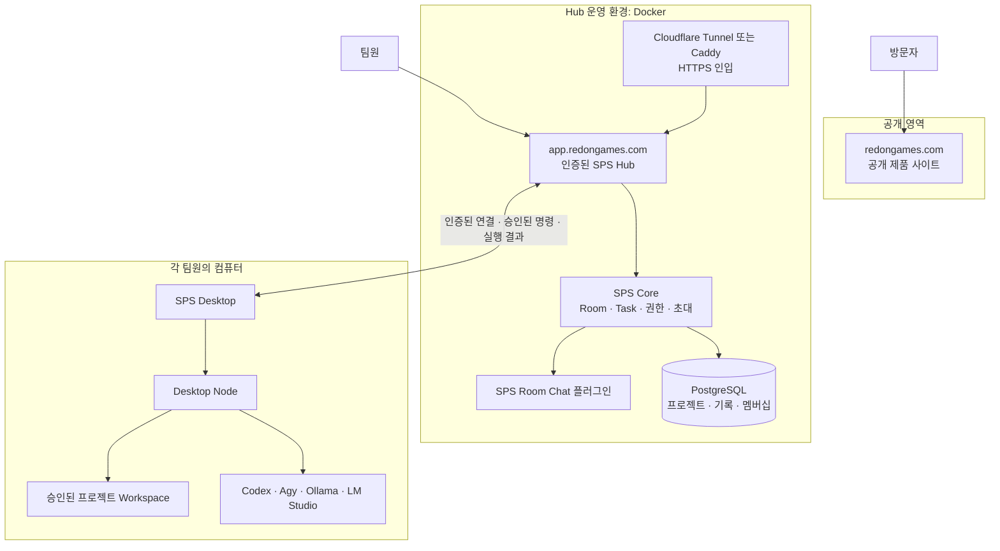

# SPS

**사람과 AI Agent가 같은 프로젝트에서 안전하게 협업하는 제작 워크스페이스.**

SPS(SonParkServer)는 프로젝트, 대화, 작업, 승인, 실행 결과를 한곳에서 관리합니다. 팀은 중앙 Hub에서 함께 계획하고, 각자의 컴퓨터는 필요한 경우에만 안전한 실행 Node로 참여합니다.

- 제품 사이트: [redongames.com](https://redongames.com)
- 협업 Hub: [app.redongames.com](https://app.redongames.com)
- 제품 범위: 사용자가 역할별 AI 팀과 작업 방식을 플러그인으로 구성하는 로컬 중심 멀티에이전트 제작 플랫폼

> 현재 SPS는 Hub·Agent Room·Task Room·Desktop Node의 핵심 작업 루프를 검증한 파일럿 단계입니다. 아래의 Plugin Kit과 공식 팀 플러그인은 첫 제품 출시를 위한 확정된 제품 범위이며, 구현 완료 기능으로 오해하지 않도록 각 문서에서 현재 상태를 별도로 표시합니다.


## 첫 제품 출시 방향

SPS의 첫 제품은 **여러 AI Agent를 실제 소규모 팀처럼 구성하고, 작업 배정부터 로컬 실행·검증·기억 관리까지 운영하는 개발 플랫폼**을 목표로 합니다.

첫 출시 범위는 다음 세 층으로 고정합니다.

| 층 | 첫 출시 범위 |
| --- | --- |
| **SPS Core Product** | Hub, Agent Room, Task Room, 프로젝트별 Workspace, Desktop Node, 실행 기록, 승인·권한, Memory 후보 흐름 |
| **SPS Plugin Kit** | 표준 manifest, 권한 선언, lifecycle, 개발 CLI, 테스트 도구, 로컬 설치·비활성화·업데이트 계약 |
| **Bundled Team Plugins** | Plugin Studio, Development Core, Indie Game Team, App Product Team, Web Product Team |

### 기본 제공 플러그인

- **Plugin Studio**: 자연어 요구사항에서 플러그인 골격·manifest·권한·테스트를 만들고, 검사와 사용자 승인 후 로컬 패키지로 내보냅니다.
- **Development Core**: 요구사항 분석, Task 분해, Git 작업 흐름, 코드 리뷰, 테스트, 빌드 로그, 릴리스 관리 등 개발 플러그인의 공통 계약을 제공합니다.
- **Indie Game Team**: 소규모 게임 팀의 기획·게임플레이 구현·에셋 협업·QA·빌드 흐름을 제공합니다.
- **App Product Team**: 모바일·데스크톱 앱의 제품 기획·UX·클라이언트·백엔드·QA·스토어 배포 흐름을 제공합니다.
- **Web Product Team**: 웹 서비스의 제품 기획·UI·프론트엔드·백엔드·QA·배포 흐름을 제공합니다.

게임·앱·웹 플러그인은 독립 제품처럼 설치되지만, 내부 구현에서는 `Development Core`를 공유해 중복 정책과 코드를 줄입니다.

### 첫 출시에서 제외하는 것

유료 플러그인 거래, 판매자 정산, 공개 Marketplace 결제, 기업용 SSO·SAML, 최종 코어 라이선스 결정은 첫 출시 범위가 아닙니다. 초기에는 공식 플러그인과 직접 설치 가능한 무료·로컬 플러그인에 집중합니다.

자세한 제품 계약과 구현 순서는 다음 문서를 기준으로 합니다.

- [제품 및 플러그인 플랫폼 계약](sps-server/114-sps-product-and-plugin-platform-contract-ko.md)
- [Plugin Kit 및 공식 팀 플러그인 구현 계획](sps-server/115-sps-plugin-kit-and-bundled-teams-implementation-plan-ko.md)
- [문서 체계 감사와 기준 문서 지도](sps-server/116-sps-documentation-audit-and-migration-ko.md)

## SPS가 해결하는 일

AI Agent에게 일을 맡길 때 필요한 맥락, 권한, 결과, 책임을 작업 단위로 남깁니다. 단순 채팅이 아니라 프로젝트의 실행 흐름을 관리하는 공간입니다.

| SPS 구성 | 역할 |
| --- | --- |
| **Hub** | 팀의 프로젝트, Room, Task, 멤버십, 권한 및 실행 기록을 보관하는 중앙 협업 서비스입니다. |
| **Agent Room** | Lead 또는 역할별 Agent와 목표·우선순위·방향을 이어서 논의하는 장기 대화 공간입니다. |
| **Task Room** | 목표, 범위, 담당자, 첨부 파일, 결과가 남는 하나의 실제 작업 공간입니다. |
| **Desktop Node** | 사용자의 컴퓨터에서 승인된 Agent 명령과 로컬 AI를 실행하는 안전한 실행 노드입니다. |
| **Memory** | 승인된 기억을 검색하고 새 기억은 후보로 제안합니다. 기억이 작업을 자동 생성하거나 배정하지는 않습니다. |

```text
사용자 → Agent Room → Task Room → 승인된 Desktop Node → 결과와 기록
```

## 서버 구조

SPS는 공개 사이트, 인증된 Hub, 각 사용자의 Desktop Node를 분리합니다. 공개 사이트는 제품 안내만 제공하며, 프로젝트 데이터와 실행 권한은 Hub와 승인된 Node 사이에서만 다뤄집니다.



### 구성 요소별 책임

| 계층 | 포함 요소 | 책임 | 보관하지 않는 것 |
| --- | --- | --- | --- |
| 공개 사이트 | `redongames.com`, `sps-server/website/` | 제품 소개, 문서와 다운로드 진입점 | Hub 쿠키, 프로젝트 데이터, 관리자 화면 |
| 협업 Hub | `app.redongames.com`, `deploy/hub/`, SPS Core, PostgreSQL | 로그인, 초대, 프로젝트, Room, Task, Node 승인, Agent 실행 권한, 결과 기록 | Node의 CLI 로그인, API 키, 로컬 모델, 절대 작업 경로 |
| Desktop Node | `desktop/`, `desktop-node/` | Hub에 연결, 로컬 실행기 확인, 승인된 명령 실행, 결과 회수 | 다른 Node의 자격 증명·작업 폴더 |
| 협업 플러그인 | `sps-room-chat/`, `sps-memory/` | Room UI, Task 협업, 기억 검색과 후보 제안 | 임의 Task 생성·배정, 승인된 기억의 자동 변경 |
| 로컬 보조 서비스 | `memory-sidecar/`, `direct-task-*` | 개발·로컬 Workplane에서의 기억 지원과 명시적 Task 실행 | 공개 Hub 비밀 값, 외부 공개 포트 |

### 작업이 실행되는 순서

1. 사용자가 Agent Room에서 목표를 논의하거나, Lead가 Task Room을 만듭니다.
2. Hub는 프로젝트·멤버십·Agent 정책을 확인하고, 실행 가능한 Node를 결정합니다.
3. Owner/Admin이 승인한 Node와 Agent 조합에만 실행 권한이 있습니다.
4. Node는 자기 컴퓨터의 등록된 Workspace와 로컬 실행기만 사용해 명령을 수행합니다.
5. 표준 출력, 오류, 완료 상태는 Hub의 같은 Task 실행 기록으로 돌아갑니다.

Node는 Hub에 **아웃바운드 연결만** 만들며, Hub가 팀원 컴퓨터의 포트를 열거나 임의의 셸을 직접 실행하지 않습니다.

## 사용자 시작하기

### 팀원으로 참여하기

1. 초대받은 SPS Hub 주소를 엽니다.
2. Google 로그인 후 초대 코드를 입력합니다.
3. 프로젝트와 Agent Room에 들어가 목표를 설명합니다.
4. Lead Agent가 필요한 Task Room을 만들고 적절한 Worker에게 할당합니다.
5. 작업 진행, 첨부 파일, 결과 보고는 해당 Task Room에서 확인합니다.

처음에는 Lead Agent에게 이렇게 요청해 보세요.

> “이 프로젝트의 현재 상태를 정리하고, 우선순위가 높은 작업을 작은 Task로 나눠 제안해줘.”

### 내 컴퓨터를 실행 Node로 연결하기

SPS Desktop은 로컬 서버를 자동으로 열지 않습니다. HTTPS Hub에 연결하는 데스크톱 클라이언트이면서, 허가된 경우에만 이 컴퓨터의 CLI·로컬 AI를 실행하는 Node입니다.

1. SPS Desktop에서 Hub 주소를 저장합니다.
2. 브라우저에서 Google 로그인을 승인합니다.
3. 필요할 때만 이 컴퓨터를 Node로 등록합니다.
4. Owner 또는 Admin이 Node를 승인하고, 실행할 Agent에 권한을 부여합니다.
5. 해당 컴퓨터에 설치·로그인된 Codex CLI, Agy CLI, Ollama 또는 LM Studio가 승인된 Task에만 사용됩니다.

Node 등록만으로는 명령이 실행되지 않습니다. **Node 승인과 Agent별 실행 권한 부여**가 모두 완료되어야 합니다.

## 보안 원칙

- Hub는 사람·프로젝트·Task·권한을 조정하고, Node는 자신의 컴퓨터에서만 실행합니다.
- CLI 로그인 정보, API 키, 로컬 모델, 절대 작업 경로는 Hub로 전송하지 않습니다.
- 새 Node는 Owner/Admin 승인을 받아야 하며, Agent별 권한도 별도로 필요합니다.
- 프로젝트 작업 폴더는 Node에 명시적으로 연결된 경로만 사용할 수 있습니다.
- 공개 제품 사이트와 인증 Hub는 분리되어 있습니다. 공개 사이트는 협업 데이터나 관리 화면에 접근하지 않습니다.

자세한 권한·Node·초대 정책은 [다중 Node 준비 상태](sps-server/109-sps-multi-node-readiness-audit-ko.md)와 [프로젝트 접근 제어](sps-server/94-project-access-control-ko.md)를 참고하세요.

## 자체 운영: Hub 배포

자체 Hub를 운영하려면 Docker, HTTPS 도메인, Google OAuth Web Client가 필요합니다. 외부에 포트를 직접 열기 어려운 환경에서는 Cloudflare Tunnel 방식을 사용할 수 있습니다.

```powershell
git clone --recurse-submodules https://github.com/Powerpunch777/SPS.git
cd SPS\sps-server\deploy\hub

.\Initialize-SPSHubDeployment.ps1 `
  -Domain "app.example.com" `
  -GoogleClientId "<Google OAuth client ID>" `
  -PromptForGoogleClientSecret
```

초기화는 비밀 값이 담긴 로컬 `.env` 파일을 만들며, 이 파일은 Git에 포함하지 않습니다. 전체 배포 절차는 [Public Hub Docker 배포 안내](sps-server/105-sps-public-hub-docker-deployment-ko.md)를 따르세요.

## 로컬 개발 환경

Windows에서 SPS Workplane과 플러그인을 실행·검증하려면 다음 순서를 사용합니다.

```powershell
git clone --recurse-submodules https://github.com/Powerpunch777/SPS.git
cd SPS

cd .\sps-server\sps-room-chat
npm ci

cd ..\sps-memory
npm ci

cd ..\..
.\sps-server\scripts\Start-SPS.ps1
.\sps-server\scripts\Test-SPSWorkplaneReadiness.ps1 | Format-List
```

기본 로컬 주소는 [http://127.0.0.1:3100](http://127.0.0.1:3100)입니다. 일반 `git clone`을 이미 실행했다면 다음 명령으로 SPS Core submodule을 받습니다.

```powershell
git submodule update --init --recursive
```

## 서버 소스 구조

```text
sps-server/
├─ deploy/
│  └─ hub/                    # Docker Compose, Hub 초기화, 공개 배포 검사
├─ desktop/                   # Electron 기반 SPS Desktop UI·패키징
├─ desktop-node/              # Hub 명령을 받는 로컬 Node 런타임
├─ sps-room-chat/             # Agent Room·Task Room 화면과 협업 Worker
├─ sps-memory/                # Memory 화면, 검색·후보 제안 플러그인
├─ memory-sidecar/            # 로컬 승인 기억·후보 저장 서비스
├─ direct-task-bridge/        # 선택적 loopback Direct Task 실행 브리지
├─ direct-task-pipe-broker/   # Windows Named Pipe 기반 실행 경로
├─ agent-instructions/        # 역할, 권한, Task 운영 규칙
├─ config/                    # 모델 카탈로그와 Workplane 설정
├─ codex-room-adapter/        # Codex app-server 프로토콜 어댑터
├─ scripts/                   # 시작, 복구, 마이그레이션, E2E 검사
├─ tests/                     # 보안·호환성·회귀 테스트 fixture
├─ tasks/                     # 구현 작업 명세와 검증 기록
└─ website/                   # GitHub Pages용 공개 제품 사이트

external/
└─ sps-core/                  # 고정 커밋으로 연결된 SPS Core submodule
```

`external/sps-core`는 별도 저장소를 가리키는 Git submodule입니다. 저장소 복제 시 `--recurse-submodules`를 사용해야 Hub, Desktop, 플러그인이 호환되는 같은 Core 버전을 사용합니다.

## 개발 검사

```powershell
# Workplane 준비 상태
.\sps-server\scripts\Test-SPSWorkplaneReadiness.ps1 | Format-List

# Room Chat 플러그인
cd .\sps-server\sps-room-chat
npm run check

# Memory 플러그인
cd ..\sps-memory
npm run check

# 공개 사이트 소스 검사
node ..\website\scripts\check-site.mjs
```

## 제품 및 운영 문서

- [문서 체계와 현재 기준](sps-server/DOCUMENTATION.md)
- [제품 및 플러그인 플랫폼 계약](sps-server/114-sps-product-and-plugin-platform-contract-ko.md)
- [Plugin Kit 및 공식 팀 플러그인 구현 계획](sps-server/115-sps-plugin-kit-and-bundled-teams-implementation-plan-ko.md)
- [문서 체계 감사와 마이그레이션](sps-server/116-sps-documentation-audit-and-migration-ko.md)
- [현재 서버 사용자 안내](sps-server/97-current-server-user-guide-ko.md)
- [SPS Desktop Hosted Hub 모드](sps-server/110-sps-desktop-host-mode-ko.md)
- [Public Hub Docker 배포](sps-server/105-sps-public-hub-docker-deployment-ko.md)
- [도메인·공개 사이트·Hub 구조](sps-server/107-redongames-domain-and-website-ko.md)
- [Cloudflare Tunnel Hub 배포](sps-server/108-sps-cloudflare-tunnel-hub-ko.md)
- [Desktop 릴리스 채널](sps-server/104-sps-desktop-release-channel-ko.md)
- [제품명 및 SPS Core 호환 경계](sps-server/106-sps-product-brand-boundary-ko.md)

## Git에 포함하지 않는 항목

다음은 개인 장비 또는 운영 환경에만 남아야 하며 GitHub에 올리지 않습니다.

- API 키, OAuth 비밀 값, 로그인 정보, `config.local.json`
- `node_modules`, 로그, 실행 상태, Memory 데이터, 첨부 파일 캐시
- Docker 배포 `.env`와 데이터베이스 데이터
- Desktop 빌드 결과물과 개인 컴퓨터의 Node 런타임
