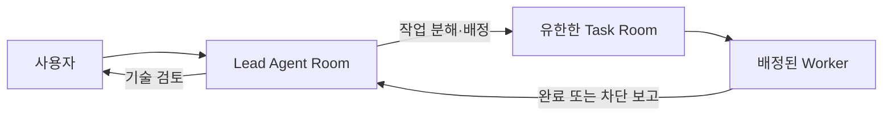

# SPS Workplane

SPS Workplane은 제작팀이 AI Agent와 직접 협업하면서, 필요한 실제 작업만 유한한 Task로 위임하도록 만든 Windows 우선의 로컬 제작 서버입니다. SPS는 Project, Agent Room, Task Room, 첨부 파일, 운영 상태와 권한을 관리하고, 설계·소스·에셋의 원본은 연결된 프로젝트 Workspace와 Git 저장소에 둡니다.

현재 로컬 서버 주소: **[http://127.0.0.1:3100](http://127.0.0.1:3100)**

## 현재 서버 상태

2026-07-18 기준 실제 준비 상태 검사 결과입니다.

| 구성 요소 | 상태 |
| --- | --- |
| SPS Core | `ok` — `127.0.0.1:3100`, `local_trusted`, private 노출 |
| 인증·초기화 | 준비 완료 |
| 데이터베이스 백업 | 활성화 및 정상 |
| Memory Sidecar | `ok` — `127.0.0.1:3188`, 경고 0 |
| 승인 메모리 / 후보 | 33 / 13 |
| 필수 Agent | CTO 및 Code Worker 모두 `idle`, 준비 완료 |
| 활성 실행 | 0 |

실시간 상태는 다음 명령으로 다시 확인합니다.

```powershell
.\sps-server\scripts\Test-SPSWorkplaneReadiness.ps1 | Format-List
```

## 사용 방식



- **Agent Room**은 Agent 한 명의 장기 대화 및 운영 데스크입니다. 목표·방향·우선순위·Task 결과를 사용자와 논의합니다.
- **Task Room**은 하나의 명확한 목표를 끝내기 위한 짧은 작업방입니다. 범위, 담당 Worker, 영향 경로, 수락 기준, 검증 방법을 포함해야 합니다.
- **Lead**는 허용된 Worker에게만 Task를 만들고 배정하며, 결과를 기술적으로 검토합니다.
- **Worker**는 배정된 Task에서만 생산 작업을 수행하고, 최종 또는 차단 보고를 남깁니다. Task 생성·재배정·완료 권한은 없습니다.
- Worker의 결과는 Task를 만든 **원래 Lead Room**에만 자동 보고됩니다.

Manager, Designer, CTO는 Lead의 일반적인 예시일 뿐입니다. 실제 권한은 Agent 이름이나 조직도가 아니라 Agent Configuration의 Workplane policy(`lead`, `worker`, `hybrid`)로 결정됩니다.

## 구성

```text
sps-server/
├── sps-room-chat/             # 지속형 SPS Agent Room 플러그인
├── sps-memory/                # 승인 메모리 검색·후보 제안 플러그인
├── memory-sidecar/            # 로컬 승인 메모리 및 후보 저장 서비스
├── agent-instructions/        # 공통 계약·프로필·역할별 운영 지침
├── config/                    # 모델 카탈로그와 Agy 프롬프트 템플릿
├── scripts/                   # 서버 시작·복구·검증·협업 모드 도구
├── direct-task-pipe-broker/   # 선택적 Windows Named Pipe Direct Task 경로
├── direct-task-bridge/        # 루프백 Direct Task 실행 브리지
├── image-worker-asset-tool/   # PixelLab/Meshy 자산 생성 companion 도구
├── codex-room-adapter/        # Codex app-server 프로토콜 스키마
├── tasks/                     # 작업 명세와 검증 기록
└── tests/                     # 회귀·보안 fixture
```

SPS Room Chat 플러그인 소스 버전은 `0.3.58`, SPS Memory 플러그인 소스 버전은 `0.1.4`입니다.

## 시작·재시작·자동 시작

```powershell
cd "C:\Users\young\Documents\AGENT 구축"

# 실행 중인 상태를 유지하며 시작하거나, 중지된 구성 요소만 시작
.\sps-server\scripts\Start-SPS.ps1

# Core와 플러그인 변경을 다시 읽도록 안전하게 재시작
.\sps-server\scripts\Start-SPS.ps1 -Restart

# 현재 사용자 로그인 시 자동 시작 등록 및 즉시 실행
.\sps-server\scripts\Install-SPSStartup.ps1 -StartNow
```

`Start-SPS.ps1`은 기본적으로 `external\sps-core`의 호환 Core 작업 트리를 사용합니다. 서버 포트를 점유한 프로세스가 기대한 로컬 Core가 아니거나, health 확인에 실패한 경우 시작을 중단하거나 검증된 프로세스만 정리합니다. 기본 구성을 임의의 외부 서버나 바닐라 Core로 바꾸지 마세요.

## Project 설정

1. 웹 UI의 **Projects**에서 Project를 열거나 만듭니다.
2. **Workplane > Workspace & task routing**에서 Design, Implementation, Shared knowledge Workspace를 연결합니다.
3. Project별 Task type과 기본 Workspace를 설정합니다. 기본 type 외에도 `research`, `release`, `api-contract` 등을 추가할 수 있습니다.
4. Agent의 실행 adapter, 모델, 작업 폴더, `CODEX_HOME`, 역할 지침, Workplane policy를 설정합니다.
5. 목적에 맞는 Lead Room에서 요구를 자연어로 요청합니다.

설계·구현·에셋 파일은 연결된 Workspace가 원본입니다. SPS에는 Room 대화, Task 계약, 첨부 파일, 체크포인트, 결과 보고 같은 운영 기록만 둡니다.

## Room, 기억, 첨부 파일

- Room은 `ROOM_WORK_STATE` 체크포인트로 현재 목표·최근 결과·원본 문서 위치·다음 후보를 보존합니다. 재시작과 compact 뒤에도 이 운영 문맥을 복구합니다.
- 첨부 파일의 원본은 SPS에 보존합니다. 실행 시 필요한 파일만 선택된 Workspace의 `.sps/room-attachments/` 캐시에 준비합니다.
- 이미지에는 이미지 입력을 사용하고, 문서·기타 파일에는 명시적 안전 검사 지침을 제공합니다. 비밀키·계정 파일·개인정보는 첨부하지 마세요.
- Memory Sidecar는 회사·프로젝트·역할별 승인 `LEARNINGS.md`를 검색하고 후보를 별도로 보관합니다. 후보는 사용자 또는 책임자의 명시적 검토 전까지 승인 메모리를 바꾸지 않습니다.

```powershell
cd .\sps-server\memory-sidecar
.\memory-recall.ps1 -Query "Task Room" -Scope project -Limit 5
.\memory-candidates.ps1 -Limit 20

# 승격은 검토 뒤에만 명시적으로 적용
.\memory-promote-candidate.ps1 -CandidateId cand_example -JournalId project-default -Apply
```

## 실행 Adapter와 모델

- **Codex Room**은 Agent별 `CODEX_HOME`을 우선 적용하여 계정·세션을 분리합니다.
- **Agy Worker**는 지속형 Room 문맥을 SPS 소유 sandbox에서 재구성해 실행합니다. Worker Room은 생산 Task가 아니므로 읽기 전용 경계를 유지합니다.
- 모델 선택기는 [모델 카탈로그](sps-server/config/sps-adapter-models.json)를 통해 관리합니다. 갱신 후 동기화하고 SPS를 재시작합니다.

```powershell
.\sps-server\scripts\Sync-SPSAdapterModelCatalog.ps1
```

Provider 한도·인증·도구 오류가 나면 서버가 조용히 다른 모델을 선택하거나 자동 재시도하지 않습니다. Task는 배정을 보존한 채 `blocked`가 되고 원래 Lead Room에 상황이 보고됩니다. Lead가 복구 후 같은 Task를 재개할지 결정합니다.

## Agent 지침과 작업 경계

`agent-instructions/`는 세 층으로 운영됩니다.

1. 회사 전체 계약: Room과 Task의 차이, 권한, 소유권, 기억과 근거
2. `task-owner` 또는 `worker` 프로필: Task 생성·검토와 생산·보고의 분리
3. 전문 역할: Manager, Designer, CTO, Code, QA, Image, Voice, Document

```powershell
# 공통 계약과 프로필 동기화 및 검사
.\sps-server\scripts\Sync-SPSCompanyInstructions.ps1 -RequireApi
.\sps-server\scripts\Test-SPSCompanyInstructions.ps1
```

프로젝트별 제품 사실과 설계·소스 파일은 `AGENTS.md`에 넣지 않고 Project Workspace에 둡니다. 일반 서버 재시작은 Agent Configuration과 역할 지침을 자동으로 덮어쓰지 않습니다.

## Image Worker

Image Worker는 버전이 있는 JSON 자산 사양으로 외부 생성 서비스를 사용합니다.

- 2D 픽셀 아트·스프라이트·타일·UI는 **PixelLab**이 기본 선택입니다.
- 명시적으로 3D가 필요한 Task만 **Meshy**를 사용합니다.
- 결과는 프로젝트 Workspace 안에 기록되며, 검토 전 최종 에셋 경로로 자동 승격되지 않습니다.

```powershell
node $env:IMAGE_WORKER_ASSET_TOOL providers
node $env:IMAGE_WORKER_ASSET_TOOL validate --spec Art/Requests/hero.asset.json
node $env:IMAGE_WORKER_ASSET_TOOL start --spec Art/Requests/hero.asset.json
node $env:IMAGE_WORKER_ASSET_TOOL status --run-id <run-id>
```

Provider 키는 Agent Configuration 또는 SPS encrypted Secret에만 `secret_ref`로 연결합니다. Room 대화, Task, 자산 사양, 저장소, 지침 파일에는 넣지 않습니다.

## Direct Task

Direct Task는 선택 기능이며 기본적으로 비활성화되어 있습니다.

1. `direct-task-pipe-broker/config.example.json`을 기준으로 로컬 `config.local.json`을 작성합니다.
2. 회사·목표·Project·Workspace 매핑과 `enabled` 값을 검토합니다.
3. Project Hub의 **Direct Task Preview**에서 역할, 상위 Agent Room, 목표를 확인한 후에만 실행합니다.

이 경로는 현재 사용자 ACL의 Windows Named Pipe와 자식 loopback Bridge를 사용합니다. Bridge URL, 토큰, API 키는 Task·Room·플러그인 구성에 노출하지 않습니다.

## 협업 모드

현재 실행 서버는 **로컬 전용(`local_trusted`)**입니다. 포트 포워딩이나 공용 인터넷 노출을 해서는 안 됩니다.

다른 사람과 협업해야 할 때는 먼저 Private Tailnet과 인증을 설정하고, 검증이 `collaboration_ready`가 된 뒤에만 사용자를 초대합니다.

```powershell
cd "C:\Users\young\Documents\AGENT 구축\sps-server"
.\scripts\Set-SPSWorkplaneAccessMode.ps1 `
  -Mode PrivateTailnet `
  -AllowedHostname "your-machine.tailnet.ts.net"
.\scripts\Start-SPS.ps1 -Restart
.\scripts\Test-SPSWorkplaneCollaboration.ps1 | Format-List
```

멀티컴퓨터 Hub/Member Node, 인앱 초대, 기기 등록, 원격 CLI 실행은 [SPS Desktop 멀티컴퓨터 운영 구조](sps-server/98-sps-desktop-multinode-architecture-ko.md)와 [계정·초대 출시 계획](sps-server/99-sps-desktop-account-invite-plan-ko.md)에 정의된 후속 제품 범위입니다. 현재 로컬 전용 서버를 외부에 그대로 열지 않습니다.

## 검증

```powershell
# 전체 서버 준비 상태
.\sps-server\scripts\Test-SPSWorkplaneReadiness.ps1 | Format-List

# Room 플러그인 전체 빌드·회귀 검사
cd .\sps-server\sps-room-chat
npm ci
npm run check

# Memory 플러그인 계약 검사
cd ..\sps-memory
npm ci
npm run check

# Image Worker 도구 검사
cd ..\image-worker-asset-tool
npm test
```

## 주요 문서

- [현재 서버 사용설명서](sps-server/97-current-server-user-guide-ko.md)
- [제품 준비도 감사](sps-server/90-product-readiness-audit-ko.md)
- [릴리스 감사](sps-server/96-release-audit-ko.md)
- [전체 스택 제품 감사](sps-server/92-full-stack-product-audit-ko.md)
- [협업 배포 준비도](sps-server/93-collaboration-deployment-readiness-ko.md)
- [프로젝트 접근 제어](sps-server/94-project-access-control-ko.md)

## Git에 올리지 않는 항목

- `node_modules/`, 로그, 런타임 상태, Room 첨부 캐시
- `memory-sidecar/config.local.json`, 후보 메모리 데이터
- Direct Task Broker의 `config.local.json`과 runtime 데이터
- SPS 인증 정보, 암호화 Secret, Provider API 키, Codex/Agy 로컬 인증 정보

서버·Core·플러그인 업데이트 전에는 준비 상태를 확인하고, 변경 후에는 `Test-SPSWorkplaneReadiness.ps1`과 해당 플러그인의 `npm run check`을 실행하세요.
