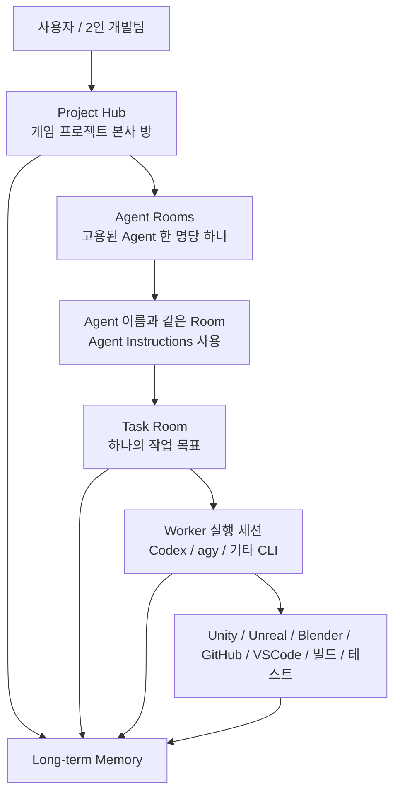
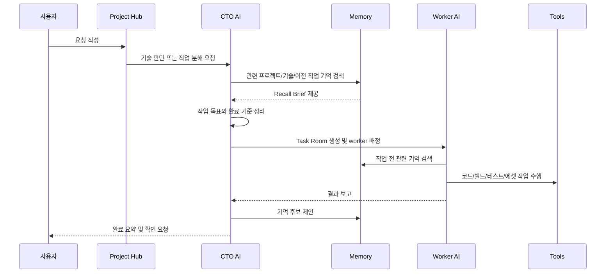

# Paperclip 게임 제작 AI 운영 모델

이 문서는 앞으로 Paperclip 기반 AI 게임 제작 Work Plane을 개조할 때 따를 기준 구조다.

목표는 Paperclip을 버리거나 Swarm처럼 다시 만드는 것이 아니라, Paperclip의 기존 회사/프로젝트/이슈/에이전트 실행 구조 위에 장기기억과 게임 제작 파이프라인을 얹는 것이다.

## 핵심 결론

Paperclip은 AI 게임 개발 회사의 사무실이다.

Memory는 그 회사의 공용 업무기억과 인수인계 시스템이다.

Task Room은 실제 일이 진행되는 작업방이다.

Agent Room은 고용된 Agent별 장기 책상이다.

CTO와 Manager는 중앙 컨트롤러에게 조종당하지 않는다. 직접 Paperclip tool과 memory tool을 사용해서 작업방을 만들고, worker를 배정하고, 결과를 취합한다.

## 완성형 구조



## Project Hub

프로젝트 하나당 중심 방을 하나 둔다.

예:

- `Project: PowerPunch`
- `Project: Combat Prototype`
- `Project: Vertical Slice`

Project Hub에는 프로젝트 전체 맥락이 쌓인다.

- 이 게임이 어떤 게임인지
- 현재 목표
- 큰 기획 결정
- 마일스톤
- 사용 엔진
- 폴더 구조
- 코딩 규칙
- 아트 스타일
- 빌드/테스트 방식
- 현재 리스크
- 다음 우선순위

Paperclip 기준으로는 `projects`, `project_workspaces`, 프로젝트 최상위 issue, 프로젝트 문서, 프로젝트 memory namespace가 이 역할을 맡는다.

## Agent Room

### 현재 적용 규칙

Agent Room의 단위는 역할이 아니라 고용된 Paperclip Agent다. 프로젝트마다
고용된 Agent 한 명당 Room을 하나 만들고, Room 제목은 Agent 이름과 같게
유지한다. 내부 연결은 Agent ID를 사용하므로 이름 변경도 안전하게 동기화할
수 있다. CTO가 둘이면 CTO Agent Room도 둘이며, 각 Room은 해당 Agent의
Instructions에서 관리되는 `AGENTS.md`만 사용한다.

새 Agent를 고용하면 기존 프로젝트에도 그 Agent의 Room을 만들며, 과거의
역할 기반 Room은 삭제하지 않고 `cancelled` 기록으로 보존한다.

각 AI 역할마다 지속되는 방을 둔다.

기본 Agent Room:

- Manager Room
- CTO Room
- Designer Room
- Code Worker Room
- Art Worker Room
- Voice Worker Room
- QA Worker Room

Agent Room은 일반 잡담방이 아니라 역할별 책상이다.

예를 들어 CTO Room에는 기술 판단, 작업 분해 기준, worker 배정 규칙이 남는다.

QA Room에는 테스트 기준, 반복되는 버그 패턴, 릴리스 체크 방식이 남는다.

Agent Room은 길게 유지되지만, 실제 산출물 작업은 보통 Task Room으로 분리한다.

## Task Room

실제 일은 Task Room에서 진행한다.

Task Room은 하나의 작업 목표를 가진다.

예:

- `플레이어 대시 기능 프로토타입`
- `전투 UX 흐름 문서 작성`
- `빌드 실패 원인 조사`
- `QA 체크리스트 작성`
- `Blender 에셋 import 규칙 정리`

Task Room은 목표가 끝나면 닫는다.

닫을 때는 반드시 다음을 남긴다.

- 목표
- 결과
- 변경 파일 또는 산출물
- 검증 결과
- 이번 작업에서 배운 것
- 장기기억 후보
- 후속 작업

Paperclip 기준으로 Task Room은 `issues`와 `issue_comments`다. `agent_task_sessions`는 사용자가 대화하는 방이 아니라, 특정 agent가 해당 issue에서 실행된 내부 세션 기록이다.

## 직접 요청 방식

사용자는 AI에게 직접 요청할 수 있어야 한다.

항상 Manager를 거칠 필요는 없다.

### Project Hub에 요청

프로젝트 전체 방향, 우선순위, 일정, 큰 목표를 이야기할 때 사용한다.

예:

```text
이번 주 목표 정리해줘. 전투 프로토타입을 우선으로 보고 싶어.
```

이 경우 Manager나 CTO가 받아서 작업을 정리하고 필요한 Task Room을 만든다.

### Agent Room에 직접 요청

특정 역할에게 바로 말하고 싶을 때 사용한다.

예:

```text
CTO, 이 기능 구현 방식 먼저 설계해줘.
Designer, 전투 UX 흐름 문서로 정리해줘.
QA, 지금 빌드 기준으로 테스트 체크리스트 만들어줘.
```

해당 agent는 자기 역할 memory를 읽고 답한다. 필요하면 직접 Task Room을 만들거나 CTO에게 넘긴다.

### Task Room에서 요청

이미 진행 중인 작업에 끼어들거나 수정 지시를 할 때 사용한다.

예:

```text
이 구현은 너무 무거워. 더 간단한 방식으로 바꿔줘.
이 Task는 보류하고, 먼저 입력 시스템부터 정리해줘.
Code Worker 결과 다시 검토해줘.
```

이 경우 해당 Task Room의 댓글, 문서, 산출물, 관련 memory를 기준으로 이어서 처리한다.

## 기본 역할 분담

큰 방향, 일정, 우선순위:

- Project Hub
- Manager

기술 설계, 작업 분해, worker 배정:

- CTO

기획, UX, 시스템 문서:

- Designer

실제 코드 수정, 버그 수정, 빌드 보조:

- Code Worker

이미지, Blender, Unity/Unreal 에셋:

- Art Worker

음성 제작, 정리, import 준비:

- Voice Worker

테스트 케이스, 버그 리포트, 릴리스 체크:

- QA Worker

## 작업 흐름



흐름을 쉽게 풀면 다음과 같다.

1. 사용자가 요청한다.
2. Manager나 CTO가 관련 기억을 읽는다.
3. CTO가 작업을 나눈다.
4. 필요한 Task Room을 만든다.
5. Worker에게 맡긴다.
6. Worker는 관련 기억을 읽고 작업한다.
7. 결과를 Task Room에 남긴다.
8. CTO가 결과를 검토한다.
9. 작업이 끝나면 배운 점을 Memory 후보로 올린다.
10. 승인된 내용만 장기기억이 된다.
11. Task Room을 닫는다.

## 예시 흐름

사용자 요청:

```text
이번 주 안에 전투 프로토타입을 하나 만들어야 해. 기본 이동, 대시, 공격까지 잡아줘.
```

처리 흐름:

1. Project Hub에 요청이 들어간다.
2. Manager가 목표와 기간을 정리한다.
3. CTO가 프로젝트 memory를 읽는다.
4. CTO가 작업을 나눈다.

생성될 수 있는 Task Room:

- `전투 프로토타입 범위 정의`
- `플레이어 이동 구현`
- `대시 구현`
- `기본 공격 구현`
- `QA 체크리스트 작성`
- `프로토타입 빌드 확인`

Designer는 조작 흐름과 UX 기준을 문서화한다.

Code Worker는 구현하고 테스트한다.

QA Worker는 체크리스트와 버그 리포트를 작성한다.

CTO는 결과를 취합하고 다음 작업을 만든다.

Memory는 다음 같은 내용을 후보로 올린다.

- 이 프로젝트는 Unity Input System을 사용한다.
- 대시는 stamina가 아니라 cooldown 기반으로 결정했다.
- PlayerController는 `Assets/Scripts/Player` 아래에 둔다.
- 빌드는 Windows x64 기준으로 먼저 검증한다.
- 사용자는 긴 보고보다 변경 파일과 검증 결과 중심 보고를 선호한다.

## Memory 구조

Memory는 모든 대화와 로그를 무식하게 저장하는 곳이 아니다.

다음 작업에 재사용할 가치가 있는 사실만 장기기억으로 승격한다.

기억 범위:

- 회사 기억: 사용자의 일하는 방식, 승인 기준, 보고 선호
- 프로젝트 기억: 게임 방향, 엔진, 폴더 구조, 아트 스타일, 기술 결정
- 에이전트 기억: 역할별 반복 규칙, 자주 하는 실수, 작업 방식
- Task 기억: 특정 작업에서 내려진 결정, 실패한 접근, 검증 결과
- 파일/아티팩트 기억: 특정 코드, 에셋, 문서와 연결된 지식

Memory는 두 단계로 운영한다.

1. 후보 기억
2. 승인된 장기기억

Agent가 발견한 모든 것을 자동으로 장기기억으로 넣지 않는다. 먼저 후보로 올리고, 사용자/Manager/CTO가 확인한 뒤 승격한다.

## Memory Tool

완성형에서 agent에게 기본으로 열어주는 memory tool은 읽기와 후보 제안에 한정한다.

- `memory_search`: 관련 기억 검색
- `memory_propose`: 기억 후보 제안

다음 기능은 agent가 임의로 실행하는 일반 도구가 아니라, 사용자 승인이나 명시적인 memory maintenance 절차에서만 다룬다.

- 후보를 장기기억으로 승격
- 오래되거나 틀린 기억 수정
- 잘못된 기억 폐기
- 기억을 task, 파일, 문서, 산출물에 연결

Task Room 종료는 Paperclip issue 상태와 close summary가 기준이다. Memory는 종료 요약에서 배운 점을 후보로 제안할 수 있지만, task를 직접 닫거나 상태를 바꾸지 않는다.

## 중요한 운영 원칙

Paperclip은 작업의 원본 기록이다.

Memory는 Paperclip을 대체하지 않는다.

Task Room은 하나의 목표만 가진다.

Agent Room은 역할별 장기 맥락을 유지한다.

CTO는 직접 tool을 사용해서 child task를 만들고 worker를 배정한다.

중앙 controller가 agent 대신 몰래 판단하지 않는다.

Worker는 배정된 Task Room의 범위 안에서 일한다.

작업이 끝나면 close summary를 남긴다.

장기기억은 자동 저장이 아니라 후보/승인 구조로 관리한다.

## 앞으로의 구현 기준

이 구조를 기준으로 단계적으로 구현한다.

1. Paperclip 현재 구조 유지
2. agent instruction에 memory 운영 규칙 추가
3. `LEARNINGS.md` 기반 임시 장기기억 도입
4. task close summary 템플릿 도입
5. memory sidecar MVP 구축
6. Paperclip run 전 recall brief 주입
7. run 후 memory candidate 추출
8. Project/Agent/Task Memory UI 추가
9. Unity/Unreal/Blender/GitHub/VSCode/QA/Voice 파이프라인 연결

이 문서와 충돌하는 구현은 하지 않는다. 구조 변경이 필요하면 먼저 이 문서를 업데이트하고 그 다음 구현한다.
