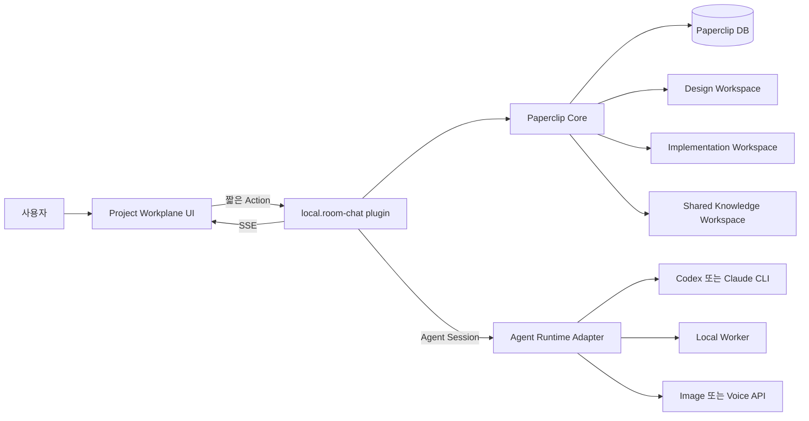
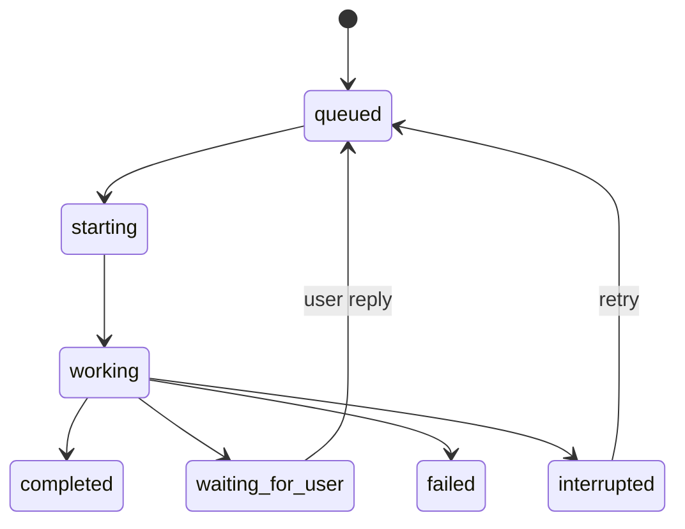
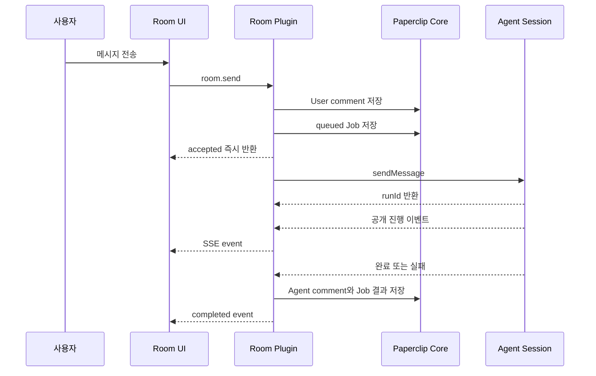

# Paperclip 최적 작업환경 최종 설계

## 문서 지위

- 작성일: 2026-07-12
- 검토 기준: 로컬 Paperclip `2026.707.0`, `local.room-chat` `0.2.20`
- 목적: 게임, 웹, 앱 등 여러 제품을 2인 팀과 역할별 AI Agent가 함께 만드는 최종 Work Plane 정의
- 이 문서는 현재 목표 구조의 단일 기준이다.
- `02-final-operating-model-ko.md`, `67-room-first-operating-model.md`, `69-task-room-collaboration-contract.md`, `71-final-model-fit-audit.md`, `74-project-workplane-and-role-rules.md`는 결정 과정과 구현 이력으로 남긴다. 충돌할 때는 이 문서를 따른다.

## 1. 결론

현재 방향의 핵심은 맞다.

1. Paperclip을 회사, Project, Agent, Task, 실행 기록의 기준 시스템으로 사용한다.
2. Project마다 고용된 Agent 한 명당 이름이 같은 장기 Agent Room 하나를 둔다.
3. Designer와 CTO가 사용자와 대화하고, 필요할 때 직접 도구로 유한한 Task를 만들어 Worker에게 할당한다.
4. 설계와 구현 산출물은 별도 Git 저장소에 두고, Paperclip에는 대화, 상태, 작업 계약, 실행 증거만 둔다.
5. Paperclip 코어는 포크하지 않고 플러그인 SDK와 upstream 기여로 확장한다.

다만 현재 `0.2.20`은 완성형이 아니라 기능 검증이 끝난 프로토타입이다. 최종 구조로 가려면 다음 네 가지를 반드시 바꿔야 한다.

- Codex 전용 직접 실행부를 모델 중립적인 Paperclip Agent Session 계층으로 옮긴다.
- 별도로 만든 HTML UI를 공식 React UI SDK, 공용 Markdown 컴포넌트, SSE 스트림으로 다시 구성한다.
- Room을 일반 Task 목록에서 완전히 제외하는 데이터 노출 정책을 upstream과 함께 정리한다.
- 메모리 안의 Promise가 아니라 영속 Job 기록을 기준으로 재시작과 중복 실행을 복구한다.

Swarm으로 다시 옮기거나 Paperclip 코어를 장기 포크하는 것보다, 현재 플러그인을 이 구조로 정리하는 것이 가장 적합하다.

## 2. 사용자가 보게 될 최종 작업 흐름

### 2.1 Project 시작

1. 사용자가 Paperclip Project를 만든다.
2. Project에 설계 Workspace와 구현 Workspace를 각각 연결한다.
3. 플러그인이 현재 고용된 Agent마다 Agent Room을 하나씩 만든다.
4. Room 이름은 Agent 이름과 정확히 같고, 같은 Agent라도 Project가 다르면 별도 Room과 별도 Session을 가진다.

예시:

- `강해린 / Designer`
- `강해린 / 손영하-CTO`
- `강해린 / Code Worker`
- `다른 프로젝트 / Designer`

### 2.2 설계 단계

1. 사용자는 먼저 Designer Room에 들어간다.
2. `대시를 설계해줘`처럼 자연어로 요청한다.
3. Designer는 Obsidian과 설계 저장소에서 기획서, 시스템 문서, UX 흐름을 작성한다.
4. Room에는 논의와 결정 요약, 저장소에는 실제 설계 파일과 Git 이력이 남는다.
5. Designer가 설계를 마쳐도 CTO 구현은 자동으로 시작되지 않는다.

### 2.3 구현 전환

1. 사용자가 CTO Room에서 명시적으로 구현을 요청한다.
2. CTO는 승인된 설계 문서와 현재 Project Tasks를 읽는다.
3. CTO가 `preview_task`로 변경 예정 경로와 충돌 Task를 확인한다.
4. CTO가 `create_task`를 직접 호출해 Task 계약을 작성하고 적절한 Worker에게 할당한다.
5. 숨은 Controller가 판단하거나 Task를 대신 만들지 않는다.

### 2.4 Task 실행

1. 할당된 Worker는 Paperclip 기본 할당 및 wakeup 흐름으로 실행된다.
2. Worker는 Task에 지정된 Workspace와 경로에서만 작업한다.
3. 진행, 질문, 변경 파일, 검증 결과를 Task 대화에 남긴다.
4. CTO는 같은 Task 대화 안에서 피드백한다.
5. 완료하면 `in_review`, 작업 불가면 `blocked`로 사용자에게 보고한다.
6. 최종 `done` 판단은 사용자가 한다.

### 2.5 재사용 지식

- Project 전용 지식은 설계 및 구현 저장소에 둔다.
- 여러 Project가 함께 사용할 규칙, 템플릿, 패턴은 별도 공유 저장소에 명시적으로 승격한다.
- 원시 대화 전체를 자동으로 공유 지식으로 만들지 않는다.

## 3. 최종 화면 구조

### 3.1 Project Workplane

Project를 선택하면 Room이 먼저 보이는 것이 기본 흐름이다.

```text
[Paperclip icon rail] [Project / Room 목록] [대화] [접이식 Context]
```

왼쪽 Project/Room 패널:

- Project 선택기
- 고용된 Agent Room 목록
- Agent 상태와 현재 실행 상태
- Rooms와 Tasks 전환

가운데 대화 패널:

- Room 대화만 표시
- 오래된 메시지부터 최신 메시지 순서
- Paperclip Task와 같은 Markdown 품질
- `Working` 카드, 공개 진행 이벤트, 공개 생각 요약
- 독립 스크롤
- 하단 고정 입력창

오른쪽 Context 패널:

- 기본은 접힌 상태
- `Tasks`: 이 Room이 만든 Task와 상태
- `Changes`: 선택 Workspace의 Git 변경 파일
- `Artifacts`: 문서, 이미지, 빌드, 테스트 결과, Paperclip Work Product
- `Session`: Adapter, 모델, Session 상태, 마지막 checkpoint, 오류와 복구 버튼

현재 Room 화면의 `Properties` 카드와 Project/Role/Session 메트릭 3개는 제거한다. 해당 정보는 헤더의 작은 상태 표시와 오른쪽 `Session` 탭으로 이동한다.

### 3.2 Tasks

- Tasks 화면에는 유한한 Project Task만 보인다.
- Agent Room과 과거 Room 컨테이너는 표시하지 않는다.
- Project를 고르기 전에는 Task를 섞어 보여주지 않는다.
- Task를 열면 Paperclip 기본 Issue Chat을 사용한다.
- 커스텀 Task 채팅을 다시 만들지 않고, 플러그인은 Task 계약과 Room 관계만 보강한다.

### 3.3 반응형 동작

- 데스크톱: Room 목록, 대화, Context의 3열 구조
- 작은 화면: 대화가 우선이며 Room 목록과 Context는 drawer로 전환
- 가운데 대화와 오른쪽 Context는 각각 독립 스크롤
- 입력창은 항상 화면 아래에 고정되고 메시지 목록과 겹치지 않는다.

### 3.4 UI 구현 원칙

현재 `src/ui/RoomChatTab.jsx`의 문자열 HTML과 Shadow DOM 중심 구현은 React 슬롯으로 교체한다.

- `usePluginData`: 초기 Room, Task, Artifact 데이터
- `usePluginAction`: 짧은 명령 접수
- `usePluginStream`: 실행 이벤트와 결과 SSE
- `MarkdownBlock`: 메시지 렌더링
- `MarkdownEditor`: 입력기
- `IssuesList`: Project Task 목록
- `FileTree`: 변경 파일과 산출물
- `StatusBadge`: Room 및 실행 상태

Paperclip Task 대화 전체 컴포넌트는 현재 SDK에 공개되어 있지 않다. 정확한 네이티브 대화 UI 재사용은 upstream에 공용 `ConversationThread` 또는 동등한 슬롯 공개를 요청한다. 그 전까지는 공식 Markdown과 디자인 토큰을 사용해 동일한 동작을 구현한다.

## 4. 전체 아키텍처



### 4.1 책임 경계

Paperclip Core:

- Company, Project, Agent, Task, 관계, 승인, 비용, 실행 기록
- Project Workspace와 실행 Workspace
- Agent Instructions
- Worker 할당과 wakeup
- 댓글, 문서, 첨부, Work Product

`local.room-chat` 플러그인:

- Agent Room 생성과 목록
- Room과 Agent, Project, Workspace 바인딩
- 장기 대화 접수, 표시, checkpoint, 복구
- CTO/Designer가 사용할 Task 도구
- Room 전용 UI와 실시간 이벤트
- Paperclip 공식 API의 조합과 정책 검증

Agent Runtime Adapter:

- 각 Agent에 설정된 실제 AI 실행
- CLI Session 재개
- 공개 실행 이벤트와 사용량 보고
- Adapter별 compact와 인증

저장소:

- 설계 문서와 구현 코드의 유일한 원본
- Git 변경 이력과 리뷰 가능한 결과

## 5. Room과 Task 데이터 모델

### 5.1 Agent Room

Agent Room은 다음 조건을 가진다.

- Project당 Agent당 정확히 하나
- 이름은 Agent 이름과 동일
- 장기 생존
- Worker 할당 대상이 아님
- 사용자와 해당 Agent가 직접 대화
- Task를 낳을 수 있지만 그 자체는 Task가 아님

Room은 당분간 Issue 기반 컨테이너를 유지한다. 이유는 Paperclip 댓글, 문서, 첨부, Task parent 관계, 감사 기록을 그대로 사용할 수 있기 때문이다.

Room 식별:

```text
originKind = plugin:local.room-chat:operation:agent-room
originId   = project:<projectId>:agent-room:<agentId>
```

Room 생성 시 `surfaceVisibility: plugin_operation`을 사용한다.

### 5.2 Task

Task는 다음 조건을 가진다.

- 하나의 명확한 목표
- 시작과 종료가 있음
- Agent Room이 만든 정상 Paperclip Issue
- 실행 Worker가 지정됨
- 설계 참조, 영향 경로, 완료 기준, 검증 방법을 포함
- 완료 후 사용자 검토

Task 계약은 `TASK_ROOM_STATE` 문서와 Issue 설명에 사람이 읽을 수 있게 남긴다.

### 5.3 Room이 Tasks에 섞이는 문제

현재 Room 8개는 일반 `todo` Issue로 저장되어 네이티브 Project Tasks에 표시된다. 커스텀 Task Board만 이를 필터링하고 있어 데이터 계층의 분리가 끝난 상태는 아니다.

로컬 Paperclip `2026.707.0`의 Issue 서비스는 plugin operation을 기본 제외하는 기능이 있지만, `projectId` 필터가 있으면 operation을 다시 포함한다. 따라서 다음 좁은 upstream 수정이 필요하다.

1. `projectId`만으로 plugin operation을 자동 포함하지 않는다.
2. Room 플러그인은 `includePluginOperations: true` 또는 명시적 `originKind`로 Room만 읽는다.
3. 일반 Project Tasks는 operation을 제외한다.
4. 기존 Room origin을 operation namespace로 마이그레이션한다.

`hiddenAt`로 Room을 숨기는 방식은 권장하지 않는다. 활성 Room을 보관 처리된 Issue로 오해하게 만들고 별도 registry를 강제하기 때문이다. upstream 반영 전에는 커스텀 Project Tasks를 운영 화면으로 사용하고, 네이티브 Project Tasks 혼입은 알려진 제한으로 표시한다.

## 6. 저장 위치와 장기기억

장기기억은 하나가 아니라 세 층이다.

| 층 | 목적 | 기준 저장소 |
| --- | --- | --- |
| 대화 기록 | 누가 무엇을 말했는지 | Paperclip Room comments |
| 현재 맥락 | Session, 마지막 실행, pending Job | issue-scoped plugin state |
| 압축 인수인계 | Session을 잃어도 이어갈 최소 요약 | `ROOM_CHECKPOINTS` Issue document |
| Project 지식 | 설계, 결정, 코드, 규칙 | Design/Implementation Git repos |
| 공유 지식 | 여러 Project의 승인된 재사용 자료 | Shared Git repo |

### 6.1 대화 내구성

- 사용자 메시지를 먼저 Paperclip comment로 저장한 뒤 AI 실행을 시작한다.
- 최종 응답도 Agent 작성 comment로 저장한다.
- 공개 reasoning summary는 별도 메시지 또는 실행 카드로 저장할 수 있다.
- 숨은 chain-of-thought 원문은 저장하거나 노출하지 않는다.

### 6.2 Session 내구성

- Room마다 `paperclipAgentSessionId`를 하나 유지한다.
- 동일 Agent라도 Project가 다르면 다른 Session ID를 사용한다.
- Adapter를 바꾸면 이전 Provider Session ID를 재사용하지 않는다.
- Adapter 변경 전 checkpoint를 만든 후 새 Session에 handoff를 주입한다.

### 6.3 Compact

Paperclip은 `codex_local`과 `claude_local`의 native context management를 인식하고 Session을 재개한다. 최종 구조는 Provider가 지원하는 native compact를 우선한다.

- `/compact`: 지원되는 Runtime에서만 native compact 요청
- `/handoff`: compact 없이 현재 checkpoint만 생성
- `/new`: checkpoint 후 새 Session 시작
- `/status`: Session, 사용량, 마지막 실행 상태 표시

Slash command는 입력 문자열을 CLI에 그대로 전달하지 않고 플러그인 명령으로 해석한다. 지원하지 않는 Runtime에서는 명확히 거절한다.

자동 checkpoint는 다음 조건 중 먼저 도달할 때 실행한다.

- 누적 turn 수
- 보고된 입력 토큰 임계치
- Session 경과 시간
- Adapter 변경 또는 Session 오류 직전

자동 checkpoint가 실패해도 comments와 저장소 원본은 남아야 하며, 사용자의 일반 대화를 막지 않는다.

## 7. 모델 중립 실행 구조

### 7.1 목표 인터페이스

```ts
interface RoomRuntime {
  open(binding: RoomBinding): Promise<RuntimeSession>;
  send(session: RuntimeSession, input: RoomTurnInput): Promise<AcceptedRun>;
  checkpoint(session: RuntimeSession): Promise<Checkpoint>;
  compact?(session: RuntimeSession): Promise<void>;
  cancel?(runId: string): Promise<void>;
  inspect(runId: string): Promise<RunSnapshot>;
}
```

구현체:

- `PaperclipAgentSessionRuntime`: 최종 기본값
- `CodexAppServerRuntime`: Project context 지원이 보완될 때까지의 호환 경로
- Specialist Runtime은 Agent Adapter 또는 별도 Plugin으로 연결

### 7.2 Paperclip Agent Session을 기본으로 삼는 이유

로컬 SDK의 `ctx.agents.sessions`는 다음을 공식 제공한다.

- Agent별 장기 Session 생성과 재개
- 모델 종류와 무관한 호출
- 비동기 `sendMessage`
- 실행 이벤트 callback
- Paperclip heartbeat run, 사용량, 비용, 감사 기록과 연결

현재 직접 Codex app-server를 실행하면 Codex에만 묶이고, Windows spawn, dynamic tools, app-server 프로토콜, process 재시작을 플러그인이 모두 책임져야 한다.

### 7.3 현재 Agent Session API의 보완 필요점

즉시 전환하지 않고 먼저 upstream 보완 또는 검증이 필요하다.

- Session 생성/메시지에 `projectId`, `projectWorkspaceId`, `issueId` context 전달
- 완료된 run 결과 조회
- Worker 재시작 후 기존 run event 재구독 또는 상태 조회
- Room에 필요한 제한된 Task 도구 profile 전달

이 기능이 확보되기 전에는 Codex 전용 Runtime을 기능 flag 뒤의 호환 구현으로 유지한다. 다만 UI와 Domain 코드는 Runtime 인터페이스만 바라보게 해 Provider 종속을 격리한다.

## 8. Workspace 설계

Project는 최소 두 Workspace를 가진다.

```text
designWorkspaceId         -> Obsidian 및 설계 Git repo
implementationWorkspaceId -> Unity, Unreal, Web, App 구현 Git repo
sharedWorkspaceId         -> 선택 사항, 공용 자산 또는 지식 repo
```

Room에는 절대 경로가 아니라 Workspace ID를 저장한다.

기본 매핑:

| Agent 역할 | 기본 Workspace |
| --- | --- |
| Designer, Manager, Document Worker | Design |
| CTO | Design 읽기 + Implementation 실행 |
| Code Worker, QA Worker | Implementation |
| Image/Voice Worker | Task가 지정한 Asset Workspace |

Task 생성 시 `taskType`에 따라 `executionWorkspaceId`를 명시한다. 한 Agent가 두 Project에서 동시에 일해도 각 Task와 Room은 서로 다른 Workspace를 사용한다.

현재 `dist/worker.js:402-405`의 강해린 절대 경로 fallback은 제거한다. `projects.read`와 `project.workspaces.read`를 사용하고, Workspace가 없으면 실행하지 않은 채 설정 요청을 표시한다.

## 9. 비동기 Job과 장애 복구

모델 실행을 `performAction` 안에서 기다리지 않는다. 모든 긴 작업에 같은 Job 흐름을 사용한다.



### 9.1 전송 순서



### 9.2 영속 Job 기록

`activeRoomMessageJobs` Map은 중복 실행을 막는 프로세스 내 보조 수단으로만 사용한다. 기준 상태는 Paperclip 안의 `room_job` plugin entity 또는 plugin DB row다.

필수 필드:

- `jobId`, `roomIssueId`, `sessionId`, `runId`
- `sourceCommentId`, `resultCommentId`
- `kind`: message, checkpoint, compact, task_feedback
- `status`, `attempt`, `createdAt`, `updatedAt`
- `idempotencyKey`, `lastError`

### 9.3 재시작 복구

플러그인 시작 시 다음을 수행한다.

1. `queued`, `starting`, `working` Job을 조회한다.
2. Paperclip run 상태를 확인한다.
3. 완료 결과가 있고 comment가 없으면 한 번만 finalization한다.
4. 실행 중이면 event를 다시 구독하거나 상태를 polling한다.
5. 조회할 수 없는 실행은 `interrupted`로 바꾸고 사용자가 재시도할 수 있게 한다.

플러그인 시작 시 복구와 별도로, 공식 scheduled job을 짧고 가볍게 실행해 오래된 `starting` 또는 `working` Job을 주기적으로 재검사한다. 이 Job은 모델을 실행하지 않고 정합성만 확인하므로 Paperclip의 recurring job 기능과 겹치지 않는다.

Room 화면을 열어야만 stale 상태를 정리하는 현재 방식은 제거한다.

### 9.4 30초 RPC 제한

현재 일반 `room-send`는 즉시 반환하도록 고쳤지만 `room-compact`와 `task-request-owner-feedback`는 여전히 모델 응답을 Action 안에서 기다린다. 세 동작 모두 위 Job 흐름으로 통합한다.

Action 응답 목표는 1초 이내이며, 어떤 LLM 실행도 Paperclip의 30초 `performAction` 제한에 걸리지 않아야 한다.

## 10. 실시간 진행과 생각 과정

UI에 표시할 수 있는 것:

- 요청 분석, 계획 단계, 명령 실행, 파일 변경, 도구 호출
- Adapter가 공개한 reasoning summary
- Task 생성, 상태 변경, 검증 결과

표시하지 않는 것:

- 숨은 chain-of-thought 원문
- 비밀값, 인증 헤더, 환경 변수
- 전체 터미널 로그의 무제한 노출

현재 700ms polling은 `ctx.streams`와 `usePluginStream` SSE로 교체한다. 연결이 끊기면 UI가 마지막 영속 상태를 다시 읽고 SSE를 재연결한다.

진행 이벤트마다 `ROOM_STATE` 문서 revision을 새로 만드는 현재 방식도 제거한다. live event는 SSE, 마지막 안정 상태는 plugin state, checkpoint와 최종 결과만 Issue document/comment에 남긴다.

## 11. Agent와 모델 설정

Agent Instructions는 역할과 조직 운영규칙만 담고 모델 종류를 전제로 하지 않는다.

- Manager, CTO, Designer: 높은 추론이 필요한 CLI Adapter
- Code, QA, Document Worker: 로컬 또는 저비용 Adapter
- Image, Voice Worker: 전문 API Adapter 또는 Plugin

동일한 CTO 역할을 Codex에서 Claude로 바꾸더라도 Instructions와 Task 계약은 그대로 작동해야 한다. Provider 변경 시 Session만 checkpoint 후 교체한다.

현재 `agy.exe` 직접 실행 helper는 로컬 Worker의 역할과 출력 계약을 검증하는 테스트 하네스로만 유지한다. 완성형에서는 agy 또는 다른 로컬 모델을 Paperclip Agent Adapter로 고용해 Task 할당, run, 비용, 실패, 재시도를 Paperclip의 한 실행 기록으로 통합한다.

Project별 설계 결정, 파일 구조, 제품 요구사항은 Agent Instructions에 복제하지 않는다. Agent가 현재 Project의 설계 저장소와 Task를 읽어 적용한다.

## 12. Task 생성과 충돌 제어

CTO와 Designer가 직접 사용하는 도구는 유지한다.

- `preview_task`
- `create_task`
- `get_task_context`
- `post_task_feedback`

Task 생성 규칙:

1. 구현 Task는 승인된 design reference가 있어야 한다.
2. 구현, QA, Art, Voice Task는 affected path 또는 asset scope가 있어야 한다.
3. 활성 Task와 경로가 겹치면 blocker 순서를 지정하기 전에는 생성하지 않는다.
4. 생성된 Task에는 Worker와 Workspace가 명시돼야 한다.
5. Worker 성공은 `in_review`, 사용자만 `done`으로 확정한다.

Code Worker의 병렬 작업은 가능하면 Paperclip execution workspace 또는 Git worktree를 사용한다. 단순 path 선언은 사전 충돌 검사이고, 실제 filesystem 격리를 대신하지 않는다.

## 13. 보안과 권한

- 인증 정보는 Paperclip Secrets 또는 Adapter 설정에만 저장한다.
- Room comment, checkpoint, Task 문서에 secret을 쓰지 않는다.
- Direct Codex fallback은 loopback에서만 실행한다.
- 플러그인 UI는 같은 origin의 trusted code이므로 사용자 입력과 Markdown을 공식 renderer로 처리한다.
- Workspace는 Paperclip에 등록된 경로만 허용한다.
- Agent가 Task를 만들 때 현재 Project, 허용 Worker, 허용 Workspace를 서버에서 다시 검증한다.
- specialist API 결과는 원본 credential이 아니라 artifact reference만 남긴다.

## 14. 업데이트 전략

### 14.1 지켜야 할 원칙

- Paperclip 코어 파일을 직접 패치하지 않는다.
- `@paperclipai/plugin-sdk` 버전은 검증된 host 버전과 맞춘다.
- 호환성 shim은 한 모듈에 격리하고 삭제 조건을 기록한다.
- Paperclip 업데이트마다 자동 smoke test를 실행한다.

### 14.2 필요한 upstream 요청

1. Agent Session에 Project, Workspace, Issue context 전달
2. Agent Session run 결과 조회 및 event 재구독
3. Project 필터에서도 plugin operation을 기본 Task 목록에서 제외
4. plugin SDK document upsert에 `baseRevisionId` 지원
5. Task Chat과 같은 공용 Conversation UI 컴포넌트 공개

이 항목은 로컬 코어 포크로 해결하지 않는다. upstream 반영 전에는 좁은 compatibility layer와 feature flag를 사용한다.

### 14.3 배포 형태

- 개발: 로컬 경로 설치와 빠른 reload
- 안정 운영: versioned npm package 또는 `npm pack` artifact 설치
- UI bundle은 `dist/ui-v0.2.x`를 계속 쌓지 않고 release directory를 원자적으로 교체한다.
- 현재 버전과 직전 rollback 버전만 보관한다.

## 15. 현재 구현 감사

### 완료된 기반

- 코어 포크 없는 플러그인 경계
- Project 생성 시 고용 Agent별 Room 자동 생성
- Room comments, `ROOM_STATE`, `ROOM_CHECKPOINTS`
- Room별 Codex thread ID 저장과 재개
- Task 계약, design reference, affected path, blocker 검사
- CTO/Designer 직접 Task 도구
- 일반 Room 메시지의 비동기 접수
- 공개 reasoning summary와 Working 상태
- 설계 및 구현 Workspace 두 개 등록
- 회귀 테스트와 plugin verification

### 부분 완료

- Room UI는 동작하지만 네이티브 Task UI 품질과 다름
- 일반 메시지는 비동기지만 compact와 Task feedback은 동기
- user comment와 thread ID는 재시작에 견디지만 실행 Job 자동 복구는 없음
- Session이 Codex 전용이라 Agent Adapter 변경을 따르지 않음
- Room과 Task는 커스텀 화면에서만 분리되고 네이티브 Project Tasks에는 섞임
- 수동 checkpoint는 있으나 자동 정책과 Provider 공통 command가 없음
- Git 변경 표시 기반은 있으나 Project Workspace 바인딩이 아닌 경로 fallback에 의존

### 미완료

- Paperclip Agent Session Runtime 전환
- durable Job ledger와 restart reconciliation
- SSE 실시간 UI
- 공식 React UI SDK 기반 Room 화면
- native Project Tasks에서 Room 완전 제외
- Project/Agent별 Workspace binding UI
- assigned local Worker의 실제 end-to-end 완료 흐름
- Image, Voice 전문 Adapter
- shared knowledge repo 승격 흐름
- Paperclip 업데이트 호환성 CI

## 16. 우선 구현 순서

### P0. 작업환경 신뢰성

1. 이 문서를 기준으로 기존 상충 문서를 historical로 표시한다.
2. `dist/worker.js` 단일 파일을 `src/worker`의 TypeScript 모듈로 분리한다.
3. 하드코딩 경로를 제거하고 Project Workspace ID 바인딩을 도입한다.
4. message, compact, feedback을 모두 영속 Job 방식으로 통합한다.
5. plugin state와 Job entity를 도입하고 restart reconciliation test를 만든다.
6. Room UI를 React, MarkdownBlock, MarkdownEditor, SSE로 교체한다.
7. Task 화면은 Paperclip native Issue Chat을 기준으로 통합한다.

### P1. 모델 중립성과 Room/Task 완전 분리

1. `RoomRuntime` 인터페이스를 도입한다.
2. Paperclip Agent Session 실험 구현과 context gap 검증을 수행한다.
3. upstream Agent Session context 및 run recovery를 제안한다.
4. Room을 plugin operation으로 마이그레이션한다.
5. upstream Task 목록 필터 수정 후 네이티브 Project Tasks에서 Room 제외를 검증한다.
6. Project 선택 + Room 목록 routeSidebar를 만든다.

### P2. 실제 제작 파이프라인

1. Code Worker와 QA Worker를 할당 Task로 end-to-end 검증한다.
2. Task별 execution workspace 또는 worktree를 적용한다.
3. Changes, Artifacts, Work Products inspector를 완성한다.
4. Image와 Voice specialist Adapter를 연결한다.
5. 공유 저장소 승격과 검색을 추가한다.

### P3. 운영 완성도

1. token 기반 자동 checkpoint 정책
2. Room 및 Job health dashboard
3. upgrade compatibility matrix와 CI
4. package install, rollback, 오래된 UI bundle cleanup
5. 2인 동시 사용과 다중 Project 부하 테스트

## 17. 완료 판정 기준

다음 조건을 모두 통과해야 완성형으로 본다.

- 새 Project에 고용 Agent 수와 같은 Room이 정확히 한 번 생성된다.
- Rooms가 어떤 일반 Task 목록에도 나타나지 않는다.
- 같은 Agent의 서로 다른 Project Room은 Session과 Workspace가 분리된다.
- 메시지 Action은 1초 안에 접수되고 30초 RPC timeout이 발생하지 않는다.
- 페이지를 닫거나 이동해도 실행이 계속된다.
- Paperclip 또는 컴퓨터가 재시작돼도 저장된 메시지와 Session 연결이 유지된다.
- 실행 중 재시작 시 완료, 재개, interrupted 중 하나로 결정되며 영원히 Working으로 남지 않는다.
- 같은 Room의 동시 메시지는 직렬화되고 다른 Room은 병렬 실행된다.
- Markdown, Working, 공개 진행, 고정 입력창이 Task UI와 같은 품질로 동작한다.
- 가운데 대화와 Context 스크롤이 분리된다.
- Designer 설계 승인 없이 CTO 구현 Task를 만들 수 없다.
- 경로가 겹치는 Task는 blocker 없이 동시에 시작되지 않는다.
- Worker 완료와 blocked 보고가 Task에 증거와 함께 남는다.
- 사용자가 승인하기 전에는 `done`이 되지 않는다.
- Adapter 교체 후에도 Instructions와 Task 계약은 그대로 적용된다.
- Paperclip minor update 후 설치, Room 대화, Task 생성, Worker 할당 smoke test가 통과한다.

## 18. 지금 구조에 대한 최종 판단

현재 구조는 잘못된 방향이 아니다. `Room은 장기 대화, Task는 유한 작업, CTO/Designer가 직접 Task를 생성, 저장소가 산출물의 원본, Paperclip이 control plane`이라는 핵심은 사용자 운영 방식과 일치한다.

남은 문제는 운영모델이 아니라 구현 층이다.

- Room이 일반 Issue로 노출되는 방식
- Codex에 고정된 실행부
- 메모리 안에만 있는 background Job
- 별도 제작된 UI와 polling
- Project Workspace를 무시하는 하드코딩 fallback

따라서 다음 개발은 새로운 플랫폼을 다시 고르는 작업이 아니라, 위 P0 순서대로 현재 플러그인을 공식 Paperclip Session, Workspace, UI, Event 기능에 맞게 재구성하는 작업이다.

## 19. 검토 근거

로컬 확인:

- `paperclip-room-chat-plugin/package.json`
- `paperclip-room-chat-plugin/dist/manifest.js`
- `paperclip-room-chat-plugin/dist/worker.js`
- `paperclip-room-chat-plugin/src/ui/RoomChatTab.jsx`
- 로컬 `@paperclipai/plugin-sdk` `2026.707.0`
- 로컬 `@paperclipai/server` `2026.707.0`
- 실제 `/CMP/agent-rooms`, `/CMP/tasks`, Project Workplane, native Task UI
- 실제 강해린 Project의 Agent 8명, Room 8개, 설계/구현 Workspace 2개

공식 참고:

- [paperclipai/paperclip](https://github.com/paperclipai/paperclip)
- [Paperclip releases](https://github.com/paperclipai/paperclip/releases)
- [Paperclip development guide](https://github.com/paperclipai/paperclip/blob/master/doc/DEVELOPING.md)
