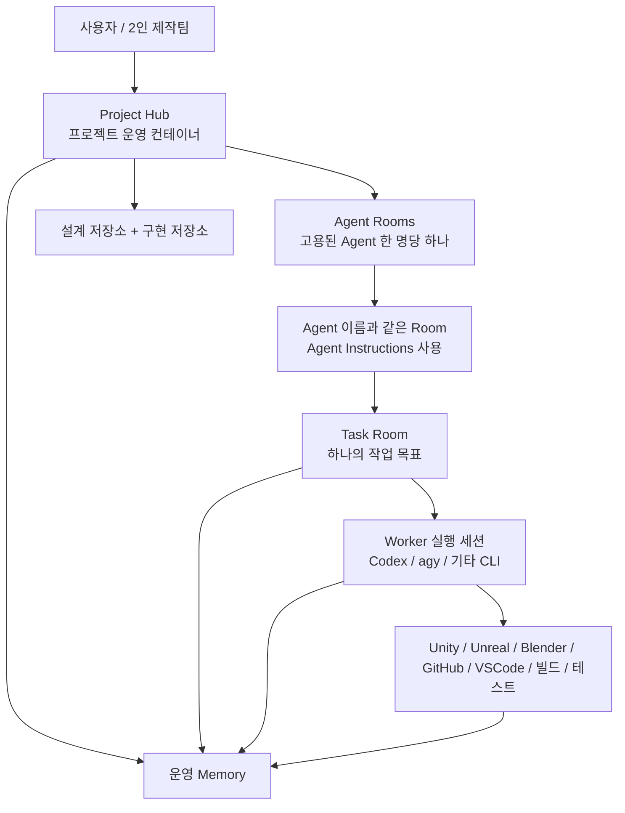
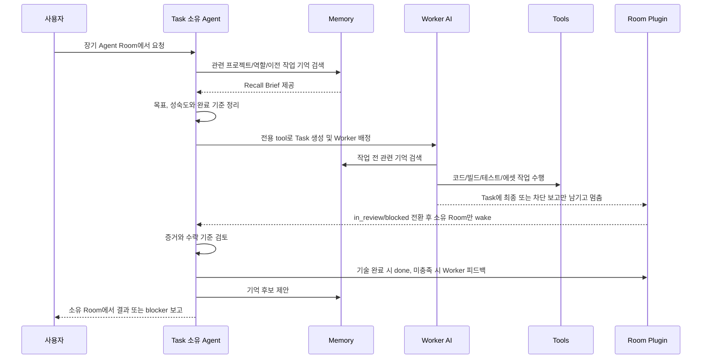

# SPS AI 제작 Work Plane 운영 모델

이 문서는 앞으로 SPS 기반 AI 게임·웹·앱 제작 Work Plane을 개조할 때 따를 기준 구조다.

목표는 SPS을 버리거나 Swarm처럼 다시 만드는 것이 아니라, SPS의 기존 회사/프로젝트/이슈/에이전트 실행 구조 위에 장기 대화, 외부 프로젝트 저장소와 역할별 제작 파이프라인을 얹는 것이다.

## 핵심 결론

SPS은 AI 제작 회사의 사무실이자 Control Plane이다.

Memory는 그 회사의 공용 업무기억과 인수인계 시스템이다.

Task Room은 실제 일이 진행되는 작업방이다.

Agent Room은 고용된 Agent별 장기 책상이다.

Manager, Designer와 모든 CTO는 중앙 컨트롤러에게 조종당하지 않는다. 직접 SPS tool과 memory tool을 사용해서 자기 Room 아래 Task를 만들고, 공용 Worker를 배정하고, 결과를 검토한다.

## 완성형 구조



## Project Hub

Project Hub는 별도 AI 채팅방이 아니라 프로젝트를 선택하고 운영하는 상위 컨테이너다.

예:

- `Project: PowerPunch`
- `Project: Combat Prototype`
- `Project: Vertical Slice`

Project Hub에서는 다음을 한곳에서 찾을 수 있어야 한다.

- 제품이 무엇인지
- 현재 목표
- 큰 기획 결정
- 마일스톤
- 사용하는 기술·엔진
- 폴더 구조
- 코딩 규칙
- 제품별 시각·음성 방향
- 빌드/테스트 방식
- 현재 리스크
- 다음 우선순위

SPS 기준으로는 `projects`, `project_workspaces`, Agent Rooms와 그 자식 Tasks가 이 역할을 맡는다. Project Hub 자체가 사용자의 메시지를 임의의 Agent에게 전달하지 않는다. 사용자는 Project를 선택한 뒤 대화할 Agent Room을 직접 고른다.

프로젝트 사실의 원본은 Project마다 따로 만든 설계 저장소와 구현 저장소다. SPS에는 Room·Task·체크포인트 같은 운영 기록과 저장소 포인터를 두며, 설계와 구현 파일을 SPS 문서로 복제하지 않는다.

## Agent Room

### 현재 적용 규칙

Agent Room의 단위는 역할이 아니라 고용된 SPS Agent다. 프로젝트마다
고용된 Agent 한 명당 Room을 하나 만들고, Room 제목은 Agent 이름과 같게
유지한다. 내부 연결은 Agent ID를 사용하므로 이름 변경도 안전하게 동기화할
수 있다. CTO가 둘이면 CTO Agent Room도 둘이며, 각 Room은 해당 Agent의
Instructions에서 관리되는 `AGENTS.md`만 사용한다.

새 Agent를 고용하면 기존 프로젝트에도 그 Agent의 Room을 만들며, 과거의
역할 기반 Room은 삭제하지 않고 `cancelled` 기록으로 보존한다.

각 고용 Agent마다 지속되는 방을 둔다. 같은 역할의 Agent가 둘이면 Room도 둘이다.

기본 Agent Room:

- Manager Room
- CTO Room
- Designer Room
- Code Worker Room
- Image Worker Room
- Voice Worker Room
- QA Worker Room
- Document Worker Room

Agent Room은 일반 잡담방이 아니라 역할별 책상이다.

예를 들어 CTO Room에는 기술 판단, 작업 분해 기준, worker 배정 규칙이 남는다.

QA Room에는 테스트 기준, 반복되는 버그 패턴, 릴리스 체크 방식이 남는다.

Agent Room은 길게 유지되지만, 실제 산출물 작업은 보통 Task Room으로 분리한다.

### Room Work State

각 Agent Room에는 대화 원문이나 프로젝트 문서를 복제하지 않는 작은 운영
책갈피 `ROOM_WORK_STATE`를 별도 문서로 둔다.

- 현재 목표와 단계
- 최근 결과의 Task/산출물 참조와 짧은 요약
- 권위 있는 설계·구현 저장소 문서 경로
- 근거가 확인된 다음 작업 후보
- 사용자, Worker, 환경 또는 Task 검토 중 무엇을 기다리는지

SPS은 매 Room 턴마다 이 책갈피와 해당 Room의 실제 자식 Task 상태를
짧은 운영 브리프로 만들어 Agent에게 제공한다. 같은 Codex Session ID를 계속
사용하더라도 매번 최신 상태를 다시 주입하므로 오래된 대화 문맥만 믿지 않는다.
새 세션이나 compact 이후에는 체크포인트와 Room 대화 복구 정보도 함께 제공한다.

이 브리프는 중앙 controller의 결정이 아니다. 담당 Agent가 현재 사용자 요청,
AGENTS.md, 저장소 원본과 Task 사실을 함께 보고 다음 행동을 판단한다. 목표·단계·
다음 후보·대기 경계가 바뀌면 Agent가 `paperclip.update_room_work_state`로 갱신한다.
Task 목록은 Projects/Tasks가 원본이고, 제품 지식은 프로젝트별 설계·구현 저장소가
원본이다.

## Task Room

실제 일은 Task Room에서 진행한다.

Task Room은 하나의 작업 목표를 가진다.

예:

- `플레이어 대시 기능 프로토타입`
- `전투 UX 흐름 문서 작성`
- `빌드 실패 원인 조사`
- `QA 체크리스트 작성`
- `Blender 에셋 import 규칙 정리`

Task Room은 목표가 끝나면 닫는다.

닫을 때는 반드시 다음을 남긴다.

- 목표
- 결과
- 변경 파일 또는 산출물
- 검증 결과
- 이번 작업에서 배운 것
- 장기기억 후보
- 후속 작업

SPS 기준으로 Task Room은 `issues`와 `issue_comments`다. `agent_task_sessions`는 사용자가 대화하는 방이 아니라, 특정 agent가 해당 issue에서 실행된 내부 세션 기록이다.

## 직접 요청 방식

사용자는 AI에게 직접 요청할 수 있어야 한다.

항상 Manager를 거칠 필요는 없다.

### Agent Room에 직접 요청

특정 역할에게 바로 말하고 싶을 때 사용한다.

예:

```text
CTO, 이 기능 구현 방식 먼저 설계해줘.
Designer, 전투 UX 흐름 문서로 정리해줘.
QA, 지금 빌드 기준으로 테스트 체크리스트 만들어줘.
```

Manager, Designer 또는 CTO Room이라면 해당 Agent가 자기 역할 memory와 저장소 근거를 읽고 답하며, 명시적 생산 위임을 받으면 자기 Room 아래 Task를 직접 만든다.

Worker Room에서도 사용자와 전문성, 가능성, 도구와 사양을 대화할 수 있다. 다만 Worker는 자기 Room 대화만으로 생산을 시작하거나 Task를 만들지 않는다. 실제 제작이 필요하면 Manager, Designer 또는 CTO Room에서 그 Worker에게 Task를 배정한다.

### Task Room에서 요청

이미 진행 중인 작업의 계약, Worker 증거와 Task Owner 피드백을 확인할 때 사용한다.

예:

```text
이 구현은 너무 무거워. 더 간단한 방식으로 바꿔줘.
이 Task는 보류하고, 먼저 입력 시스템부터 정리해줘.
Code Worker 결과 다시 검토해줘.
```

Task 수정 지시는 Task를 만든 소유 Agent가 같은 Task에 피드백한다. 사용자 질문, blocker, 선택지와 최종 기술 완료 보고는 소유 Agent의 장기 Room에서 처리하며 Task Room에 별도 승인 요청을 만들지 않는다.

## 기본 역할 분담

큰 방향, 일정, 우선순위:

- Manager

기술 설계와 구현 분해:

- CTO

기획, UX, 시스템 문서:

- Designer

실제 코드 수정, 버그 수정, 빌드 보조:

- Code Worker

이미지, Blender, Unity/Unreal 에셋:

- Image Worker

음성 제작, 정리, import 준비:

- Voice Worker

테스트 케이스, 버그 리포트, 릴리스 체크:

- QA Worker

### 역할별 Task 위임권

사용자는 Manager, Designer 또는 어느 CTO와도 직접 대화할 수 있다. 이 책임
Agent들은 SPS 전용 tool로 공용 Worker 풀의 어떤 Worker에게도 Task를
만들 수 있다. 중앙 controller가 대신 판단하거나 몰래 작업을 시작하지 않는다.

- Task를 만든 Agent Room이 유일한 Task 소유 Room이다. Task의
  `originatingRoomIssueId`와 `owningAgentId`가 소유권과 결과 보고 경로를 정한다.
- SPS Company는 Workplane 전체를 담는 하나의 기술적 시스템 컨테이너다.
  운영 Agent는 `reportsTo = null`인 공용 평면 풀로 유지하며, Org 계층을 업무
  라우팅이나 권한 모델로 사용하지 않는다.
- Manager, Designer와 모든 CTO는 필요에 따라 Code, QA, Image, Voice,
  Document Worker를 직접 선택할 수 있다. 각 책임자는 자신의 전문 분야를
  벗어난 생산을 직접 수행하지 않고 해당 전문 Worker에게 명확한 Task로 맡긴다.
- Designer가 Image Worker를, CTO가 Code Worker를 주로 사용하는 것은 기본적인
  전문성 선택이지 강제된 상하 관계가 아니다. 예를 들어 어느 CTO든 Image
  Worker에게 기술 규격에 맞는 에셋 Task를 바로 만들 수 있다.
- 설계 승인은 구현의 절대 관문이 아니다. 사용자가 필요하다고 판단하면 설계 전
  탐색 구현이나 프로토타입을 시작할 수 있다. Task에는 `exploration`,
  `prototype`, `committed implementation` 중 작업 성숙도를 명시하고, 탐색 결과를
  승인된 제품 설계로 가장하지 않는다.
- Worker는 배정된 Task 안에서만 작업한다. 자기 Room의 대화만으로 별도
  생산 작업을 시작하거나 Task를 생성·재배정·재위임하지 않는다.
- Worker는 배정된 Task Room에 실질적인 완료(final) 또는 차단(blocker) 보고를 정확히 하나 작성하고 멈춘다. Worker는 Task 상태를 절대로 변경하지 않으며, 승인(approval) 또는 질문(question) 인터랙션을 생성하지 않는다.
- Workplane 서버/플러그인이 상태를 `in_review` 또는 `blocked`로 원자적으로 변경하고 Task를 만든 Agent Room만 깨운다. Worker는 `done`을 선택하지 않는다. 소유 Agent가 증거와 수락 기준을 검토해 충족되면 기술 완료로 `done` 처리하고 자기 Room에서 사용자에게 보고한다. 이 판정은 사용자·제품·설계 승인이 아니다.
- 완료 보고는 제목만 남길 수 없다. `## SPS Final Report`로 시작하고 변경
  경로 또는 산출물, 실제 검증 결과, 남은 위험, 다음 검토자를 포함해야 한다.
  차단 보고는 `## SPS Blocker Report`로 시작하고 정확한 차단 원인, 영향,
  근거와 다음 조치를 포함해야 한다. Workplane 서버/플러그인은 이 실질 보고와 일치하는
  상태 전환을 원자적으로 처리하고 소유 Agent Room 알림을 대기열에 추가한 뒤에만 소유 Agent Room을 깨운다.
- 같은 최종 보고를 여러 번 게시하거나 SPS 자격증명을 탐색해서 재제출하지
  않는다. 현재 Task에 제공된 권한만 사용하고, 보고가 수락된 뒤 상태 변경이
  실패하면 이미 수락된 보고를 다시 쓰지 않고 실패 사실만 남긴다.
- `issue_continuation_needed`처럼 재개된 Worker 실행은 최근 댓글 묶음이 비어
  있을 수 있다. 이 경우 Worker는 생산 작업 전에 현재 Task 댓글을 한 번 읽어
  최신 소유 Agent 피드백과 Task Protocol을 확인한다. 이 읽기는 Task 문맥을
  복구하기 위한 것이며, 다른 Agent·자격증명·내부 설정을 탐색할 권한은 아니다.

### Worker 병렬 실행

- CLI Worker는 Task마다 독립 CLI 세션과 작업 공간을 쓰고 선언된 영향 경로가
  겹치지 않을 때 한 Worker가 여러 Task를 동시에 실행할 수 있다.
- 같은 파일, 에셋, 인터페이스 또는 빌드 출력 경로가 겹치면 병렬 실행하지 않고
  책임 Agent가 순서를 조정한다.
- 로컬 AI Worker는 한 번에 하나의 Task만 실행한다.
- API Worker는 공급자가 병렬 요청을 지원하고 외부 비용·쿼터 정책을 위반하지
  않을 때 병렬 실행할 수 있다.
- 사용자가 특정 Worker에게 위임했는데 그 Worker가 시작 전에 사용자가 직접
  일시정지한 상태라면 Task 생성을 생략하지 않는다. 지정 Worker에게 정확히 하나의
  Task를 `blocked`로 만들고 소유 Agent Room에서 재개 행동을 보고한다. Worker가
  사용 가능해지면 새 Task를 만들지 않고 같은 Task를 시작한다.
- 권한·런타임·작업 계약 문제로 막혀도 Agent가 Worker를 임의로 재개, 복제, 교체
  또는 재배정하지 않는다. Task를 `blocked`로 유지하고 소유 Agent Room에서
  정확한 복구 행동을 보고한다. 공급자 quota도 같은 가시적 복구 경계를 따른다.

### 실행 공급자와 한도 회복

- Manager, Designer와 모든 CTO는 강한 추론이 필요한 관리 역할이므로 Codex를
  주 실행 공급자로 사용한다. Codex 사용 한도가 소진되면 Agent 설정을 영구 변경하지
  않고, 같은 Room 요청을 Agy로 이어서 처리한 뒤 다음 요청에서는 다시 Codex를 먼저
  시도한다.
- Code, Image, QA, Voice, Document Worker는 비용과 병렬 처리량을 위해 Agy를
  주 실행 공급자로 사용한다. 모델은 역할 난이도에 맞춰 선택하되 역할 계약과 Task
  권한은 공급자나 모델에 종속시키지 않는다.
- 공급자 한도 소진은 Room Job, Task, 소유 Room, 담당 Worker와 최신 입력을
  보존한 가시적 quota blocker다. 기본 제품 정책은 숨은 시간 기반 자동 재시도를
  하지 않는다. 소유 Agent Room은 정확한 한도 상태와 재개 방법을 보고하고,
  사용자 또는 소유 Agent가 한도 회복 뒤 명시적으로 같은 요청이나 Task를 다시
  실행한다. 한도 때문에 Worker를 pause하거나 Task를 복제·재배정하지 않는다.
- Codex에서 Agy로 전환한 관리 Room도 기존 SPS 전용 tool의 권한 검사를
  그대로 거친다. 이 전환은 Plugin 설정에서 명시적으로 켠 경우에만 허용하며,
  Agy가 직접 SPS REST API나 자격증명을 탐색하지 않으며,
  Task 생성·조회·피드백은 동일한 Room identity와 소유권 검사를 통과해야 한다.
- Agy도 한도에 도달하면 같은 durable Room Job 또는 Task와 마지막 입력을
  보존하고, 소유 Agent Room에 blocker를 남긴다. 컴퓨터나 SPS이 재시작되어도
  이 상태와 보고 기록은 보존되며, 명시적 재실행은 새 Task를 만들지 않고 같은
  Task 또는 Room 요청을 이어서 사용한다.
- 권한 거부, 잘못된 작업 계약, 빌드 결함, 파일 충돌과 같은 비한도 오류는 자동으로
  무시하지 않는다. 기존 Task blocker 보고와 소유 Agent 검토 경계를 따른다.

사용자는 제품 방향, 큰 범위 변화, 외부 비용, 릴리스와 최종 수락을 결정한다.
각 책임자는 승인된 방향 안에서 Task 분할, 작업 순서, 문서 준비, 시안 제작
같은 일상적인 실행 결정을 맡으므로 사용자가 매 세부 작업을 지시할 필요는
없다.

### AGENTS.md 운영 구조

모든 Agent는 같은 모델을 쓰지 않아도 동일한 회사 규칙을 따라야 한다. 이를
위해 모델별 프롬프트가 아니라 다음 세 층으로 Instructions를 구성한다.

1. 공통 회사 운영 헌법
   - Company, Project, Agent Room, Task의 차이
   - 사용자, Manager, Designer, CTO, Worker의 권한
   - 자연어 위임 해석, Task 생명주기, 기억과 증거 규칙
2. 배정 프로필
   - `task-owner`: Manager, Designer, CTO의 Task 생성·검토·보고 흐름
   - `worker`: 전문 Worker의 실행·증거·완료·차단 보고 흐름
3. 역할별 정책
   - 해당 역할의 임무, 허용 범위, 금지 범위, Task와 보고 규칙

공통 헌법의 단일 원본은 `agent-instructions/COMPANY_CONTRACT.md`, 배정 프로필의
단일 원본은 `agent-instructions/profiles/*.md`다. 실제 Agent의 `AGENTS.md` 안에서는
두 원본이 관리 마커 사이에 함께 동기화된다. 마커 아래의 역할별 영역은
SPS의 `Agents > Instructions`에서 수정할 수 있으며 일반 동기화가 덮어쓰지
않는다.

Room 실행기는 매 turn마다 현재 Agent의 `AGENTS.md`를 다시 읽어 Codex의
새 thread와 resume 모두에 developer instructions로 전달하고, agy 실행에도
같은 역할 Instructions를 포함한다. 따라서 Instructions를 바꾼 뒤 기존 Room을
삭제할 필요는 없다.

상세한 반복 작업 절차는 `AGENTS.md`를 길게 만들지 않고 별도 Skill이나 운영
문서로 둔다. 역할 밖 Task 생성을 절대 차단해야 할 때는 Instructions와 별도로
SPS Task 도구에 Agent ID 및 Task 유형별 권한 검사를 둔다.

## 작업 흐름



### Task 상태 권한

Worker는 Task Room에 증거가 있는 최종 보고 또는 차단 보고를 한 번 남기고 멈춘다. Worker는 상태를 변경하거나 사용자 승인·질문 Interaction을 만들지 않는다. Room Plugin이 보고를 `in_review` 또는 `blocked`로 전환하고, Task를 만든 Agent의 장기 Room만 깨운다. 소유 Agent는 수락 기준을 충족한 결과를 기술 완료로 `done` 처리하고 그 Room에서 사용자에게 보고한다. 사용자를 대신한 승인 표현은 사용하지 않는다.

흐름을 쉽게 풀면 다음과 같다.

1. 사용자가 요청한다.
2. 대화 중인 책임 Agent가 관련 기억과 활성 Task를 읽는다.
3. 책임 Agent가 작업 목표, 성숙도, 영향 경로와 수락 기준을 정한다.
4. 전용 SPS tool로 자기 Room 아래 Task를 만들고 Worker에게 맡긴다.
5. 지정 Worker가 일시정지 상태면 같은 Worker에게 배정한 `blocked` Task 하나를
   보존한다. 사용자가 Worker를 재개한 뒤 같은 Task를 시작한다.
6. Worker는 관련 기억을 읽고 작업한다.
7. Worker는 제목만이 아닌 실질 완료/차단 보고와 검증 근거를 Task Room에 정확히 하나 작성하고 멈춘다. Worker는 Task 상태를 직접 변경하지 않는다.
8. Workplane 서버/플러그인이 상태를 `in_review` 또는 `blocked`로 원자적으로 변경하고, Task를 만든 Manager/Designer/CTO의 장기 Agent Room 알림을 대기열에 추가하여 자동으로 깨운다.
9. Task를 만든 책임 Agent가 결과를 기술 검토한다. 미충족이면 Task에 피드백하고, 충족이면 `done`으로 바꾼다. 이는 사용자 승인이 아니다.
10. 책임 Agent가 자기 Room에서 사용자에게 결과 또는 수행 불가와 사용자 검토 항목을 보고한다.
11. 작업이 끝나면 배운 점을 Memory 후보로 올린다.
12. 사용자가 승인한 내용만 승인 기억이 된다. 사용자는 필요하면 완료 결과를 검토하고 Task를 다시 열 수 있다.

## 예시 흐름

사용자 요청:

```text
이번 주 안에 전투 프로토타입을 하나 만들어야 해. 기본 이동, 대시, 공격까지 잡아줘.
```

처리 흐름:

1. 사용자가 Project를 선택하고 Manager Room에 요청한다.
2. Manager가 목표와 기간을 정리한다.
3. CTO가 설계 저장소, 활성 Task와 관련 memory를 읽는다.
4. CTO가 작업을 나눈다.

생성될 수 있는 Task Room:

- `전투 프로토타입 범위 정의`
- `플레이어 이동 구현`
- `대시 구현`
- `기본 공격 구현`
- `QA 체크리스트 작성`
- `프로토타입 빌드 확인`

Designer는 조작 흐름과 UX 기준을 문서화한다.

Code Worker는 구현하고 테스트한다.

QA Worker는 체크리스트와 버그 리포트를 작성한다.

CTO는 결과를 취합하고 다음 작업을 만든다.

Memory는 다음 같은 내용을 후보로 올린다.

- 이 프로젝트는 Unity Input System을 사용한다.
- 대시는 stamina가 아니라 cooldown 기반으로 결정했다.
- PlayerController는 `Assets/Scripts/Player` 아래에 둔다.
- 빌드는 Windows x64 기준으로 먼저 검증한다.
- 사용자는 긴 보고보다 변경 파일과 검증 결과 중심 보고를 선호한다.

## Memory 구조

Memory는 모든 대화와 로그를 무식하게 저장하는 곳이 아니다.

다음 작업에 재사용할 가치가 있는 사실만 장기기억으로 승격한다.

기억 범위:

- 회사 기억: 사용자의 일하는 방식, 승인 기준, 보고 선호
- 프로젝트 기억: 게임 방향, 엔진, 폴더 구조, 아트 스타일, 기술 결정
- 에이전트 기억: 역할별 반복 규칙, 자주 하는 실수, 작업 방식
- Task 기억: 특정 작업에서 내려진 결정, 실패한 접근, 검증 결과
- 파일/아티팩트 기억: 특정 코드, 에셋, 문서와 연결된 지식

Memory는 두 단계로 운영한다.

1. 후보 기억
2. 승인된 장기기억

Agent가 발견한 모든 것을 자동으로 장기기억으로 넣지 않는다. 먼저 후보로 올리고, 사용자/Manager/CTO가 확인한 뒤 승격한다.

## Memory Tool

완성형에서 agent에게 기본으로 열어주는 memory tool은 읽기와 후보 제안에 한정한다.

- `memory_search`: 관련 기억 검색
- `memory_propose`: 기억 후보 제안

다음 기능은 agent가 임의로 실행하는 일반 도구가 아니라, 사용자 승인이나 명시적인 memory maintenance 절차에서만 다룬다.

- 후보를 장기기억으로 승격
- 오래되거나 틀린 기억 수정
- 잘못된 기억 폐기
- 기억을 task, 파일, 문서, 산출물에 연결

Task Room 종료는 SPS issue 상태와 close summary가 기준이다. Memory는 종료 요약에서 배운 점을 후보로 제안할 수 있지만, task를 직접 닫거나 상태를 바꾸지 않는다.

## 중요한 운영 원칙

SPS은 작업의 원본 기록이다.

Memory는 SPS을 대체하지 않는다.

Task Room은 하나의 목표만 가진다.

Agent Room은 역할별 장기 맥락을 유지한다.

Manager, Designer와 모든 CTO는 직접 전용 tool을 사용해서 자기 Room의 child Task를 만들고 공용 Worker를 배정한다.

중앙 controller가 agent 대신 몰래 판단하지 않는다.

Worker는 배정된 Task Room의 범위 안에서 일한다.

Worker는 Task Room에 실질 완료/차단 보고를 정확히 하나 작성하고 멈춘다. 중간 상태 변경은 Workplane 서버/플러그인이 처리하며, 최종 종료(`done`)는 Task 소유 Agent가 증거를 기술 검토한 뒤 결정한다. `done`은 사용자 승인과 분리한다.

장기기억은 자동 저장이 아니라 후보/승인 구조로 관리한다.

## 현재 구현 기준

이 운영 모델의 핵심 루프는 다음 경계로 구현한다.

1. SPS은 Company, Project, Agent, Task, 댓글, 문서, 첨부와 실행 기록을 관리하는 control plane으로 유지한다.
2. Project마다 고용된 Agent 한 명당 하나의 장기 Agent Room을 만들고, Room은 Project와 Workspace가 지정된 CLI Session 또는 Codex Thread를 재사용한다.
3. CLI의 native compact는 같은 Session/Thread 안의 토큰 문맥을 압축한다. SPS Room checkpoint는 compact 직전 인수인계 요약을 외부에 보존하는 장애 복구 기록이며, 두 기능을 함께 사용한다.
4. 저장된 Thread를 재개할 수 없거나 계정·실행 경로가 바뀌면 새 Thread의 첫 turn에 최신 Room checkpoint와 그 이후 댓글 기록을 자동으로 주입한다. 주입 완료 Thread ID를 Room 상태에 기록해 같은 Thread에는 중복 주입하지 않는다.
5. Room 대화와 체크포인트는 SPS에 보존한다. 설계·구현 산출물과 프로젝트 지식의 원본은 Project별 외부 설계 저장소와 구현 저장소에 둔다.
6. 역할별 `AGENTS.md`는 공통 회사 계약, Task Owner/Worker 배정 프로필과 전문 역할 정책의 세 층으로 구성하고 매 turn 다시 적용한다.
7. Manager, Designer와 모든 CTO가 전용 SPS tool을 직접 사용해 자기 Room의 Task를 만들고 공용 Worker를 지정한다. Raw REST 호출이나 임의 `curl`은 Room Task 운영 경로로 사용하지 않는다.
8. Worker의 완료·차단 보고는 한 번의 원자적 연산으로 댓글과 `in_review`/`blocked` 상태를 함께 기록한다.
9. 실질 보고가 확인된 뒤에만 Task 소유 Agent의 기존 Room을 깨운다. 소유 Agent가 수락 기준을 검토해 기술 완료 `done`을 결정하고, 사용자 보고와 재검토는 그 Room에서 처리한다. Agent는 사용자를 대신해 승인했다고 말하지 않는다.
10. Memory Sidecar는 승인 기억 검색과 후보 제안을 제공한다. 프로젝트 설계의 원본을 대신하지 않으며, 승인되지 않은 후보를 자동 승격하지 않는다.
11. Room 상태는 UTF-8 JSON envelope로 저장하고 Session/Thread ID, 마지막 run, context 복원 표식과 오류를 기록해 프로세스나 컴퓨터가 재시작되어도 복구한다.
12. upstream에 없는 필수 계약은 `codex/workplane-core-contract` 로컬 코어 브랜치에 작게 유지한다. UI와 회사 정책은 플러그인에 두고, SPS 업데이트마다 재적용 테스트를 수행한다.
13. SPS Company는 하나의 기술적 시스템 컨테이너로 유지하고 운영 Agent는 `reportsTo = null`인 평면 풀로 둔다. Task 권한과 완료 보고 라우팅은 `originatingRoomIssueId`와 `owningAgentId`로 복구한다.
14. CLI Worker는 독립 세션·작업 공간·비충돌 경로일 때 병렬 실행하고, 로컬 AI는 직렬화하며, API Worker는 공급자 능력에 따라 병렬화한다.
15. Code, Image, QA, Voice, Document Worker는 Agy를 주 실행 공급자로 사용할 수 있다. Manager, Designer와 모든 CTO의 Codex-to-Agy 전환은 Owner/Admin이 Plugin 설정에서 명시적으로 허용한 경우에만 같은 Room 요청을 이어간다.
16. 공급자 한도 소진은 같은 Room Job 또는 Task와 담당자를 보존한 가시적 quota blocker로 기록한다. 기본 정책은 숨은 자동 재시도를 하지 않으며, 한도 회복 뒤 소유 Agent 또는 사용자가 같은 요청을 명시적으로 재실행한다.
17. 관리 Room의 Agy fallback tool 호출은 기존 Room identity, 역할, Task 소유권, 영향 경로 충돌 검사를 그대로 통과해야 한다. 공급자 전환으로 권한이 넓어지지 않는다.
18. 설치형 Agy adapter에 필요한 quota 호환 패치는 시작 스크립트가 idempotent하게 검증·재적용한다. 플러그인과 정책은 upstream SPS 코어 업데이트 경계를 존중한다.

Unity, Unreal, Blender, GitHub, VSCode, QA, Image, Voice 공급자 연결은 이 루프를 바꾸지 않는 외부 adapter/tool 확장으로 추가한다.

이 문서와 충돌하는 구현은 하지 않는다. 구조 변경이 필요하면 먼저 이 문서를 업데이트하고 그 다음 구현한다.
