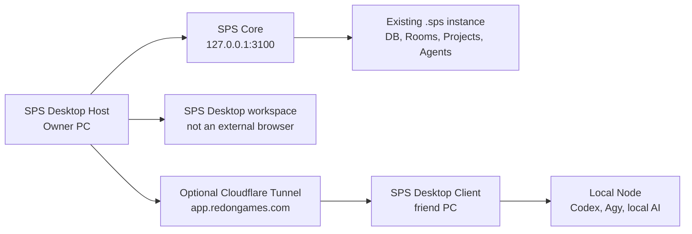

# SPS Desktop Host Mode

## 결정

SPS Desktop은 단순한 원격 Hub 접속 창이 아니다. 하나의 설치 파일이 다음 세 모드를 제공한다.

| 모드 | 담당 | 사용하는 사람 |
| --- | --- | --- |
| Local Host | 로컬 SPS Core, embedded PostgreSQL, 파일 저장소, 백업, Desktop workspace | 개인 Owner 컴퓨터 |
| Shared Hub | Host의 HTTPS 주소, Google 로그인, 초대, 다중 사용자 권한 | Owner와 협업자 |
| Node | 해당 컴퓨터의 Codex, Agy, 로컬 AI와 프로젝트 폴더 실행 | 각 작업 컴퓨터 |

사용자는 브라우저로 SPS를 열지 않는다. SPS Desktop이 자체 창에서 workspace를 연다. Google OAuth만 제공자 인증 때문에 기본 브라우저를 잠깐 사용한다.

## 기존 인스턴스 보존

현재 Owner 컴퓨터의 기존 인스턴스는 다음 경로를 권위 원본으로 사용한다.

```text
C:\Users\young\.sps\instances\default
```

| 경로 | 보존 대상 |
| --- | --- |
| `config.json` | 포트, 배포 모드, 저장소와 백업 설정 |
| `db` | embedded PostgreSQL 데이터 |
| `data` | 첨부파일, 백업, 로컬 저장소 |
| `companies`, `projects`, `workspaces` | 기존 조직과 작업공간 자료 |
| `secrets` | 로컬 암호화 비밀 키 |

Host 전환은 이 경로를 복사, 초기화, 삭제하지 않는다. 먼저 실행 중인 인스턴스를 발견해 채택하고, 명시적인 재시작에서만 Desktop이 같은 경로와 설정으로 서버를 시작한다.

## 동작 흐름



1. Owner가 Host 앱에서 `Use the SPS server on this computer`를 선택한다.
2. 앱은 `http://127.0.0.1:3100/api/health`를 확인하고 현재 `default` 인스턴스를 채택한다.
3. Host workspace는 같은 Electron 앱 창에서 로컬 서버를 연다. local trusted 인스턴스는 Google 로그인을 요구하지 않는다.
4. Host 앱은 백업, 상태, 안전한 종료와 재시작을 관리한다.
5. 친구의 Desktop Client는 `https://app.redongames.com`을 통해 Host에 로그인하고, 권한을 받은 Node에서만 로컬 CLI를 실행한다.

## 구현 단계

### Phase 1: 기존 Host 채택

- Desktop이 loopback SPS Hub를 구분한다.
- `127.0.0.1:3100`에 이미 실행 중인 기존 인스턴스를 Google 로그인 없이 workspace로 연다.
- 원격 Shared Hub와 Node 흐름은 그대로 유지한다.

### Phase 2: Desktop 소유 Host 실행기 (구현 완료)

- SPS Core 엔진을 Desktop 설치 파일의 별도 Host runtime으로 패키징한다.
- 배포용 runtime은 링크 없는 `sps-vendor`로 포함하며, 첫 Host 시작 시에만 `%APPDATA%/SPS Desktop/host-runtime/<버전>`의 `node_modules`로 복원한다.
- Electron 실행 파일은 `ELECTRON_RUN_AS_NODE=1`로 이 runtime을 실행하므로, 사용자가 별도로 Node나 개발 서버 명령을 설치·실행할 필요가 없다.
- Windows PostgreSQL 초기화 제약을 피하기 위해 Host runtime은 한글 경로의 개발 폴더가 아니라 ASCII 이름의 SPS AppData 경로에서만 실행한다.
- 앱이 시작 전에 인스턴스 잠금과 포트 충돌을 검사한다.
- 이미 실행 중인 외부 프로세스는 `adopted-external`로 표시하며, 사용자가 재시작을 명시했을 때만 Desktop child process로 교체한다.
- stdout/stderr는 비밀 값 없이 Host diagnostics에 기록한다.
- Desktop 종료는 기본적으로 창만 닫고 Host는 tray에서 계속 실행한다. `Stop local Host`는 명시적인 명령으로만 수행한다.

### Phase 3: 공유 Host 운영

- Cloudflare Tunnel connector, Google OAuth, 공개 health 상태를 Host 앱에서 읽기 전용으로 확인한다.
- Owner만 Tunnel 재연결, 공개 모드 전환, 백업 복구를 실행할 수 있다.
- 협업자는 서버 비밀·DB·CLI 로그인에 접근하지 못한다.

## 안전 규칙

- 다른 컴퓨터의 `localhost:3100`은 Owner Host가 아니다. 원격 컴퓨터는 HTTPS Hub 주소만 사용한다.
- Node의 Codex/Agy 로그인과 로컬 AI 모델은 Node 밖으로 전송하지 않는다.
- Host data directory와 비밀 키는 초대, Git, Room, Agent 지침에 포함하지 않는다.
- 기존 인스턴스를 Desktop에서 처음 채택할 때는 최신 백업 상태를 확인한 뒤에만 lifecycle 관리를 활성화한다.
