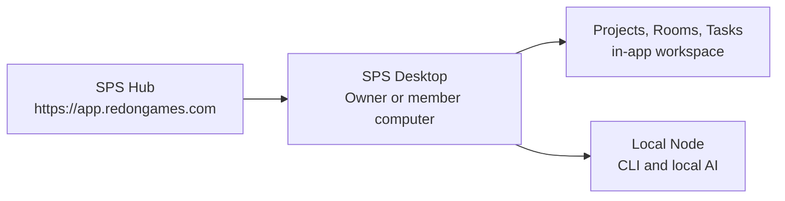

# SPS Desktop Hosted Hub Mode

## 결정

SPS Desktop은 중앙 Hub의 데스크톱 클라이언트이자 각 컴퓨터의 안전한 Agent 실행 Node다. 설치 파일은 로컬 데이터베이스나 `localhost:3100` 서버를 기동하지 않는다.

1. 사용자는 SPS Desktop에서 HTTPS Hub 주소를 저장한다.
2. Google 로그인을 기본 브라우저에서 승인한다.
3. 앱 안의 workspace가 중앙 Hub의 Projects, Rooms, Tasks, 권한과 장기기억을 연다.
4. 필요할 때만 이 컴퓨터를 SPS Node로 등록한다.
5. Owner/Admin이 Node와 Agent의 실행 권한을 부여하면, 해당 PC의 CLI·로컬 AI가 작업을 실행한다.

## 데이터와 기존 로컬 인스턴스

기존 `C:\Users\young\.sps\instances\default` 데이터는 이 변경으로 삭제·초기화·이전되지 않는다. 해당 인스턴스는 보관하거나 별도 SPS Hub 운영 환경으로 이전할 수 있지만, 일반 SPS Desktop은 그 주소에 연결하지 않는다.

공동 작업의 권위 데이터는 HTTPS Hub에 있으며, 각 Desktop에는 다음만 남는다.

- Google 승인으로 받은 암호화된 Desktop 세션
- Node Ed25519 개인키의 DPAPI 암호문
- 사용자가 연결한 프로젝트의 로컬 작업 폴더 매핑
- 해당 컴퓨터의 CLI 로그인과 로컬 AI 모델

## 안전 규칙

- Desktop은 HTTPS Hub만 연결한다. `localhost`와 사설 HTTP 주소는 제품 연결 대상으로 허용하지 않는다.
- Node의 CLI 로그인, API 키, 모델, 절대 작업 경로는 Hub에 전송하지 않는다.
- Node는 Hub로 아웃바운드 요청만 만들며, Hub가 컴퓨터의 포트를 직접 열거나 임의 셸을 실행하지 않는다.
- Node 등록·승인·Agent grant를 모두 마쳐야만 로컬 명령을 실행할 수 있다.
