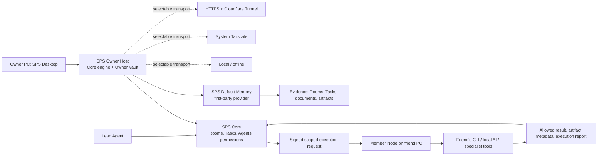

# SPS Owner Host와 메모리 플랫폼 아키텍처

> 상태: 기준 설계
>
> 이 문서는 SPS Desktop, 다중 컴퓨터 실행, 장기기억의 현재 기준을 정의한다.
> 이전 문서의 `중앙 HTTPS Hub만 사용`, `메모리는 플러그인 또는 sidecar 우선`이라는
> 표현은 이 문서의 결정으로 대체한다. 기존 문서는 도입 과정과 과거 검증 기록으로 보존한다.

## 1. 제품 경계

SPS v1은 개인과 소규모 팀을 위한 데스크톱 제품이다. Owner가 사용하는 메인 PC의
SPS Desktop은 기존 SPS 서버 엔진을 **Owner Host**라는 내부 구성 요소로 패키징하고,
자동으로 시작·감시·업데이트한다. 이는 네이티브 제품을 새로 작성하는 것이 아니며,
사용자가 PowerShell에서 따로 실행하고 브라우저로 접속해야 하는 `localhost:3100`
개발 서버도 아니다.

Owner Host는 회사, 프로젝트, Room, Task, 권한, 감사 기록, 첨부파일, 메모리의
권위 있는 원본을 보관한다. 하나의 Owner Host 안에는 여러 회사가 논리적으로 분리되어
공존할 수 있다. 데이터는 하나의 암호화된 Owner Vault에 보관하며 회사 단위의
내보내기와 전체 Vault 복구가 가능해야 한다.

`redongames.com`은 회사 웹사이트이며, 향후 `app.redongames.com` 같은 주소는
공용 접속을 위한 게이트웨이가 될 수 있다. 이것은 기본 데이터 호스트가 아니다.
대규모 팀을 위한 외부 서버 배포는 같은 SPS Host 엔진을 Docker 또는 서버 환경에서
실행하는 후속 모드다.



## 2. 책임 분리

| 구성 요소 | 반드시 담당하는 일 | 담당하지 않는 일 |
| --- | --- | --- |
| **SPS Core** | 회사·프로젝트·Room·Task·Agent·권한·감사 기록, 메모리 표준 계약, 이벤트 생명주기, 범위 검증, 암호화·백업 연동 | 특정 LLM, 벡터 DB, Obsidian 또는 검색 전략을 강제하지 않음 |
| **SPS Default Memory** | 기본 요약, 체크포인트, 근거 연결, 범위별 검색, 후보·확정·폐기 처리 | Core DB를 직접 우회 수정하거나 외부 Provider를 막지 않음 |
| **Optional Memory Provider** | Git/Obsidian, 로컬 벡터 DB, 외부 벡터 DB, 최소 기억 등 선택된 전략 구현 | Core 권한을 우회하거나 허가되지 않은 파일·비밀을 전송하지 않음 |
| **SPS Owner Host** | 서버 설정, 서버 상태, 회사·멤버·초대, Node 등록·승인, Agent-Node 실행 권한, Vault·백업 정책의 권위 있는 원본 | 친구의 CLI 로그인·API 키·로컬 모델 파일 보관 |
| **SPS Desktop** | Owner Host 엔진 패키징·시작·중지·업데이트·복구, 로컬 Vault 경로 선택, 이 PC의 CLI·로컬 AI 실행기 제공 | 서버 설정을 별도 데스크톱 상태로 중복 보관하거나 다른 PC의 자격증명을 수집 |
| **SPS Member Node** | 자기 PC의 실행기 탐색, 명시적으로 승인된 Agent 작업 실행, 로컬 자격증명 보호 | Host 데이터를 권위 있게 변경하거나 다른 PC에 임의로 접속 |

`Node`는 실행 가능한 **컴퓨터**이며 Agent가 아니다. Agent는 SPS의 역할과 운영 규칙을
가진 논리적 직원이고, Node는 그 Agent가 실제로 실행될 수 있는 PC다.

### 첫 실행과 화면 경계

SPS Desktop의 기본 화면은 별도의 운영 콘솔이 아니라 SPS Workspace여야 한다. Workspace는
Owner Host와 외부 Host에서 같은 SPS UI를 사용하므로, Room·Task·Project·Agent와 함께
서버 설정, 서버 상태, 멤버 초대, Node 승인 화면도 같은 제품 안에서 연다.

처음 설치한 경우에만 Desktop이 짧은 온보딩을 보인다.

1. 사용자는 SPS 계정으로 Google 로그인을 완료한다.
2. 다음 화면에서 **이 컴퓨터에 서버 만들기** 또는 **기존 서버에 참여하기**를 선택한다.
3. 서버 만들기는 Owner Host와 Owner Vault를 준비하고 Workspace를 연다.
4. 서버 참여는 초대 코드로 Host 주소와 회사 범위를 받은 뒤, 해당 컴퓨터를 Member Node로
   등록한다.

Google 계정 확인은 사람의 식별이고, 회사·프로젝트·Agent 권한은 항상 선택한 SPS 서버가
판정한다. 이 첫 로그인에는 공개 데스크톱 OAuth 클라이언트의 PKCE 흐름이 필요하다. 서버별
Google OAuth Web Client는 사설 Team Host의 브라우저 로그인과 초대 수락에만 사용하며,
Desktop 공통 로그인과 혼용하지 않는다.

온보딩 이후 Desktop에는 업데이트, 복구, 로컬 실행기 권한처럼 이 PC에서만 가능한 기능만
남긴다. 서버 상태나 Node 권한을 바꾸는 버튼은 Workspace의 서버 설정 화면에서 시작하고,
실제 로컬 동작이 필요할 때만 승인된 Desktop/Node에 범위 제한 요청을 전달한다.

## 3. 작업과 권한의 기본 루프

1. 사용자 또는 Lead Agent가 Room에서 목표를 정한다.
2. **Lead 역할을 가진 Agent만** Task를 만들고 Worker에게 할당한다. Worker는 Task를
   새로 만들거나 다른 Worker에게 재할당하지 않는다.
3. Core는 할당자, 대상 Agent, 허용 Node, 작업 경로, 도구 종류, 동시 실행 가능 여부를
   검증한다.
4. 선택된 Node는 Host에 바깥쪽 연결만 유지하고, 서명된 범위 제한 실행 요청을 받을 때만
   자기 PC의 CLI·로컬 AI·전문 API 도구를 실행한다.
5. Worker가 완료 또는 차단 상태를 판단하면 결과와 근거를 Task에 남긴다. Core는 해당
   Task를 만든 Lead Room에 보고를 전달하고 Lead를 깨운다.
6. Lead는 결과를 검토해 다음 Task, 수정 요청, 또는 완료를 판단한다. 사람은 언제든
   검토·승인·중단·권한 변경을 할 수 있다.

완료 보고나 메모리 처리 실패는 Task/Room 원본 기록을 막아서는 안 된다. 메모리 Provider가
일시적으로 실패하면 Core는 재시도 가능한 이벤트로 기록하고, 작업 루프는 계속 진행한다.

## 4. 데이터와 보안 경계

### Owner Vault

Owner Vault에는 SPS Core 데이터베이스, 첨부파일, 감사 로그, 기본 메모리 데이터,
Provider 색인, 백업 메타데이터, Host 설정이 들어간다. Vault는 운영체제 보안 저장소로
보호되는 키로 암호화한다. 여러 회사의 데이터는 Core의 회사 ID와 접근 권한으로 분리하며,
내보내기 시에는 선택한 회사만 포함하는 암호화 패키지를 만들 수 있어야 한다.

### Member Node

Codex CLI 로그인, 다른 CLI의 세션, API 키, 모델 파일, 로컬 작업 폴더는 Member Node에만
남는다. Host에는 실행 가능 여부, 실행기 버전, 동의한 작업 경로, 상태, 결과와 필요한
산출물 메타데이터만 전송한다. Host가 친구 PC의 셸을 일반 원격 제어하거나, 다른 사람의
CLI 자격증명을 받는 구조는 만들지 않는다.

### 권한

권한은 최소한 다음 세 축으로 평가한다.

- 사용자 -> Agent: 보기, 대화, 설정, 검토, Lead 권한
- Agent -> Node: 해당 Agent가 어떤 PC에서 실행될 수 있는지
- Task -> 실행 범위: 작업 폴더, 도구 종류, 첨부파일, 결과 업로드 범위

초대코드는 회사 참가를 위한 일회성 수단일 뿐이며 CLI·API 키·전체 Node 권한을 부여하지
않는다. 새 Member에게 전달하는 `SPS2-...` 코드는 private Team Host 주소와 일회용
Operator 초대를 함께 전달한다. 초기 Owner 구성용 Owner 초대는 공유하지 않는다. Google
로그인은 사용자 확인을 담당하고, Node의 비밀은 각 PC의 OS 보안 저장소에 머문다.

## 5. 메모리 계약과 생명주기

메모리는 제품의 핵심 동작이므로, 다음 **계약과 정책은 Core**에 둔다.

```text
MemoryProvider
  getCapabilities()
  recall(query, scopes, callerContext)
  recordEvidence(event, sourceRef)
  propose(summary, evidenceRefs, scope)
  resolveCandidate(candidateId, decision)
  checkpoint(roomId, executionContext)
  compact(roomId, compactResult, evidenceRefs)
  link(memoryId, sourceRef)
  export(companyId)
  import(package)
  health()
```

Core는 각 호출 전후에 회사·프로젝트·Room·Task·Agent 범위와 호출자 권한을 확인하고,
Provider 요청 및 반환 근거를 감사 기록에 남긴다. 실제 API 이름과 저장 형식은 구현 단계에서
정하되, Provider가 Core 테이블을 직접 읽거나 쓰지 않는 원칙은 고정한다.

### 범위

- `company`: 회사 공통 운영 규칙과 선호
- `project`: 제품·게임·앱의 설계와 기술 제약
- `agent`: 역할별 반복 규칙과 실수 방지 지식
- `room`: 장기 역할 대화의 체크포인트
- `task`: 목표가 종료될 때까지 필요한 작업 맥락
- `artifact`: 문서, 빌드, 에셋, 테스트 결과와 연결된 지식
- `user`: 승인 방식과 개인 선호. 명시적 허용이 있어야 사용

### 생명주기

1. **실행 전**: Core가 현재 Task·Room·Project 범위의 관련 기억과 근거 링크를 Provider에
   요청한다.
2. **실행 중**: 댓글, 문서 변경, 도구 결과, 테스트·빌드 결과는 원본 Evidence로 남는다.
3. **체크포인트/CLI compact**: 실행기가 반환한 compact 결과를 원본 대화의 대체물로
   취급하지 않고, Room 체크포인트와 근거 링크로 기록한다.
4. **Task 종료**: Provider가 후보 기억을 제안한다. 자동 확정 가능 여부는 회사 정책과
   기억 유형에 따라 Core가 판정한다.
5. **다음 실행**: Provider의 검색 결과는 항상 범위·출처·갱신 시각을 함께 돌려주며,
   Agent는 오래된 기억을 사실로 단정하지 않는다.

`SPS Default Memory`는 위 계약을 만족하는 기본 제공 구현이다. 사용자는 설치 과정을 볼
필요가 없으며 새 Owner Host에서 즉시 작동한다. 필요하면 회사별로 Optional Provider를
추가하거나 Default Memory를 최소 모드로 설정할 수 있다.

## 6. 연결 모드

| 모드 | 적합한 경우 | 연결 방식 | 제한 |
| --- | --- | --- | --- |
| **Local / offline** | 한 대의 메인 PC, 인터넷이 끊긴 작업 | Desktop이 내부 Owner Host에 직접 연결 | 이미 인증된 사용자만 사용 가능. 새 Google 로그인·원격 초대·원격 Node 실행은 불가 |
| **Private** | 친구와 사설 네트워크로 협업 | 사용자가 설치한 Tailscale 등의 사설 연결 | Tailscale은 앱에 내장하지 않고 감지·설정 안내만 제공 |
| **Public HTTPS** | 인터넷을 통한 협업 | Cloudflare Tunnel 또는 동등한 HTTPS 게이트웨이 | Google 로그인, 초대, TLS, Host 공개 상태 확인 필요 |
| **Future external Host** | 대규모 팀·항상 켜진 운영 | 같은 Host 엔진을 외부 서버에 배포 | v1의 기본 설치·운영 경로가 아님 |

모든 원격 Node는 Host에 대한 outbound 연결만 만든다. Host가 임의 포트를 통해 Member PC에
들어가거나 임의 명령을 실행하는 연결은 허용하지 않는다.

### SPS Desktop의 Private Tailnet 전환

SPS Desktop은 Tailscale을 제품 안에 포함하거나 Tailscale 계정을 대신 관리하지 않는다.
대신 사용자가 이미 연결해 둔 시스템 Tailscale에서 MagicDNS 이름을 읽고, `tailscale serve`로
**loopback Owner Host만** 사설 HTTPS 주소에 연결한다. Core는 계속 `127.0.0.1`에만
바인딩되므로 LAN 포트 개방으로 협업을 시작하지 않는다.

전환 절차는 다음처럼 고정한다.

1. Owner가 Desktop의 Private team access에서 Tailscale을 감지하고 MagicDNS 및 HTTPS certificate 준비 상태를 확인한다.
2. Desktop이 표시한 `https://<host>.ts.net/api/auth/callback/google`을 Owner의 Google OAuth
   클라이언트 redirect URI로 등록한다.
3. Owner가 회사를 하나 선택하고 전환한다. 전환 직전에는 그 회사의 짧은 수명 Owner 초대가
   하나 생성된다.
4. Desktop은 Owner Vault의 Core 설정을 `authenticated/private`와 명시적인 Tailnet HTTPS
   주소로 바꾸고, Windows secure storage에만 인증 비밀과 Google OAuth client secret을 보관한다.
5. Owner는 방금 만든 초대를 Google로 수락한 뒤 Desktop sign-in을 완료한다. 이후에만
   사람 초대와 Member Node 승인을 시작한다.

전환 전에는 SPS가 기존 `tailscale serve` 규칙이 비어 있는지 확인한다. 전환 해제 시에도 SPS가
만든 `HTTPS :443` 루트 프록시가 그대로 남아 있을 때만 그 규칙만 제거한다. 규칙이 사용자가 수정한
상태라면 SPS는 추측해서 지우지 않고 해제를 중단해 사용자가 Tailscale에서 정리하도록 안내한다.
따라서 다른 Serve 구성을 덮어쓰거나, 해제 뒤에 의도치 않은 외부 경로를 남기지 않는다.

## 7. 백업, 이동, 복구

Owner Host는 다음을 사용자에게 제공해야 한다.

- 자동 암호화 백업과 수동 즉시 백업
- 전체 Owner Vault 복원과 선택 회사 내보내기·가져오기
- 새 메인 PC로 이동할 때의 내보내기 -> 설치 -> 복원 -> 새 Node 신뢰 재설정 흐름
- Provider별 포함 범위, 미포함 외부 색인, 복구 후 재색인 필요 여부 표시
- 복원 전 무결성 검사, 버전 호환성 검사, 되돌리기 가능한 복원 지점

기존 개인 PC의 데이터는 이 단계에서 이전하지 않는다. 새 Host 형식이 안정된 뒤 별도의
읽기 전용 가져오기 도구와 검증 절차를 만든다.

## 8. 현재 `local.memory-sidecar`에서의 전환

현재 `local.memory-sidecar`와 `sps-memory`는 Core 플러그인 경계에서 메모리 UI와
자동화를 제공한다. 이 구현을 바로 삭제하지 않는다.

1. Core에 Provider 계약, 범위·권한 검사, 이벤트 outbox, 감사·백업 연결을 추가한다.
2. 기존 sidecar 호출을 새 계약으로 연결하는 호환 어댑터를 만든다.
3. 기본 구현을 `SPS Default Memory`로 패키징해 Owner Host가 함께 시작·상태 검사·업데이트한다.
4. 새 Owner Vault에서 Default Memory를 기본값으로 사용한다. 기존 메모리 데이터 이전은
   별도 마이그레이션과 검증이 준비될 때까지 선택 사항으로 둔다.
5. 플러그인 UI는 Core가 제공하는 상태·검색·근거 API를 사용하도록 바꾸고, Provider 장애 시
   Room과 Task가 계속 동작하는지 검증한다.

## 9. 업데이트 호환성과 확장 규칙

- Core 계약은 의미 버전과 마이그레이션 정책을 가진다. Provider는 지원하는 계약 버전을
  선언해야 한다.
- SPS Default Memory는 Desktop과 함께 테스트·배포되는 first-party 구성 요소다. 사용자에게
  별도 설치를 요구하지 않는다.
- Optional Provider는 공개 계약과 권한 있는 Evidence API만 사용한다. Core DB, Vault 키,
  다른 회사 데이터에 직접 접근할 수 없다.
- Provider가 없거나 실패해도 원본 Room·Task·문서·산출물은 Core에 남는다. 검색 품질은
  낮아질 수 있어도 협업과 실행이 멈추면 안 된다.
- Core 업데이트 전에 Vault 백업과 Provider 호환성 검사를 수행하고, 실패 시 이전 Provider
  버전으로 되돌릴 수 있어야 한다.

## 10. 구현 순서와 완료 기준

### 단계 1: Core 메모리 기반

- Provider 계약, 이벤트 outbox, 범위·권한 검사, 감사 기록, health 상태를 Core에 만든다.
- **완료 기준**: Provider가 없는 상태에서도 Room·Task가 정상 작동하고, 권한 밖 기억을
  검색·기록할 수 없으며, 이벤트 재시도가 중복 기억을 만들지 않는다.

### 단계 2: SPS Default Memory

- 기존 sidecar 기능을 Provider 계약 뒤로 옮기고, Owner Host 패키지에 기본 포함한다.
- **완료 기준**: 새 Desktop 설치 후 추가 설치 없이 Room 체크포인트, Task 종료 후보,
  근거 링크, 검색이 동작한다. Provider를 꺼도 원본 협업 흐름은 계속된다.

### 단계 3: Owner Host와 Vault

- Desktop이 Host 런타임, Vault 생성·암호화·백업·복구·상태 진단을 관리한다.
- **완료 기준**: 사용자가 서버 명령을 실행하지 않아도 앱 시작 후 Workspace를 열 수 있고,
  종료·재시작·PC 재부팅 뒤에도 데이터와 Room 기억이 보존된다.

### 단계 4: Member Node와 권한

- 인앱 초대, Google 계정 확인, Node 승인, Agent-Node grant, 서명된 실행 요청을 연결한다.
- **완료 기준**: 친구 PC의 CLI가 친구 계정으로만 실행되고, 권한이 취소되면 다음 요청이
  즉시 거절되며, 완료/차단 보고가 Task를 만든 Lead Room으로 전달된다.

### 단계 5: 이동성과 선택 Provider

- 암호화 export/import, Optional Provider 등록, 네트워크 모드 전환을 제공한다.
- **완료 기준**: 빈 새 PC에서 Vault를 복원해 회사 데이터와 기본 기억을 검증할 수 있고,
  외부 Provider가 없어도 작업을 계속할 수 있다.

## 11. 이번 문서가 대체하는 표현

- “SPS Desktop은 HTTPS 중앙 Hub에만 연결하며 로컬 Host를 시작하지 않는다.”
- “장기기억은 plugin 또는 sidecar first이고 Core 변경은 최소화한다.”
- “메모리 Provider 실패 시 Task 실행을 중단한다.”

앞으로는 **Core 계약 + Desktop에 내장된 SPS Default Memory + 교체 가능한 Provider**를
기준으로 구현·테스트·문서를 작성한다.
