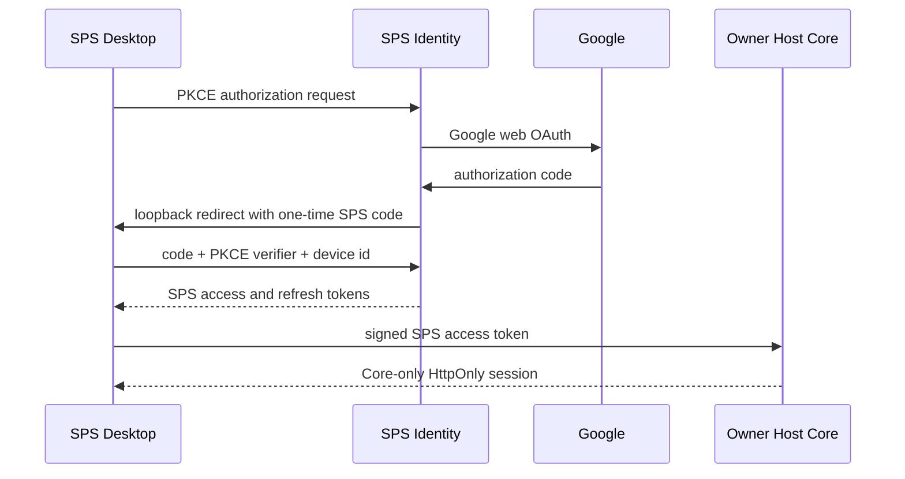

# SPS Central Identity Architecture

## Decision

SPS uses a small central identity service at `https://auth.redongames.com`.
The service authenticates a person and their Desktop device. It is not an SPS
workspace server and it never stores project files, Rooms, Tasks, agent
instructions, provider credentials, local AI models, or CLI sessions.

The data plane remains local by default:

- An Owner Host keeps its Core database, Default Memory, attachments, and
  backups inside its encrypted Owner Vault.
- A Member Node keeps its CLI login, local model runtime, workspace files, and
  execution logs on that member computer.
- A remote team connection uses the Owner Host URL (for example through
  Tailscale Serve). The central identity service only proves who is signing in.

## Why This Replaces Desktop Google OAuth

The former Desktop flow exchanged a Google authorization code inside the app.
Some Google OAuth configurations require a client secret, which made the
desktop distribution fragile and required configuration on every computer.

The new flow uses a confidential Google **web** client only in the identity
service. Its secret is a Cloudflare secret and is never packaged into SPS
Desktop, sent to an Owner Host, or written to an SPS repository.

## Login Flow

1. SPS Desktop creates PKCE verifier, challenge, state, a stable installation
   `device_id`, and a temporary `127.0.0.1` callback listener.
2. Desktop opens `auth.redongames.com`. The service sends the user to Google.
3. Google returns only to `auth.redongames.com`; the service exchanges the
   authorization code using its protected client secret.
4. The service verifies Google's signed ID token and its one-time `nonce`, then
   redirects to Desktop's loopback callback with a short-lived, single-use
   authorization code. It never places an access token in the URL.
5. Desktop exchanges that code, the PKCE verifier, and the same `device_id`
   for SPS access and refresh tokens, then stores them with Electron
   `safeStorage`. The refresh token is also bound to that device.
6. Before opening a local or remote SPS Core workspace, Desktop presents the
   short-lived SPS access token to that Core's local identity-session endpoint.
7. Core verifies the signed token using the public SPS Identity JWKS, creates
   its own scoped browser session, and applies that Core's membership and
   invitation rules.

## Token and Session Contract

SPS Identity signs access tokens with `RS256` and publishes matching public
keys from `/.well-known/jwks.json`.

Required access-token claims:

- `iss`: exact SPS Identity issuer URL
- `aud`: `sps-core`
- `sub`: stable central SPS user identifier
- `email`, `name`, `picture`: verified profile fields when available
- `device_id`: the Desktop installation that obtained the token
- `scope`: includes `sps.core.session`
- `iat`, `nbf`, `exp`, `jti`

An access token is short-lived (15 minutes). Refresh tokens are opaque,
rotation-only values stored encrypted by Desktop and hashed by the identity
service. A Core creates a separate, revocable session record with its own
seven-day lifetime. Signing out removes the local Core session and Desktop
tokens; a future identity revocation endpoint can also invalidate refresh
tokens centrally. The identity service rejects an authorization code or refresh
token presented from a different device id.

## Core Trust Bridge

Authenticated Core instances can enable the bridge with:

- `SPS_IDENTITY_ISSUER=https://auth.redongames.com`
- `SPS_IDENTITY_AUDIENCE=sps-core`
- `SPS_IDENTITY_JWKS_URL=https://auth.redongames.com/.well-known/jwks.json`
- `SPS_AUTH_SECRET=<local generated secret>`

The bridge accepts a valid SPS access token only at the explicit local session
exchange endpoint. It creates or refreshes a local user record but does not
grant company access by itself. Company membership remains controlled by the
Owner Host's invitation and authorization rules.

Local/offline Owner Hosts remain valid. A previously created Core session keeps
working until its local expiry; creating a new Google/SPS Identity session or
refreshing a token requires network access.

## Service Boundaries

| Component | Stores | Must never receive |
| --- | --- | --- |
| SPS Identity | central user id, device id, token hashes, OAuth state | projects, Rooms, Tasks, prompts, attachments, provider keys, CLI logs |
| SPS Desktop | encrypted SPS tokens, connection settings | Google client secret, other computers' CLI credentials |
| Owner Host | workspace data, local authorization, Core sessions | Google client secret, Member Node private keys |
| Member Node | local runtimes, local project mappings, execution material | other computers' local credentials |

## Deployment

`sps-server/sps-identity` is a Cloudflare Worker with D1 for OAuth state,
one-time authorization codes, refresh-token hashes, and device records.
Secrets are Cloudflare bindings:

- `GOOGLE_CLIENT_ID`
- `GOOGLE_CLIENT_SECRET`
- `SPS_IDENTITY_PRIVATE_KEY_PEM`

Non-secret Worker variables are `SPS_IDENTITY_PUBLIC_JWK` and
`SPS_IDENTITY_KEY_ID`. The public JWK is generated with the matching private
key but contains no signing material.

The Worker is deployed only after the Google Web OAuth client has the exact
redirect URI `https://auth.redongames.com/v1/oauth/google/callback` and the
custom domain is attached. No OAuth secret belongs in source control.

## Rollout

1. Ship the identity Worker, test its health endpoint, JWKS, and token exchange.
2. Switch SPS Desktop to central Identity and verify login on the Owner PC and
   a second computer.
3. Enable the Core trust bridge for a test Owner Host. When private-team mode
   starts, Desktop accepts the Owner invitation through its new Core session so
   the Owner keeps access without an external browser hand-off. Verify member
   invitation, logout, and Node approval.
4. Remove the legacy per-machine Google client configuration from the setup UI.
5. Retire legacy direct Google OAuth only after the central flow has passed the
   two-computer end-to-end test.
