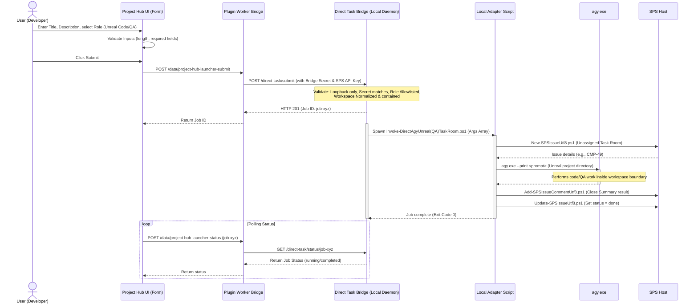

# Design Log: Project Hub Direct-Request Launcher (CMP-48)

- **Task Room Identifier**: `CMP-48`
- **Issue ID**: `5765bcdc-960d-4480-9085-2e0c2b6b8f8c`
- **Title**: Design safe Project Hub direct-request launcher
- **Status**: Design/Feasibility Completed

> [!IMPORTANT]
> **CORRECTION NOTICE**:
> The authority design, credential forwarding model, and configuration storage in this design have been corrected and superseded. Please refer to [41-direct-task-bridge-authority-correction-log.md](file:///C:/Users/young/Documents/AGENT%20%EA%B5%AC%EC%B6%95/sps-server/41-direct-task-bridge-authority-correction-log.md) for the authoritative design and implementation contract under CMP-49. Do not use the raw credential forwarding or sidecar-shared config model specified below.

---

## 1. Request Flow Diagram

Below is the request flow diagram detailing how a user-initiated request in the Project Hub is validated, proxied, executed locally as an unassigned Task Room, and closed with SPS remaining the source of truth.



---

## 2. Architecture Decision: Separated Concerns

### Decision:
* **Memory Sidecar**: Retains its existing design as a **strictly memory-only service** (recall, index, search, and propose candidates). No execution capabilities or filesystem modifications will be added to the Memory Sidecar.
* **Direct Task Bridge (DTB)**: Introduce a **separate loopback daemon** (running on Node.js/PowerShell) specifically to handle process execution, command-line argument construction, and script invocation for direct-request task runs.

### Rationale:
1. **Security Isolation & Privilege Minimization**: The Memory Sidecar handles passive text indexing and is exposed via search capabilities. If process-spawning capabilities were combined into the sidecar, any vulnerability (e.g., in query parsing, token leakage, or candidate submission) could escalate to Remote Code Execution (RCE).
2. **Attack Surface Separation**: Spawning high-privilege scripts (`Invoke-DirectAgyUnrealTaskRoom.ps1`) that interact with the local filesystem and CLI tools requires highly hardened input validation. Keeping this in a standalone `Direct Task Bridge` with its own secret token ensures that a compromise of the Memory Sidecar does not compromise the execution layer.
3. **Operational Simplicity**: Spawning background jobs and managing process timeouts, concurrency queues, and exit status is highly stateful. Keeping this logic separate from the stateless/memory-centric Memory Sidecar preserves codebase cleanly.

---

## 3. Minimal API Proposal

The Direct Task Bridge (DTB) will run on a separate local loopback port (e.g., `127.0.0.1:3199`) and expose the following endpoints.

### 1. `POST /direct-task/preview`
Evaluates the request parameters, resolves the workspace paths, and previews the command and prompt templates without invoking anything.

* **Request Headers**:
  * `x-direct-bridge-token`: `<bridge-secret>`
* **Request Body**:
  ```json
  {
    "companyId": "181e1bf7-3390-4b8d-8507-b736a03e444b",
    "projectId": "2e0a5142-c2d2-4f23-8079-a287e8c8e59f",
    "title": "Add dash cooldown config",
    "description": "Expose a dash cooldown parameter in the character blueprint.",
    "role": "unreal-code",
    "projectFile": "MyGame.uproject"
  }
  ```
* **Response Body (200 OK)**:
  ```json
  {
    "valid": true,
    "resolvedWorkspace": "C:\\Users\\young\\Documents\\Unreal Projects\\MyGame",
    "resolvedProjectFile": "C:\\Users\\young\\Documents\\Unreal Projects\\MyGame\\MyGame.uproject",
    "scriptPath": "scripts\\Invoke-DirectAgyUnrealTaskRoom.ps1",
    "argumentArray": [
      "-CompanyId", "181e1bf7-3390-4b8d-8507-b736a03e444b",
      "-Title", "Add dash cooldown config",
      "-Description", "Expose a dash cooldown parameter...",
      "-ProjectId", "2e0a5142-c2d2-4f23-8079-a287e8c8e59f",
      "-ProjectFile", "MyGame.uproject"
    ],
    "promptPreview": "You are a direct local Unreal Code Worker..."
  }
  ```

### 2. `POST /direct-task/submit`
Submits a job for execution. Uses a client-supplied idempotency key to prevent double-submission.

* **Request Headers**:
  * `x-direct-bridge-token`: `<bridge-secret>`
* **Request Body**:
  ```json
  {
    "idempotencyKey": "9b1deb4d-3b7d-4bad-9bdd-2b0d7b3dcb6d",
    "companyId": "181e1bf7-3390-4b8d-8507-b736a03e444b",
    "projectId": "2e0a5142-c2d2-4f23-8079-a287e8c8e59f",
    "title": "Add dash cooldown config",
    "description": "Expose a dash cooldown parameter in the character blueprint.",
    "role": "unreal-code",
    "projectFile": "MyGame.uproject",
    "proposeCandidates": true,
    "markDone": true
  }
  ```
* **Response Body (201 Created)**:
  ```json
  {
    "jobId": "job_9b1deb4d3b7d4bad",
    "status": "pending",
    "createdAt": "2026-07-10T16:10:00.000Z"
  }
  ```

### 3. `GET /direct-task/status/:jobId`
Retrieves the execution status of a submitted job.

* **Request Headers**:
  * `x-direct-bridge-token`: `<bridge-secret>`
* **Response Body (200 OK)**:
  ```json
  {
    "jobId": "job_9b1deb4d3b7d4bad",
    "status": "running" | "completed" | "failed",
    "exitCode": 0,
    "issueId": "5765bcdc-960d-4480-9085-2e0c2b6b8f8c",
    "identifier": "CMP-48",
    "outputPath": "C:\\Users\\young\\Documents\\Unreal Projects\\MyGame\\.direct-agy-runs\\CMP-48-20260710-161000.output.md",
    "error": null,
    "memoryCandidateId": "cand_9b1deb4d3b7d4bad"
  }
  ```

---

## 4. Threats and Non-Negotiable Security Controls

To ensure that the Direct Task Bridge does not become an unsafe arbitrary command runner, the following strict controls must be built into the system:

1. **Loopback Binding Only**: The bridge daemon must bind strictly to `127.0.0.1` and `::1`. Any external connection attempts must be rejected at the socket level.
2. **Explicit Bridge Secret**: All endpoints on the bridge must require a strong token/secret (passed in `x-direct-bridge-token`), configured via environment variable `DIRECT_TASK_BRIDGE_TOKEN` or `config.local.json`. This secret must be separate from the Memory Sidecar token.
3. **SPS Board Authentication**: The plugin worker will proxy the caller's active SPS board credentials (`PAPERCLIP_API_KEY`) to the bridge. The bridge will supply these credentials to the spawned PowerShell scripts, ensuring that task writes are restricted by the active user's permissions and preventing privilege escalation.
4. **Fixed Role Allowlist**: The bridge must enforce a strict allowlist of roles. Initially, only `unreal-code` and `unreal-qa` are allowed. Any request specifying other roles will be rejected immediately.
5. **Registered Project/Workspace Mapping**: The bridge will maintain a hardcoded mapping of `projectId` -> `allowedWorkspacePath` in its local config. The API will NOT accept arbitrary workspace paths. It will look up the workspace path using the provided `projectId` and verify that it matches.
6. **Path Normalized & Contained Boundary**: If a custom `projectFile` is supplied, the bridge must normalize the path and execute boundary containment checks (similar to `Resolve-UnrealWorkspace.ps1`) to ensure the file is strictly nested within the mapped workspace, blocking sibling prefix collisions and directory traversals (`..`).
7. **Argument-Array Process Invocation**: The bridge must spawn the PowerShell runner via Node.js `child_process.spawn` using a fixed argument array (`['pwsh.exe', '-File', 'scripts/Invoke-DirectAgyUnrealTaskRoom.ps1', ...]`). The bridge must NEVER invoke a raw shell command or evaluate unescaped shell strings.
8. **No Raw Shell Command Field**: The API schema will have no parameters representing raw executable names, additional CLI flags, or custom arguments.
9. **Bounded Text Inputs**: The bridge will enforce strict length limits on inputs: `title` is capped at 200 characters; `description` is capped at 4,000 characters.
10. **Concurrency limit**: The bridge will enforce a strict concurrency limit (e.g., maximum 1 concurrent process running). Additional requests while a job is running will receive a `429 Too Many Requests` status, protecting local compute resources.
11. **Process and Job Status Tracking**: Process lifespans must be actively tracked in memory. A strict maximum timeout of 15 minutes will be enforced; processes exceeding this limit will be immediately reaped/killed and marked as failed.
12. **Audit Logging**: Every API request (timestamp, source IP, endpoint, parameters, and outcome) and process invocation event must be appended to a local log file `logs/direct-task-bridge.log` for auditability.
13. **No Automatic Memory Promotion**: Proposed memory candidates are strictly written to the Memory Sidecar candidate queue `/memory/candidates` and are never automatically merged into approved `LEARNINGS.md` files.

---

## 5. Phased Implementation Plan

We recommend a phased approach to implementing this launcher to prevent early execution hazards:

### Phase 1: Non-Executing Preview UI First
* **Objective**: Create the Project Hub UI form and worker endpoints, exposing only the `/direct-task/preview` flow.
* **Details**:
  1. Add the launcher form UI as a tab in the Project detail view.
  2. Implement the `preview` data handler in the plugin worker.
  3. The UI will render a "Preview Launch" button showing the generated PowerShell command and prompt preview.
  4. The "Launch" button will remain disabled/non-functional. No process spawning logic is introduced.

### Phase 2: Explicitly Configured Submit Path Second
* **Objective**: Implement the backend daemon, configure path mapping, and enable safe execution.
* **Details**:
  1. Implement the Node-based `direct-task-bridge.mjs` daemon.
  2. Add configuration parameters to `config.local.json` (bridge secret token, project-to-workspace mapping).
  3. Wire the "Launch" button in the UI to the worker proxy, triggering the `/direct-task/submit` endpoint.
  4. Implement the status polling loop in the UI.

---

## 6. Precise List of Impacted Files

Later implementation of this feature will need to create or modify the following files:

1. **`sps-memory/dist/manifest.js`** (Modify): Add the Project Hub launcher tab slot definition and new configuration schema parameters for the Direct Task Bridge (e.g., `directBridgeUrl`, `directBridgeToken`).
2. **`sps-memory/src/ui/MemoryTab.jsx`** (Modify): Add the new custom web component (`paperclip-project-hub-launcher`) that renders the launcher form, preview panel, and execution status.
3. **`sps-memory/dist/worker.js`** (Modify): Register new data/action handlers to proxy `preview`, `submit`, and `status` calls to the loopback Direct Task Bridge.
4. **`memory-sidecar/config.local.json`** (Modify): Register allowed project-to-workspace path mappings and the `DIRECT_TASK_BRIDGE_TOKEN`.
5. **`scripts/direct-task-bridge.mjs`** (New File): The Node.js loopback daemon that implements the DTB server, validates paths, and spawns the PowerShell script runner.
6. **`scripts/Start-DirectTaskBridge.ps1`** (New File): PowerShell helper to run the Direct Task Bridge daemon in the background with local log redirection.
7. **`scripts/Invoke-DirectAgyUnrealTaskRoom.ps1`** (Verify/Modify): Ensure the runner can receive the API credentials and returns structured JSON output upon completion.
8. **`scripts/Invoke-DirectAgyUnrealQATaskRoom.ps1`** (Verify/Modify): Ensure the QA runner behaves consistently with the code runner.

---
*Created by Antigravity (Direct Local Worker) on behalf of Codex CTO.*
