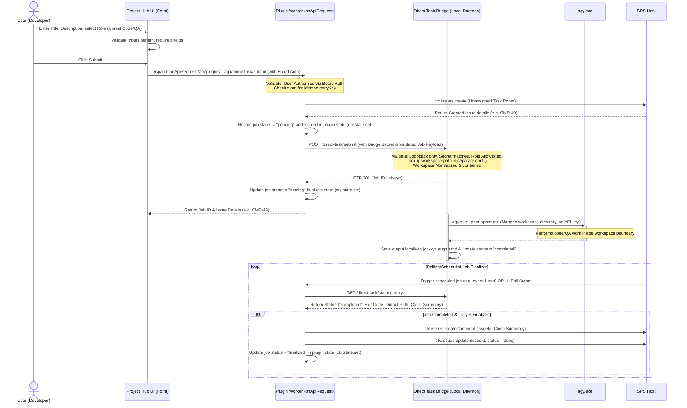

# Correction Log: Direct Task Bridge Authority Design (CMP-49)

## 1. Objective
Revise the Project Hub direct-request launcher feasibility design using the actual installed SPS plugin SDK capability model. Correct the two unsafe/unproven assumptions in CMP-48 before any launcher UI or execution bridge implementation begins. This document supersedes the affected parts of `40-project-hub-direct-request-launcher-log.md`.

## 2. Corrected Sequence Diagram
Below is the corrected request flow showing the updated authority split. The user's raw `PAPERCLIP_API_KEY` is never forwarded to the Direct Task Bridge, and the Bridge does not perform direct writes to SPS or memory.

## 3. Corrected Authority Split & Capability Delta
To ensure strict security boundaries, the responsibilities are split between the board-authenticated plugin worker and the local Direct Task Bridge.

### 3.1. Capability Delta
The plugin manifest must request only the following safe/scoped capabilities, mapping directly to installed SDK capabilities:
* `issues.create`: Allows the plugin worker to create unassigned Task Rooms.
* `issues.update`: Allows the plugin worker to update issue properties (e.g. status = done).
* `issue.comments.create`: Allows the plugin worker to append the run's close summary.
* `plugin.state.read` / `plugin.state.write`: Allows the plugin worker to store job mappings and idempotency keys.
* `jobs.schedule`: Allows the plugin to run a scheduled finalization job in the background.
* `api.routes.register`: Allows the plugin UI to invoke the worker via board-authenticated endpoints.
* `secrets.read-ref`: Allows the plugin to resolve the bridge secret via `ctx.secrets.resolve()` without exposing it to the browser.
* `http.outbound`: Allows the plugin worker to post payloads to the local bridge daemon.

The **Direct Task Bridge** has **no** SPS API capabilities, access keys, or credentials. It operates as a local process runner that works strictly with mapped file system paths.

### 3.2. Config and Secret Ownership
* **Memory Sidecar (`memory-sidecar/config.local.json`)**: Strictly memory-only. It remains completely unaware of workspaces, project files, execution secrets, or running processes.
* **Direct Task Bridge (`direct-task-bridge/config.json`)**: Separately owned config path. Contains:
  * `bridgeSecret`: Strong token validating requests from the plugin worker.
  * `projectWorkspaceMappings`: Hardcoded mapping of `projectId` -> `localWorkspacePath` (e.g., `"2e0a5142-c2d2-4f23-8079-a287e8c8e59f"` -> `"C:\Users\young\Documents\Unreal Projects\강해린"`).
  * Enforced boundaries: The Bridge will reject any path resolving outside the mapped workspace or containing double dots (`..`).

## 4. Exact Job-State, Finalization Flow & Idempotency Points
To prevent double-execution, stale status, and duplicate comments, the state is managed in a strict pipeline:

1. **Idempotency Point 1 (User Submission)**:
   - When the user submits the form, the UI generates a unique `idempotencyKey`.
   - The plugin worker receives this key and checks `ctx.state.get({ scopeKind: "project", stateKey: idempotencyKey })`.
   - If a job is already associated with this key, the worker returns the existing Job ID immediately instead of creating a new issue.
2. **Idempotency Point 2 (Task Room Creation)**:
   - If not present, the worker calls `ctx.issues.create`.
   - The returned `issueId` is saved in `ctx.state` mapped to the `idempotencyKey` and `jobId`.
3. **Idempotency Point 3 (Bridge Dispatch)**:
   - The plugin worker POSTs the job payload to the Direct Task Bridge.
   - The Bridge maintains an in-memory job map and rejects submissions sharing a duplicate `jobId`.
4. **Finalization Flow**:
   - The Bridge executes the local `agy.exe` runner. During execution, the status endpoint returns `status: "running"`.
   - Upon completion, the Bridge saves the stdout/output to a local file, sets `status: "completed"`, and stores the `closeSummary`.
   - A scheduled background job in the plugin (run via `jobs.schedule` handler `direct-task-finalizer`) polls the Bridge's GET `/direct-task/status/:jobId` for all jobs marked `running` in `ctx.state`.
   - Once a job status is reported as `completed`:
     1. The finalizer posts the `closeSummary` via `ctx.issues.createComment`.
     2. The finalizer marks the issue as resolved via `ctx.issues.update`.
     3. The finalizer updates the plugin state for the job to `status: "finalized"`.
   - If finalization fails mid-way, the next run of the scheduler checks the state (still `running` / `completed` but not `finalized`) and retries. Since status update to `finalized` is the final step, duplicate writes are avoided by asserting the issue's current comment count or checking if the issue status is already `done`.

## 5. Bounded Inputs & Trust Constraints
The Direct Task Bridge must operate under a "zero-trust" model regarding inputs passed from SPS:
* **Recall Brief Bounding**: The Recall Brief contains only the minimal, static, normalized fields: `title`, `description`, and `role`. It never passes raw credentials, dynamic execution flags, or user-supplied command strings.
* **Command Validation**: The Bridge does not trust arbitrary commands. It constructs arguments explicitly via a fixed template:
  `['pwsh.exe', '-File', 'scripts/Invoke-DirectAgyUnrealTaskRoom.ps1', '-CompanyId', companyId, '-ProjectId', projectId, '-IssueId', issueId, '-ProjectFile', projectFile, ...]`
* **Path Containment**: The Bridge resolves the workspace path locally based on the `projectId` lookup. The `projectFile` parameter is validated to be a relative path and checked via `Resolve-UnrealWorkspace.ps1` to prevent path traversal.

## 6. Residual Limitations
* **Local Run Dependency**: Because the Direct Task Bridge is a local daemon bound to loopback, the local developer environment must be running. If the daemon is offline, the plugin worker will fail to dispatch the job and will return a clear error in `ctx.state`.
* **Polled Finalizer Latency**: The scheduled background job runs at a fixed interval (e.g. 1 minute). There will be a short delay between the local task completion and the Task Room status update in SPS.
* **No Automatic Memory Promotion**: The Bridge does not write to the Memory Sidecar. Any proposed learning candidates must still be explicitly reviewed and promoted via existing local CLI scripts.
