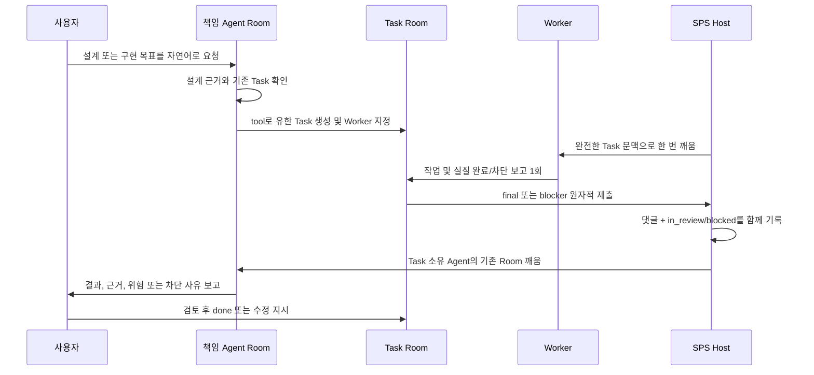

# 주요 작업 루프 최종 구조 감사

Updated: 2026-07-14

## 결론

현재 방향은 `02-final-operating-model-ko.md`와 일치한다. SPS을 버리고
별도 제품을 다시 만드는 것보다, SPS을 control plane으로 유지하고
필수 호스트 계약만 로컬 코어에 보강하는 구성이 가장 완성도가 높다.

핵심 루프는 구조와 자동 테스트 기준으로 완성되었고 Windows 자동 시작 작업도
로컬 코어 실행기로 교체되었다. 남은 일은 다음 재부팅 관찰, 실제 공급자별
end-to-end 점검, UI 다듬기다.
이들은 Room과 Task의 권한 구조를 다시 설계해야 하는 문제는 아니다.

## 완성형 작업 흐름

중앙 controller는 이 흐름에서 작업을 대신 판단하지 않는다. Designer, CTO,
CEO 같은 책임 Agent가 자기 Room에서 직접 tool을 사용한다. Worker는 배정된
Task의 생산 작업만 수행하고, 사용자 승인이나 별도 Worker를 만들지 않는다.

## 책임 경계

| 계층 | 책임 | 두지 않는 것 |
| --- | --- | --- |
| SPS 기반 코어 | 인증, Company/Project/Agent/Task, 댓글, 문서, 첨부, run, 데이터베이스 | 역할별 회사 정책과 Room 전용 UI |
| 로컬 코어 계약 | Agent Session 문맥·복구, 원자적 Worker 보고, 실행 소유권, Windows ACP/UTF-8, Codex 시작 설정 | 작업 라우팅과 역할 판단 |
| Room 플러그인 | Agent별 Room 생성, Room UI, Task tool, 상태 envelope, owner wake, 첨부 staging | 설계·코드 산출물의 원본 |
| Memory Sidecar | 승인 기억 검색, 기억 후보, 범위별 journal | 후보 자동 승인, 프로젝트 설계 원본 대체 |
| 외부 저장소 | Obsidian/Git 설계 문서, 구현 코드, 에셋과 변경 이력 | Room 실행 상태 |
| Agent adapter/tool | Codex, agy, Image, Voice, Unity/Unreal/Blender 등 실제 실행 | 회사의 권한 구조 결정 |

프로젝트의 설계와 구현 지식은 외부 저장소가 원본이다. SPS에는 Room
대화, 체크포인트, Task 증거와 운영 기억을 남긴다. 따라서 SPS 데이터가
사라지지 않는 한 대화는 복구되고, 외부 저장소가 있는 한 산출물도 독립적으로
보존된다.

## 반복 장애의 원인과 해결

| 장애 | 근본 원인 | 현재 해결 |
| --- | --- | --- |
| `dynamic tool request failed`, RPC timeout | 짧은 plugin action scope를 background 작업에서 재사용 | action 안에서 Agent Session run을 접수하고 terminal event로 비동기 완료 |
| Worker 보고 순서가 꼬이거나 중복됨 | 댓글 작성과 상태 변경이 별도 연산 | 활성 assignee/run을 검증한 transaction에서 보고와 상태를 원자 처리 |
| 완료 후 상사 Room이 안 깨어남 | 상태만 보고 깨우거나 소유 Room 연결이 불명확 | 실질 보고가 있는 `in_review/blocked`만 idempotent하게 소유 Room으로 전달 |
| 다른 Worker가 실행되거나 Manager가 대신 작업 | Issue 변경과 recovery가 실행 소유권을 충분히 구분하지 않음 | assignee, active run, Task owner 경계를 코어에서 검증하고 역할 규칙을 매 turn 주입 |
| 승인 요청이 Task에 생김 | Worker와 책임 Agent의 사용자 대화 권한이 섞임 | Worker는 final/blocker만 제출하고 질문·승인은 소유 Agent Room에서 처리 |
| 한글과 파일명이 깨짐 | Windows code page와 분할 UTF-8 stream | streaming decoder, UTF-8 BOM instruction, versioned base64 JSON envelope |
| 재시작 뒤 Room이 `working`에 멈춤 | 메모리 Map이 기준 상태처럼 사용됨 | SPS Agent Session, `ROOM_STATE`, run ledger를 기준으로 재조정 |
| 내장 `Reflection Coach` Room이 생김 | 모든 비종료 Agent를 고용 직원으로 간주 | `paperclipBuiltInAgent` metadata를 제외하고 기존 Room은 cancelled 이력으로 보존 |
| 최신 Codex 모델이 실행 시 거절됨 | ACP의 오래된 모델 목록과 사후 config 변경 | 최신 `codex-acp`와 `CODEX_CONFIG` 시작 설정으로 모델·추론 옵션 전달 |
| 최종 답변에 작업 과정이 섞임 | thought와 output delta를 같은 summary로 합침 | activity에는 과정 요약을 유지하고 최종 댓글은 output stream만 사용 |

## 코어를 수정한 이유

플러그인만으로 해결할 수 없는 것은 서버가 보장해야 하는 원자성과 실행
소유권이다. 다음 계약은 클라이언트 플러그인이 흉내 내면 재시도, 충돌,
프로세스 종료 시 다시 깨진다.

1. Agent Session에 `projectId`, `projectWorkspaceId`, `issueId`를 검증해 저장
2. session의 `lastRunId`, `lastError`와 terminal event를 영속화
3. 같은 Worker run의 terminal report를 한 번만 받고 댓글과 상태를 transaction 처리
4. Task를 배정받은 Worker와 활성 run만 보고할 수 있도록 권한 확인
5. Windows에서 ACP 실행 파일, ESM 경로와 UTF-8 stream을 안정적으로 처리
6. Codex 모델과 추론 설정을 session 시작 전에 전달

반대로 Room 화면, 회사 규칙, Task 작성 순서, 기억 정책, 외부 도구 선택은
코어에 넣지 않았다. 이 경계가 upstream 업데이트 비용을 제한한다.

## 업데이트 전략

SPS 원본은 `upstream` remote로 유지하고, 로컬 계약은
`codex/workplane-core-contract` 브랜치에 둔다. 실행기는 registry cache가 아니라
`external/sps-core`를 명시적으로 시작하며 다른 3100 프로세스를 정상
서버로 오인하지 않는다.

업데이트 절차는 다음과 같다.

1. 데이터베이스를 백업한다.
2. `upstream` 변경을 가져와 로컬 계약 브랜치에 통합한다.
3. migration과 Plugin SDK 타입 변경을 먼저 검토한다.
4. 코어 contract test와 typecheck를 실행한다.
5. Room 플러그인 전체 `npm run check`를 실행하고 bundle을 다시 만든다.
6. startup test와 Room 재시작 복구 smoke test를 수행한다.
7. Worker final, blocker, duplicate, owner wake 경로를 확인한 뒤 운영 서버를 전환한다.

registry 패키지를 실행 중에 직접 덮어쓰는 방식은 기본 경로로 사용하지 않는다.
명시적인 registry fallback은 진단용이며, Workplane 필수 계약이 없다는 경고를
표시해야 한다.

## 단독 제품 판단

지금 단독 제품으로 분리하지 않는다. 별도 제품은 SPS이 이미 제공하는
인증, Project/Task 모델, 댓글, 첨부, 문서, run, adapter, 데이터베이스와 UI
기반을 다시 구현해야 한다. 현재 장애는 SPS 자체를 버려야 해결되는
문제가 아니라, 몇 개의 호스트 계약이 부족해서 생긴 문제였다.

다음 조건 중 하나가 생기면 단독 제품 또는 upstream 정식 fork를 다시 검토한다.

1. upstream이 필요한 Plugin/Agent Session API를 제거하거나 통합을 반복적으로 막는다.
2. 로컬 코어 변경이 매 업데이트마다 광범위한 충돌을 일으킨다.
3. Room/Task가 SPS 데이터 모델로 더 이상 표현되지 않는다.
4. 다중 사용자 권한, 원격 실행, 과금 격리가 SPS 보안 모델과 양립하지 않는다.
5. 커스텀 UI가 SPS 화면 대부분을 대체해 기반을 유지할 이점이 사라진다.

## 검증 증거

- Room 플러그인 전체 검사: 23개 시나리오 통과
- 코어 집중 검사: 128개 통과, 환경 의존 26개 skip, 실패 0
- startup 검사: 6개 통과
- Designer Room 실제 Agent Session: `7ba1320f-c305-4f63-9e08-33a02f6d4bf4`
- 실제 완료 run: `5b1ef6ce-09c6-4024-9a54-63f6151838fa`
- 서버 재시작 후 같은 session, run, assistant comment와 versioned `ROOM_STATE` 복구 확인
- Worker final/blocker, 중복 보고, 런타임 실패, 모든 역할 공통 owner wake를 자동 테스트로 확인
- 회사 AGENTS 검사: 고용 직원 9명 모두 통과, SPS 내장 Agent는 Room/계정 선택에서 제외
- 전체 6개 Project 감사: Project마다 직원 Room 9개, 내장 Room 0개, 누락된 Agent binding 0개

과정 요약과 최종 출력 분리는 단위 테스트를 통과했고, 로컬 서버 재시작으로
새 실행 코드가 적용되었다. 재시작 뒤에도 위 Agent Session과 마지막 run,
결과 댓글, versioned `ROOM_STATE`가 동일하게 복구되었다.

## 남은 작업

1. 다음 Windows 재부팅에서 `SPSLocalServer`의 로컬 코어 자동 기동 관찰
2. 실제 프로젝트에서 Designer -> Task -> Worker -> owner Room 한 건을 저비용 smoke test
3. PixelLab, Meshy, Voice 등 실제 API를 연결할 때 공급자별 credential과 결과 검증 추가
4. 사용하면서 발견되는 UI 불편을 운영 계약을 바꾸지 않는 범위에서 정리

구조 변경의 기준 문서는 계속 `02-final-operating-model-ko.md`다. 이 감사 문서는
현재 구현과 검증 상태를 설명하며, 둘이 충돌하면 먼저 02 문서를 검토한다.
