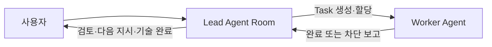
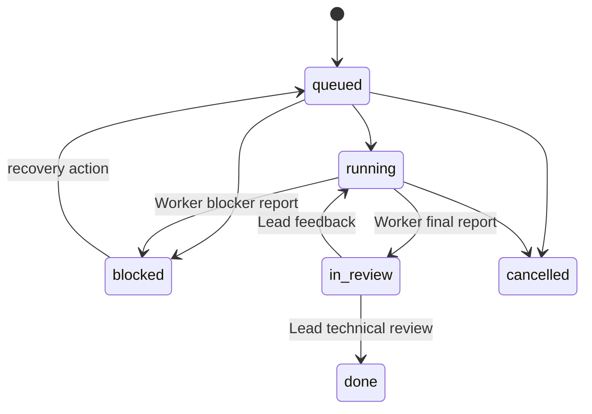

# 맞춤형 Agent Workplane 제품 아키텍처

Updated: 2026-07-17

## 제품 정의

이 제품은 특정 게임 개발 회사의 자동화가 아니라, 사용자가 자신의 조직과 작업
방식을 설정해 사용하는 협업형 AI Workplane이다.

기본 실행 구조는 다음과 같다.

- `Lead`는 맡겨진 목표 안에서 필요성을 판단하고 Worker Task를 직접 만든다.
- `Worker`는 배정받은 Task만 실행하며 Task를 만들거나 다른 Agent에게 재위임하지 않는다.
- 사용자에게 보이지 않는 중앙 controller는 Task를 만들거나 업무 판단을 대신하지 않는다.
- 완료·차단 결과는 Task를 만든 Lead의 기존 Room으로만 돌아간다.
- 여러 사용자는 같은 Company와 Project에서 각자 Agent Room, Task, 산출물과 검토 기록을 함께 본다.

## 고정 코어와 사용자 설정의 경계

### 제품 코어: 역할 이름과 분야를 모른다

코어는 `CTO`, `Designer`, `게임`, `Unity` 같은 고유 명사를 해석하지 않는다. 다음
일반 개념만 보장한다.

- Company, 사용자 멤버십, Project, Workspace, Repository
- Role, Agent, Agent Room, Task, Run, Artifact, Memory Scope
- Lead와 Worker의 실행 권한
- Task의 불변 소유자, 담당 Agent, 보고 Room, 상태 전이
- 실행 Job의 영속성, 재시작 복구, 중복 방지, 감사 로그
- Worker 실행 엔진, 계정, 모델, 비용·동시성 정책
- 첨부파일 staging, UTF-8, Workspace 접근 경계

### 사용자 설정: 회사와 운영 방식을 정의한다

사용자는 UI에서 다음을 설정한다.

- 역할 이름과 설명: CTO, PM, Artist, Research Lead 등
- 역할 유형: `lead`, `worker`, `hybrid`
- Lead가 호출할 수 있는 Role 또는 개별 Agent
- 역할별 Instructions, 도구, 모델, 계정, 비용·동시성 한도
- Task 유형과 계약 템플릿: 코드, 아트, 조사, 문서, QA 등
- 검토 흐름: Task Owner 검토, QA 추가 검토, 사용자 검토 여부
- Project별 저장소, Workspace, 공유 지식과 장기기억 범위
- 자율성 수준, 외부 서비스·배포·비용 승인 규칙

## 권한 모델

### Role capability

역할에는 이름이 아닌 capability를 부여한다.

| Capability | 의미 |
| --- | --- |
| `task.create` | 자기 Room에서 Task를 생성할 수 있음 |
| `task.assign` | 허용된 Worker/Role에게 Task를 배정할 수 있음 |
| `task.review` | Worker의 증거를 검토하고 수정 피드백을 남길 수 있음 |
| `task.complete` | 기술 수락 기준 충족 시 `done`으로 처리할 수 있음 |
| `task.execute` | 배정된 Task Run을 실행할 수 있음 |
| `memoryAccess` policy | Agent별로 SPS memory의 읽기·후보 제안·차단을 강제함 |
| `reviewMode` policy | Worker 최종/차단 보고 후 Owner Lead Room을 자동 실행할지, 수동 검토 대기로 둘지 결정함 |

기본 제품 정책은 다음과 같다.

- `lead`: `task.create`, `task.assign`, `task.review`, `task.complete`
- `worker`: `task.execute`만 기본 보유
- `hybrid`: 제품 사용자가 명시적으로 선택할 때만 Lead와 Worker capability를 함께 보유
- Worker는 기본값으로 `task.create`, `task.assign`, `task.complete`를 갖지 않는다.
- `memoryAccess`: Lead/Hybrid는 기본 `read_write`, Worker는 기본 `read`이며 Organization에서 `read_write`, `read`, `none`으로 바꿀 수 있다.
- `reviewMode`: Lead가 만든 새 Task에만 복사된다. `automatic`은 기존처럼 Lead Room을 즉시 깨우고, `manual`은 원래 Lead Room에 결과를 남긴 뒤 다음 Lead turn을 수동으로 시작할 때까지 `in_review`/`blocked`으로 유지한다.

권한은 조직도 표시용 `reportsTo`가 아니라 **Delegation Policy**로 판단한다. 즉,
누가 누군가의 상사인지와 누가 Task를 배정할 수 있는지는 별도의 설정이다.

## 자율성 모델

Lead는 현재 Room 목표와 저장된 Task 계약 안에서 필요하다고 판단한 유한 Worker Task를
스스로 만들 수 있다. 이 결정은 Role 이름이나 조직도 `reportsTo`가 아니라 Lead capability,
Delegation Policy, Worker 역할 일치, Project Workspace, 경로 충돌 미리보기로 제한된다.

현 구현에는 문서만 존재하던 `scheduled` Task 생성 모드가 없다. 승인된 일정에 따른
백그라운드 생성은 별도 Scheduler 제품 기능으로 추가할 때까지 약속하지 않는다. 외부 비용,
외부 전송, 공개·배포, 삭제처럼 큰 결과가 생기는 행동은 Task 자율성과 별개로 runtime/도구
권한에서 제한한다.

## 모델과 도구 설정 경계

Organization 화면은 Workplane 역할, 위임 범위, SPS memory 접근, Worker 결과 검토
방식을 관리한다. 각 행의 **Configure model & tools**는 SPS 기본 Agent Configuration으로
이동하며, 여기서 adapter, 모델, CLI 계정, 실행 환경, sandbox, 환경 변수와 Agent Instructions를
설정한다.

외부 CLI/MCP/API 도구의 실제 권한은 해당 Agent runtime에 속한다. 그러므로 Workplane 플러그인은
없는 보안 경계를 흉내 내지 않고, 자체 SPS 동적 도구와 Task 권한만 직접 강제한다. 새 Agent는
기본적으로 Room과 Workplane policy만 갖고, 전문 도구는 사용자가 해당 Agent Configuration과
Instructions에서 명시적으로 연결한다.

## Task 계약과 상태 기계

Task는 Lead Room에서 시작하는 유한한 실행 단위다. 다음 필드는 생성 뒤 불변으로
기록한다.

- `originatingRoomId`: Task를 만든 Lead Room
- `owningAgentId`: 기술 검토 책임 Agent
- `assigneeAgentId`: 실행 Worker
- `projectId`, `workspaceIds`, `repositoryRefs`
- `maturity`: `exploration`, `prototype`, `committed_implementation`
- `affectedPaths` 또는 `artifactScope`
- 목표, 산출물, 수락 기준, 검증 방법, 의존성

상태는 아래 규칙만 허용한다.

- Worker의 최종/차단 보고는 댓글과 상태 전이를 하나의 경계 처리로 묶는다. `automatic`
  reviewMode에서는 Lead Room wake까지 이어지고, `manual`에서는 같은 Lead Room에 내구성 있는
  검토 대기 보고를 남긴다.
- Worker는 `done`, 재배정, 재위임, 사용자 승인 Interaction을 만들 수 없다.
- `done`은 기술 완료이며 사용자·제품·비용·배포 승인이 아니다.
- `in_review`와 `blocked`의 다음 검토자는 언제나 `originatingRoomId`의 Lead다.

## 여러 사용자 협업 모델

한 Company에는 여러 사람을 멤버로 둔다. 사람과 Agent는 별도의 정체성이다.

| 주체 | 기본 권한 |
| --- | --- |
| Company Owner | Company 설정, 멤버, 결제/비밀, 템플릿, 모든 Project 관리 |
| Project Admin | Project Agent, Workspace, 정책, 멤버 관리 |
| Contributor | Room 대화, Task 생성 요청, Project 산출물 검토 |
| Viewer | 읽기 전용 |
| Agent | 배정된 Role capability와 Project 접근 범위만 보유 |

Agent가 사용자를 대리한다고 해서 사람의 권한을 자동 상속하지 않는다. Agent는
명시적으로 부여된 Project, Workspace, 외부 도구 capability 안에서만 행동한다.

### 현재 제품 권한 경계

현재 SPS의 사람 멤버십은 `Owner`, `Admin`, `Operator`, `Viewer`를 기본으로
사용한다. Workplane은 이를 대체하지 않고 다음처럼 사용한다.

- `Owner`와 `Admin`만 Agent의 Workplane Policy, CLI 계정 연결, 조직 템플릿 적용을
  변경할 수 있다. 이 동작은 `agents:configure` 권한을 요구한다.
- `Operator`는 Project·Room·Task 협업에 참여할 수 있지만 조직 구조나 실행 계정은
  바꿀 수 없다.
- `Viewer`는 읽기 전용이다.
- 장기적으로 Project Admin/Contributor 같은 제품 용어는 이 기본 멤버십과 Project
  범위 정책 위에 추가하되, Company의 Agent 설정 권한을 암묵적으로 얻지 않는다.

권한 확인은 UI의 disabled 상태만으로 끝내지 않는다. Plugin UI가 필요한 권한을
요청하면 코어가 현재 인증된 사람 또는 Agent의 유효 권한만 계산해 Action Context에
전달한다. Workplane Worker는 그 스냅샷에서 기대한 권한을 다시 확인한 뒤에만
설정 변경을 수행한다. 따라서 브라우저 요청을 직접 조작해도 권한 없는 멤버는
Agent 설정을 바꿀 수 없다.

Task API도 같은 원칙을 따른다. Agent가 명시적으로
`adapterConfig.workplane.kind = worker`로 설정된 경우, 코어는 Task 생성·배정·재배정
요청을 거부한다. 이 검사는 Room 도구를 우회한 기본 API, MCP, 자동화 경로에도
적용된다. Workplane 설정이 없는 일반 SPS Agent에는 이 추가 경계가 적용되지
않으므로 기존 조직의 기본 동작은 유지한다.

## Agent Room 프로비저닝과 복구

Project의 장기 대화 공간은 별도 Role 이름이 아니라 **고용된 Agent 한 명당 한 개의
Agent Room**으로 관리한다. 이 규칙은 다음 시점에 멱등적으로 적용된다.

- Project 생성: 현재 고용 Agent 각각의 Room을 생성한다.
- Agent 생성·변경: 모든 기존 Project를 다시 확인해 빠진 Room을 만들고, 이름 변경과
  퇴사 상태를 반영한다.
- Agent 삭제: 기존 Room을 `cancelled`로 보존해 기록은 남기되, 활성 Room 목록에서는
  제거한다.
- 플러그인/서버 재시작: 모든 Company와 Project를 재조정하여 이벤트 유실로 생긴
  Room 누락이나 퇴사 Agent의 활성 Room을 복구한다.

이 과정은 Task나 Room 대화 내용을 삭제하지 않는다. 더 이상 고용되지 않은 Agent의
Room만 이력 보존 상태로 전환하고, 재고용된 Agent는 같은 규칙으로 필요한 Project에
새 Room을 갖는다.

초기 배포는 개인 서버에서 여러 계정이 로그인하는 구조로 만들되, Company와
Project 모델은 향후 여러 독립 Company를 수용할 수 있게 tenant 경계를 둔다.

## 기본 제공 템플릿

### 게임 제작팀: 현재 사용자의 템플릿

- Lead: Manager, Designer, CTO
- Worker: Code, Image, Voice, QA, Document
- 모든 Lead는 공용 Worker 풀의 허용 Agent에게 Task 배정 가능
- Designer는 설계 책임, CTO는 구현 책임이며 Worker 전속 관계를 만들지 않음
- 설계와 구현 산출물은 각각 연결된 Repository가 원본

### 웹·앱 개발팀

- Lead: Product Lead, Technical Lead
- Worker: Frontend, Backend, QA, Documentation
- `Web / App starter` preset은 위처럼 이름 붙인 미설정 Agent에 명시적 generic
  Lead/Worker policy를 적용한다. Lead는 공유 Worker pool에 위임한다.

### 범용 소규모 팀

- Lead: Project Lead
- Worker: Generalist Worker, QA Worker
- `Small team starter` preset은 위 역할 이름을 인식해 같은 policy를 적용한다.

템플릿은 시작점일 뿐이다. 사용자는 복제 후 Role, Delegation Policy, 모델,
Instructions, Task 템플릿을 수정할 수 있다.

## Instructions와 Harness의 분리

AGENTS.md에는 역할의 판단과 품질 기준만 둔다.

- 어떤 작업을 Task로 분해할지
- 어떤 Worker가 적합한지
- 산출물과 수락 기준을 어떻게 정할지
- 전문 분야 품질을 어떻게 검토할지
- 사용자에게 결과·위험·선택지를 어떻게 설명할지

반대로 다음은 런타임이 강제한다.

- Task 생성/배정/완료 capability
- Task 소유 및 보고 Room
- 상태 전이, 중복 보고, Worker wake, 실행 Job 복구
- Workspace 접근, 첨부 staging, UTF-8
- 동시 실행·경로 충돌·비용·계정 정책

이 경계 덕분에 사용자가 Agent의 모델이나 역할 이름을 바꿔도 작업 흐름은
무너지지 않는다.

## 구현 우선순위

1. 현재 게임 제작 전용 규칙을 `Game Studio` 템플릿으로 분리한다.
2. Role capability와 Delegation Policy를 역할 이름과 `reportsTo`에서 분리한다.
3. Task ownership, 상태 전이, Worker 보고/wake를 코어 계약으로 유지·일반화한다.
4. Company Member와 Project Member 권한을 추가하고 Agent identity와 분리한다.
5. Agent/Role/Task Template/Runtime 설정을 관리하는 Organization UI를 만든다.
6. Project별 Workspace, Repository, Memory Scope와 Artifact Browser를 연결한다.
7. 멀티 사용자 인증, audit log, 비밀 관리, 외부 접속 배포를 강화한다.

## 제품 완료 기준

- 새 사용자가 템플릿 또는 빈 조직에서 자기 Role과 Agent를 만들 수 있다.
- Lead만 Task를 만들고 Worker는 배정 Task만 실행한다.
- Lead는 사용자 지시의 목표 안에서 Worker Task를 자율적으로 만들 수 있다.
- Task 결과는 언제나 생성 Lead Room으로 돌아가며 다른 조직도 때문에 바뀌지 않는다.
- 두 명 이상의 사람이 같은 Project에서 Room, Task, 산출물, 실행 이력을 함께 본다.
- Agent 모델·CLI·전문 API를 교체해도 Role과 Task 계약은 유지된다.
- Project·Workspace·Memory·첨부·비밀은 멤버와 Agent 권한 경계를 넘지 않는다.
- `Operator`가 조직 화면을 보더라도 Agent Policy·CLI 계정·템플릿 변경은 서버에서
  거부되고, `Owner`/`Admin`만 변경할 수 있다.
- 친구 또는 팀원이 접속하는 배포는 `local_trusted` 포트 개방이 아니라
  authenticated/private 또는 authenticated/public HTTPS 모드로만 전환한다.
- 실제 두 브라우저/두 사용자 수락 테스트에서 Owner/Admin과 Operator의 경계, Lead의
  Task 위임, Worker의 원래 Lead Room 보고를 검증한다.
