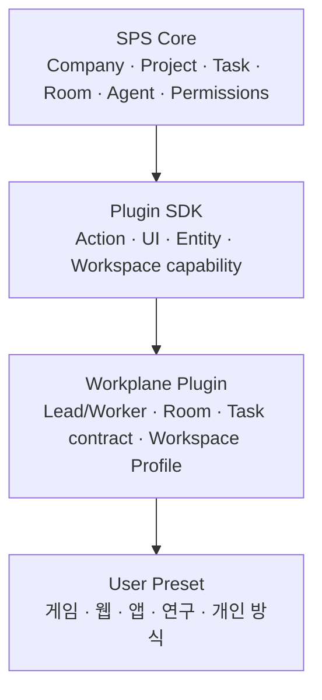

# Core 업데이트와 플러그인 경계

Updated: 2026-07-17

## 결론

맞다. 기본 SPS Core는 협업 시스템과 Plugin SDK를 제공하고, 사용자의 작업
방식은 외부 Workplane 플러그인으로 만든다.

현재 구조는 다음처럼 분리한다.

## Core에 남기는 것

Core에는 특정 개발 방법을 넣지 않는다.

- Company, 사람 멤버십, Project, Task, Room, Agent 실행
- Plugin의 UI, Action, Entity, 권한 검증, 감사 경계
- Project Workspace를 Plugin이 생성·수정·제거할 수 있는 일반 capability
  `project.workspaces.write`
- Plugin SDK의 Workspace API와 서버 host service
- Plugin의 Event, Scheduled Job, durable state, UI slot, Action capability
- Task별 실행 상태를 읽는 orchestration summary. 이 정보는 특정 CLI나
  조직도를 해석하지 않는 범용 실행 관측 API다.

이 확장점은 `Design`, `Implementation`, `Unity`, `CTO` 같은 단어를 전혀 모른다.
그래서 다른 Plugin도 문서 공간, 실험 공간, 클라이언트/서버 공간처럼 자기 방식의
Workspace Profile을 만들 수 있다.

## Workplane 플러그인에 남기는 것

이 플러그인만 사용자의 회사 운영 방식을 해석한다.

- Lead, Worker, Hybrid capability와 Delegation Policy
- Agent Room과 Task Room의 관계
- original Lead Room 보고·wake 규칙
- Worker final/blocker 보고 계약과 review 흐름
- Room Work State, checkpoint, native compact 관측
- Project별 Workspace Profile UI와 Agent별 Workspace 연결
- 게임 제작팀 같은 Legacy migration 또는 시작 프리셋

게임 팀 프리셋은 Plugin의 시작점일 뿐이다. 사용자가 UI에서 역할 이름, 위임 대상,
Workspace, 저장소, 모델, 도구, Instructions를 바꾸면 웹·앱·연구·콘텐츠 제작에도
같은 Core를 쓸 수 있다.

## 업데이트를 받는 방식

Workplane 플러그인은 `sps-server`에서 독립적으로 버전 관리한다.
일반 SPS 업데이트는 다음 순서로 받는다.

1. `external/sps-core`의 upstream 변경을 가져온다.
2. 작은 Core extension만 rebase 또는 병합한다.
3. Plugin을 새 Core SDK로 빌드한다.
4. Core SDK/server 컴파일과 Plugin `npm run check`를 실행한다.
5. 별도 Test Project에서 Workspace, Room, Worker 보고를 브라우저로 확인한다.
6. 실제 서버를 재시작하고 readiness를 확인한다.

Core에 필요한 사용자 정의는 현재 아래의 일반 확장점으로 제한돼 있다.

- `packages/shared/src/constants.ts`
- `packages/plugins/sdk/src/types.ts`
- `packages/plugins/sdk/src/protocol.ts`
- `packages/plugins/sdk/src/host-client-factory.ts`
- `packages/plugins/sdk/src/worker-rpc-host.ts`
- `packages/plugins/sdk/src/testing.ts`
- `packages/plugins/sdk/src/index.ts`
- `server/src/services/plugin-capability-validator.ts`
- `server/src/services/plugin-host-services.ts`

이 목록은 게임/조직 정책 코드가 아니라 Plugin이 Project Workspace를 다루는 일반 API
추가분이다. 따라서 upstream에 제안하거나 별도 작은 유지보수 패치로 관리하기 좋다.

## 사용자가 바꾸는 것과 Plugin이 바꾸는 것

같은 Core 위에서 두 수준의 개방성을 제공한다.

| 수준 | 사용자가 바꾸는 대상 | 예시 |
| --- | --- | --- |
| Organization 설정 | Agent 이름, Lead/Worker 유형, 위임 가능 대상, 모델, CLI, AGENTS.md, 검토 방식 | CTO 대신 Tech Lead라는 이름을 쓰고 Code Worker를 여러 명 둠 |
| Project Workspace Profile | 폴더, 저장소 링크, 기본 Workspace, Agent별 Workspace | Design/Implementation 또는 Frontend/Backend 또는 Sources/Experiments |
| Workplane preset | 기본 역할 묶음, Task 계약 템플릿, 화면 구성, 권장 정책 | 게임 제작, 웹 제품, 연구, 콘텐츠 제작 시작점 |
| 별도 Plugin | 외부 도구 연결, 새로운 업무 상태, 전용 대시보드, 고유 자동화 | Figma 검토, CI 결과 수집, Blender 큐, 사내 승인 시스템 |

따라서 사용자가 자신의 방식에 맞추기 위해 Core를 포크할 필요는 없다. 대부분은
Organization과 Project 설정으로 끝나고, 공용 설정으로 표현하기 어려운 업무 흐름만
Plugin으로 추가한다.

## Core와 Workplane의 실행 책임

Core는 실행 프로세스의 생성, 로그, 취소, timeout, 복구 이벤트처럼 모든 Plugin에
공통인 사실을 관리한다. Workplane은 그 사실을 회사 규칙으로 해석한다.

예를 들어 Worker CLI가 `timeoutSec`을 초과해 종료되면 Core는 이를 일반적인
`timed_out` 실행 실패로 기록한다. Workplane은 이를 다시 실행하지 않는다. 같은
Worker에게 Task를 유지한 채 Task를 `blocked`로 만들고, Task를 만든 원래 Lead Room에
실패 원인과 다음 조치를 보고한다. timeout 값은 Agent Configuration에 열어 두므로
짧은 반복 Worker와 장시간 빌드·렌더 작업을 같은 정책으로 강제하지 않는다.

이 분리는 중요한 이유가 있다. Core가 `Designer`, `CTO`, `승인`, `설계 레포`를 알면
업데이트마다 특정 회사의 정책과 충돌하지만, Core가 실행 사실만 제공하면 어떤
Workplane Plugin도 자기 조직의 보고·검토·복구 규칙을 안정적으로 적용할 수 있다.

## 제품 확장 방식

새로운 사용자는 Core를 포크해서 역할을 하드코딩하지 않는다. 다음 순서로 확장한다.

1. 빈 `Lead + Worker` 조직에서 Agent와 위임 범위를 설정한다.
2. 필요하면 해당 산업의 preset Plugin을 설치한다.
3. preset은 Workspace Profile, Task 계약 템플릿, 전용 UI만 제공한다.
4. 모델, CLI, MCP, API, AGENTS.md는 각 Agent Configuration에서 선택한다.

이렇게 하면 특정 사용자의 게임 제작 방식이 다른 사용자의 개발 방식을 오염시키지
않으면서도, 공통의 Room·Task·Memory·실행 내구성은 모두 공유할 수 있다.
