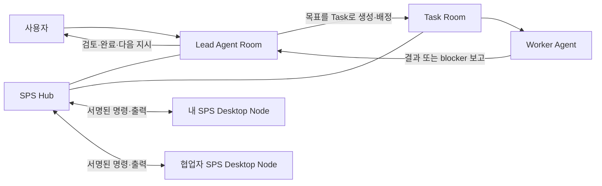

# SPS 서버 사용설명서

SPS는 여러 사람이 각자의 컴퓨터에서 AI 실행기를 유지하면서, 하나의 Hub에서
프로젝트·Room·Task·권한·작업 기록을 함께 관리하는 AI 개발 Workplane이다.

- 로컬 Hub: [http://127.0.0.1:3100](http://127.0.0.1:3100)
- 공개 Hub: [https://app.redongames.com](https://app.redongames.com)

## 1. 기본 구조



- **Lead**: Task를 만들고 Worker에게 배정하며, 결과를 검토한다. Manager, Designer, CTO가 일반적인 예다.
- **Worker**: 배정된 Task에서만 실제 생산 작업을 수행하고 결과 또는 blocker를 보고한다.
- **Agent Room**: 프로젝트마다 Agent 한 명당 하나씩 만들어지는 장기 역할 대화 공간이다.
- **Task Room**: 하나의 명확한 목표가 완료되거나 작업 불가로 닫힐 때까지 사용하는 단기 작업 공간이다.
- **SPS Desktop Node**: 각 컴퓨터에서 Codex CLI, agy CLI, Ollama, LM Studio 같은 로컬 실행기를 보유하는 앱이다. 로그인 정보와 API 키는 Node 컴퓨터 밖으로 전송되지 않는다.

## 2. 시작하기

1. SPS에 Google 계정으로 로그인한다.
2. **Projects**에서 프로젝트를 열거나 만든다.
3. Project의 **Rooms**에서 대화할 Agent Room을 선택한다.
4. Lead에게 자연어로 목표와 제약을 전달한다.
5. Lead가 필요한 Worker Task를 만들고 배정한다.
6. Worker가 `in_review` 또는 `blocked`로 보고하면 Task를 만든 Lead Room에서 검토한다.

예시:

```text
Designer, 이 프로젝트의 핵심 사용자 흐름과 화면 목록을 설계해줘.
```

```text
CTO, 승인된 설계를 기준으로 구현 순서를 정리하고 Code Worker Task를 만들어줘.
```

## 3. Project, Room, Task

### Project

Project는 운영 기록의 경계다. 프로젝트를 만들면 현재 고용된 Agent마다 같은 이름의
Agent Room이 하나씩 생성된다. Agent 이름을 바꾸면 Room 제목도 함께 바뀐다.

설계 문서와 구현 파일은 SPS 내부에 복사하지 않고 각 프로젝트의 Git 저장소와 Workspace에 둔다.

- 설계 저장소: 기획, UX, Obsidian 문서, 아트 브리프
- 구현 저장소: 소스 코드, 에셋, 빌드, 테스트
- 공유 지식 저장소: 여러 프로젝트에서 재사용할 규칙, 템플릿, 기술 메모

### Agent Room

Agent Room에서는 목표, 방향, 우선순위, 설계 검토, blocker 해소를 논의한다.
Lead는 여기서 Worker Task를 만든다. Worker도 역할 범위 안에서 논의할 수 있지만,
실제 생산 작업은 Task를 받은 뒤 시작한다.

### Task Room

Task에는 목표, 범위, 담당 Worker, 영향 경로, 참고 문서, 완료 기준, 검증 방법을 적는다.
Worker는 결과를 Task에 남기고, 완료 또는 작업 불가 시 Task를 만든 Lead Room에 보고한다.

| 상태 | 의미 |
| --- | --- |
| `todo` | 배정되었지만 아직 시작하지 않음 |
| `in_progress` | Worker가 작업 중 |
| `in_review` | Worker 결과를 Lead가 기술 검토해야 함 |
| `blocked` | 권한, 환경, 요구사항, 도구 문제로 진행 불가 |
| `done` | Lead가 완료 기준을 확인함 |

## 4. Agent 역할과 Instructions

**Agents > Configuration**에서 Agent마다 실행 adapter, 모델, 실행 Node, Instructions를 설정한다.

| 정책 | 권한 |
| --- | --- |
| `lead` | Task 생성·배정, Worker 결과 검토, 사용자 보고 |
| `worker` | 배정된 Task 실행, 결과·blocker 보고 |
| `hybrid` | lead와 worker 권한 모두 사용 |

역할 규칙은 Agent의 **Instructions**에서 편집한다. 이 내용은 해당 Agent의 공통
`AGENTS.md` 역할을 하며 모든 프로젝트에 적용된다. 프로젝트별 기획·구현 정보는
Instructions가 아니라 연결된 Workspace와 저장소 문서에 둔다.

## 5. 협업자와 SPS Desktop Node

협업자 초대와 실행 권한은 별개다. 초대만으로 다른 컴퓨터의 CLI를 실행할 수 없다.

1. Owner/Admin이 **Company settings > Invites**에서 `Operator` 초대를 만든다.
2. 협업자가 초대 링크를 열고 자기 Google 계정으로 로그인한다.
3. 협업자가 자기 컴퓨터에서 SPS Desktop을 열고 Hub URL을 입력한다.
4. SPS Desktop이 표시한 연결 승인을 협업자 계정으로 완료한다.
5. Owner/Admin이 **Company settings > Nodes**에서 새 Node를 승인한다.
6. Owner/Admin이 필요한 Agent에만 Node grant를 부여하고 기본 Node를 선택한다.
7. 해당 Agent의 Task가 생기면 Hub는 승인된 Node에만 서명된 실행 명령을 전달한다.

Node는 기본적으로 `pending`이며, 승인 전에는 실행할 수 없다. Node를 revoke하거나
Agent grant를 제거하면 대기·실행 중 명령도 즉시 실패 처리된다.

Hub에는 Node 표시 이름, 운영체제, 지원 실행기 종류와 모델 이름만 기록된다. 실행 파일
경로, 개인키, Codex/agy 로그인, API 키, 로컬 프로젝트 파일은 Node 컴퓨터에만 남는다.

## 6. 장기 대화와 파일

Agent Room은 `ROOM_WORK_STATE`를 이용해 현재 목표, 최근 결과, 다음 판단, 대기 이유를
복구한다. CLI가 자체 compact를 실행해도 최신 Room 상태와 관련 Task 정보는 다음 turn에
다시 제공된다.

Room에 올린 첨부파일은 필요할 때만 Agent가 읽는다. 설계 원본, 구현 산출물, 대용량 에셋은
가능하면 프로젝트 저장소에 두고 링크·경로·커밋으로 참조한다. 비밀번호, 계정 인증 파일,
개인정보가 포함된 파일은 첨부하지 않는다.

## 7. 실행기와 비용

- Lead는 복잡한 판단이 필요한 경우 Codex CLI 같은 강한 추론 실행기를 사용한다.
- 반복적인 코드·QA·문서 작업은 agy 또는 로컬 AI Worker로 비용을 줄일 수 있다.
- 이미지·음성 같은 전문 작업은 PixelLab, Meshy, ElevenLabs 등의 전용 API adapter를 Worker에 연결한다.

공급자 한도 또는 인증 문제가 생기면 SPS는 몰래 다른 모델로 바꾸거나 무한 재시도하지 않는다.
같은 Task와 담당자는 보존하고, 원래 Lead Room에 blocker를 보고한다. Lead 또는 사용자가
복구 후 같은 Task를 다시 실행한다.

## 8. 운영 명령

```powershell
Set-Location "C:\Users\young\Documents\AGENT 구축"

# 로컬 SPS 상태 확인 및 시작
.\sps-server\scripts\Start-SPS.ps1

# 로컬 서비스·플러그인·Agent 준비 상태 확인
.\sps-server\scripts\Test-SPSWorkplaneReadiness.ps1 | Format-List

# 공개 Hub 배포 상태와 외부 health 확인
Set-Location .\sps-server\deploy\hub
.\Test-SPSPublicHubDeployment.ps1 -Mode tunnel -CheckPublicHealth
```

## 9. 검증 범위

현재 자동 검증은 별도의 임시 Hub와 PostgreSQL에서 다음을 확인한다.

- Google 전용 공개 Hub의 인증 경계와 bootstrap
- Owner의 Operator 초대, 협업자 가입, Viewer 권한 제한
- 서로 다른 두 초대 협업자의 SPS Desktop 인증과 각자 Node 등록
- Owner/Admin의 Node 승인, Agent별 grant, Agent마다 다른 기본 Node 선택
- Hub가 명령을 생성하고 Desktop Node가 서명된 요청으로 claim
- 각 Agent의 명령이 자신에게 grant된 Node에서만 출력 스트리밍·완료 처리되는지

명령 전송 통합 검증은 고정된 `node` 출력만 사용하므로 Codex/agy 제공자 비용을 발생시키지 않는다.
실제 협업을 시작하기 전에는 친구의 두 번째 컴퓨터에서 한 번 로그인·Node 연결·권한 부여·작은
Task 실행을 확인하면 된다.

## 10. 문제 해결

| 상황 | 먼저 확인할 것 |
| --- | --- |
| Worker가 깨어나지 않음 | Task 상태, 담당 Agent 상태, Node grant, 해당 Lead Room의 blocker |
| Node가 실행되지 않음 | Node가 `active`인지, 최근 heartbeat가 있는지, 필요한 CLI capability가 있는지 |
| Task가 `in_review` | Task를 만든 Lead Room에서 결과와 완료 기준을 검토 |
| Task가 `blocked` | blocker에 적힌 권한·도구·요구사항을 해결한 뒤 같은 Task 재시작 |
| Agent가 맥락을 잃음 | Room checkpoint, `ROOM_WORK_STATE`, 관련 Workspace 문서와 최근 Task를 확인 |
| 파일 충돌 우려 | Lead가 영향 경로를 비교하고 Task 순서 또는 담당 경로를 조정 |

공개 Hub Docker 배포 상세는 [105-sps-public-hub-docker-deployment-ko.md](./105-sps-public-hub-docker-deployment-ko.md)를 참고한다.
