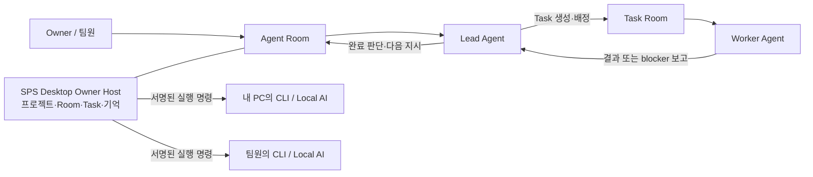

# SPS Desktop 사용 설명서

SPS는 AI 에이전트 팀이 프로젝트를 함께 만드는 데스크톱 작업 환경이다.
기본적으로 한 대의 **Owner Host** PC 안에서 오프라인으로 동작하며, 필요할 때만
Tailscale 기반의 사설 팀 연결을 켠다. 설계·구현 파일은 각 프로젝트의 Git 저장소에
남고, Room의 작업 맥락과 대화 기록은 Owner Host의 SPS Vault에 남는다.

## 1. 기본 구조

- **Owner Host**: 회사, 프로젝트, Agent, Room, Task, 권한, 장기기억의 기준 데이터가 있는 PC다.
- **Agent Room**: 프로젝트마다 고용된 Agent 한 명당 하나씩 생기는 장기 대화 공간이다.
- **Task Room**: 하나의 명확한 작업 목표를 끝낼 때까지 쓰는 임시 실행 공간이다.
- **Lead Agent**: Manager, Designer, CTO처럼 Task를 만들고 Worker에게 배정할 수 있는 역할이다.
- **Worker Agent**: 배정된 Task를 실행하고 결과 또는 작업 불가 사유를 보고하는 역할이다.
- **SPS Desktop Node**: 각 컴퓨터의 Codex CLI, agy CLI, Ollama, LM Studio, 전문 API 도구를 안전하게 실행하는 앱 구성 요소다.

Worker는 Lead가 만든 Task에서만 생산 작업을 한다. Worker의 완료·blocker 보고는
그 Task를 만든 Lead의 Agent Room으로 돌아간다. Lead와 Owner가 결과를 검토하고 다음
Task를 결정한다.

## 2. 한 대의 PC에서 시작하기

1. SPS Desktop을 실행한다. 첫 실행 시 암호화된 Owner Vault와 내부 Owner Host가 만들어진다.
2. **Use Owner Host**를 선택한다.
3. 회사와 프로젝트를 만든다.
4. 프로젝트의 **Rooms**에서 Designer, CTO 등 Lead에게 목표와 제약을 자연어로 설명한다.
5. Lead가 설계·작업 분해를 마치면 필요한 Worker Task를 만들고 배정한다.
6. Worker 결과가 Lead Room에 보고되면 Owner가 검토하거나 다음 지시를 준다.

처음에는 네트워크, Google 로그인, 외부 서버가 필요 없다. 이 상태에서 저장소와
프로젝트 폴더는 모두 Owner PC에 남는다.

## 3. Project, Room, Task

### Project

Project는 작업 범위와 기록의 경계다. 프로젝트를 만들면 각 고용 Agent와 같은 이름의
Agent Room이 하나씩 만들어진다. Agent 이름을 바꾸면 Room 제목도 함께 바뀐다.

- 설계 저장소: 기획, UX, Obsidian 문서, 아트 브리프
- 구현 저장소: 소스 코드, 에셋, 빌드, 테스트
- 공유 저장소: 여러 프로젝트가 함께 쓰는 규칙, 샘플, 기술 메모

SPS는 저장소를 복제해 장기기억으로 삼지 않는다. Room은 필요한 순간에 연결된
저장소 문서·첨부파일·Task 결과를 읽고, 현재 판단과 다음 행동을 Room 상태 파일에 기록한다.

### Agent Room

Agent Room은 방향, 우선순위, 설계 검토, 결과 검토를 위한 장기 대화방이다. Lead는
여기서 Worker Task를 만들 수 있다. Worker도 자신의 Room에서 Owner와 대화할 수 있지만,
실제 생산 작업은 배정된 Task에서 진행한다.

### Task Room

Task에는 목표, 범위, 담당 Worker, 변경 가능한 경로, 참고 문서, 완료 기준, 검증 방법을 둔다.
Worker는 완료 또는 작업 불가 시 Task에 결과를 남긴다. SPS는 이 결과를 Task를 생성한
Lead Room으로 전달한다.

| 상태 | 의미 |
| --- | --- |
| `todo` | 배정되었지만 아직 시작하지 않음 |
| `in_progress` | Worker가 작업 중 |
| `in_review` | Worker가 결과를 보고했고 Lead 또는 Owner의 검토가 필요함 |
| `blocked` | 권한, 환경, 요구사항, 한도 등으로 진행할 수 없음 |
| `done` | Agent가 목표와 완료 기준을 충족했다고 판단함 |

## 4. Agent 역할과 Instructions

**Agents > Configuration**에서 Agent별 실행 adapter, 모델, 실행 Node, Instructions를
설정한다. Instructions는 해당 Agent의 공통 `AGENTS.md` 역할을 하며 모든 프로젝트에 적용된다.

- `lead`: Task 생성·배정, Worker 결과 검토, Owner 보고 가능
- `worker`: 배정된 Task 실행, 결과·blocker 보고
- `hybrid`: Lead와 Worker 권한을 함께 가짐

설계·구현 세부 정보는 Agent Instructions가 아니라 프로젝트 저장소 문서에 둔다. 이렇게 하면
프로젝트마다 다른 개발 방식과 도구를 사용할 수 있고, Agent의 역할 규칙은 일관되게 유지된다.

## 5. 장기기억과 Compact

SPS 장기기억은 다음을 함께 사용한다.

1. Room 상태 파일: 현재 목표, 결정, 최근 결과, 다음 행동, blocker
2. Task 기록: 작업 계약, 실행 결과, 검증 내역
3. 프로젝트 저장소: 설계와 구현의 원본 문서
4. 첨부파일: 필요한 순간에만 읽는 원본 자료

CLI가 토큰 한도로 자동 compact를 수행해도 Room 상태 파일과 Task 기록은 남는다. 다음 turn은
이 기록과 필요한 저장소 문서를 다시 읽어 작업을 이어간다. 전원 종료나 앱 재시작에도 이미
저장된 메시지·Room 상태·Task 기록은 Owner Vault에 보존된다.

## 6. 팀원을 사설 네트워크로 초대하기

이 기능은 여러 사람이 각자 PC의 CLI와 로컬 AI를 쓰되, 회사 데이터는 Owner PC에 두고 싶을
때 사용한다.

### Owner 준비

1. Owner와 팀원의 PC에 Tailscale을 설치하고 같은 tailnet에 연결한다.
2. Owner Host에서 **Private team access > Detect Tailscale**을 누른다.
3. 화면이 `Tailscale HTTPS: ready`를 보여 주는지 확인한다. 아니라면 Tailscale Admin에서 HTTPS certificates를 활성화한 뒤 다시 검사한다.
4. 표시된 `https://<device>.<tailnet>.ts.net/api/auth/callback/google` 주소를 Google OAuth 웹 클라이언트의 redirect URI로 등록한다.
5. 회사를 선택하고 Google OAuth client ID와 secret을 입력한다. secret은 Windows secure storage에만 저장된다.
6. **Enable private team Host**를 누른다.
7. 브라우저에서 열린 일회성 Owner 초대를 Google 계정으로 수락하고, SPS Desktop에서도 Google 로그인을 마친다.

SPS는 Team Host를 만들기 전에 기존 `tailscale serve` 규칙이 비어 있는지 검사한다. 전환을
되돌릴 때도 SPS가 만든 HTTPS 루트 규칙임이 확인될 때만 제거한다. 규칙이 외부에서 바뀌었다면
SPS는 삭제하지 않고 Tailscale에서 먼저 확인하라고 안내한다.

### 팀원 준비

1. Owner가 회사 설정에서 사람 초대를 만든다.
2. 팀원이 초대 링크 또는 `sps://join` 링크를 열고 Google 로그인으로 초대를 수락한다.
3. 팀원의 SPS Desktop에서 Owner의 사설 SPS 주소로 로그인한다.
4. 팀원의 PC에서 프로젝트별 로컬 clone 폴더를 연결한다.
5. Owner가 **Company settings > Nodes**에서 새 Node를 승인한다.
6. Owner가 허용할 Agent만 그 Node에 grant하고, 필요한 Agent의 기본 실행 Node로 선택한다.

## 7. Node와 실행 권한

각 Node는 자신의 컴퓨터에서만 CLI 로그인 정보, API key, 로컬 모델, 프로젝트 파일을 사용한다.
Owner Host는 임의 셸 명령이나 임의 경로를 보내지 않는다.

- Node는 서명된 명령만 가져간다.
- Agent별 grant와 primary Node binding이 모두 있어야 실행된다.
- 명령을 가져오는 순간에도 grant와 binding을 다시 확인한다.
- 프로젝트 ID는 Node가 사용자가 선택한 로컬 폴더에만 매핑한다.
- Codex/agy 로그인 정보, `OPENAI_API_KEY`, 로컬 모델 key는 Hub나 다른 PC로 전송하지 않는다.

## 8. 백업과 PC 교체

Owner Vault에는 데이터베이스, 첨부파일, Room 기록, 백업, 암호화 키가 들어 있다. PC를 바꾸기
전에 Desktop의 export/backup 절차로 Vault 백업을 만든다. 새 PC에서 SPS Desktop을 설치한 뒤
복원하면 프로젝트·Room·Task 기록을 이어갈 수 있다. Git 저장소는 별도로 clone한다.

## 9. 문제 해결

| 상황 | 먼저 확인할 항목 |
| --- | --- |
| Worker가 시작하지 않음 | Task 상태, 담당 Agent 상태, Node grant, primary Node, CLI capability |
| Worker 결과가 Lead Room에 오지 않음 | Task를 만든 Lead Room, Task의 `in_review` 또는 `blocked` 상태, 보고 이벤트 |
| Node가 명령을 실행하지 않음 | Node가 `active`인지, 최근 heartbeat가 있는지, 프로젝트 폴더 매핑이 있는지 |
| Google 로그인이 실패함 | HTTPS 주소와 Google redirect URI가 정확히 일치하는지 |
| 사설 팀 전환 해제가 막힘 | Tailscale Serve의 HTTPS 루트 규칙이 SPS가 만든 규칙과 같은지 |
| Agent가 맥락을 놓침 | Room 상태 파일, 최근 Task 기록, 연결된 저장소의 결정 문서 확인 |

제품 사이트는 [redongames.com](https://redongames.com)이고, Owner PC의 데이터는 기본적으로
그 사이트나 외부 서버로 자동 전송되지 않는다.
