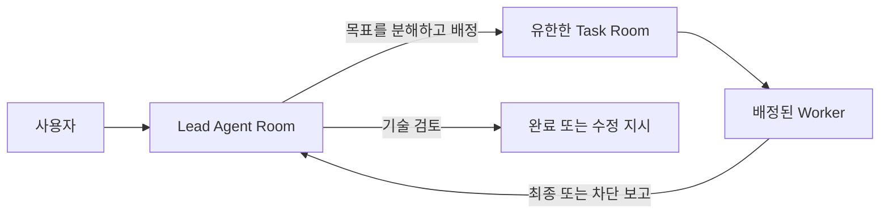

# SPS Workplane 현재 서버 사용설명서

이 문서는 현재 로컬 SPS Workplane 서버를 실제 제작팀이 사용하는 방법을
설명한다. 게임, 웹, 앱, 문서, 연구 프로젝트에 공통으로 적용된다.

기준 주소: [http://127.0.0.1:3100](http://127.0.0.1:3100)

## 1. 이 서버는 무엇을 하는가

이 서버는 AI가 임의로 회사를 운영하는 자동화 도구가 아니다. 사용자가 각 Agent와
직접 대화하면서, 필요한 실제 작업만 유한한 Task로 만들어 맡기는 제작 Workplane이다.

기본 흐름은 다음 하나다.



- **Lead**: 필요성을 판단하고 Worker Task를 만들고 기술 결과를 검토한다.
- **Worker**: 배정된 Task 안에서만 실제 생산 작업을 한다.
- **Agent Room**: Agent 한 명의 장기 대화·운영 책상이다.
- **Task Room**: 하나의 명확한 목표를 끝낼 때까지 쓰는 짧은 작업방이다.
- **Project**: Room, Task, Workspace, 운영 기록을 묶는 컨테이너다.

`Manager`, `Designer`, `CTO`는 일반적인 Lead 예시일 뿐이다. 실제 권한은
Agent 이름이나 조직도가 아니라 Agent Configuration의 Workplane policy로 정한다.

## 2. 바로 시작하기

1. 브라우저에서 [http://127.0.0.1:3100](http://127.0.0.1:3100)을 연다.
2. 왼쪽 **Projects**에서 기존 Project를 선택하거나 새 Project를 만든다.
3. Project를 열면 기본으로 **Workplane** 탭과 Agent Room 목록이 보인다.
4. 대화할 Agent Room 하나를 선택해 자연어로 요청한다.

예시:

```text
Designer, 이번 프로젝트의 핵심 사용자 흐름과 화면 목록을 설계해줘.
```

```text
CTO, 이 설계를 기준으로 구현 순서와 위험을 정리하고 필요한 Code Worker Task를 만들어줘.
```

```text
QA, 현재 빌드에서 확인해야 할 회귀 테스트 목록을 만들어줘.
```

사용자는 항상 Manager를 거칠 필요가 없다. 목적에 맞는 Lead Room을 직접 고르면
된다.

## 3. Project를 처음 만들 때

### 3.1 Project와 Agent Room

Project를 만들면 현재 고용된 Agent마다 이름이 같은 **Agent Room**이 하나씩
생긴다. 예를 들어 `손영하-CTO`와 `박정훈-CTO 2`가 있으면 Project마다 두 개의
독립 Room이 생긴다.

- Room은 역할명이 아니라 **Agent ID**에 연결된다.
- Agent 이름을 바꾸면 Room 제목도 안전하게 동기화된다.
- 새 Agent를 고용하면 기존 Project에도 그 Agent의 Room이 생성된다.
- 퇴사 또는 제거된 Agent의 Room은 기록 보존용 `cancelled` 상태가 되며, 기존
  대화와 Task 기록은 지워지지 않는다.

### 3.2 Workspace 연결

Project의 **Workplane > Workspace & task routing**에서 실제 작업 폴더 또는 Git
저장소를 연결한다.

권장 예시:

| Workspace | 용도 |
| --- | --- |
| `Design repository` | 기획서, UX, Obsidian 문서, 아트 브리프 |
| `Implementation repository` | 게임/웹/앱 소스, 빌드, 테스트 |
| `Shared knowledge repository` | 여러 Project에서 재사용할 패턴, 템플릿, 규칙 |

설계와 구현 파일의 원본은 이 외부 저장소다. SPS에는 Room 대화, Task 계약,
첨부, 체크포인트, 결과 보고 같은 **운영 기록**만 둔다. 같은 내용을 SPS
문서에 복제하지 않는다.

Task type도 Project마다 정할 수 있다. 기본 `design`, `implementation`, `qa`,
`art`, `voice`, `documentation` 외에 `research`, `release`, `api-contract` 같은
형식을 추가할 수 있다. 각 type에 기본 Workspace를 연결하면 Lead가 Task를 만들 때
해당 작업 경계가 자동으로 제시된다.

## 4. Agent를 설정하는 법

Owner/Admin은 왼쪽 **Agents** 목록에서 Agent를 열고 **Configuration**에서 다음을
설정한다.

1. 실행 adapter와 모델: Codex CLI, agy CLI, 전문 API adapter 등
2. 실행 폴더와 필요한 환경 변수
3. 사용할 Codex 계정 (`CODEX_HOME`) 또는 전문 도구 credential
4. Instructions: 해당 Agent의 공통 `AGENTS.md` 역할 규칙
5. Workplane policy: `lead`, `worker`, 또는 필요한 경우 `hybrid`

### 권장 policy

| 종류 | 주요 권한 | 일반적인 예 |
| --- | --- | --- |
| `lead` | Task 생성, 배정, 피드백, 기술 완료 | Manager, Designer, CTO, Project Lead |
| `worker` | 배정된 Task 실행과 결과 보고 | Code, QA, Image, Voice, Document Worker |
| `hybrid` | Lead와 Worker 권한 모두 | 소규모 팀의 전문 Lead |

Lead는 허용된 Worker pool에만 배정할 수 있다. Worker는 Task 생성, 재배정,
재위임, Task 완료 권한을 갖지 않는다.

`AGENTS.md`는 모든 Project에 공통 적용되는 역할 운영 규칙이다. Project별 제품
사실, 설계 파일, 구현 파일은 Agent Instructions가 아니라 각 Project Workspace에
둔다. 서버 재시작은 Agent Configuration이나 Instructions를 자동으로 덮어쓰지
않는다.

## 5. Room과 Task를 구분해서 쓰기

### Agent Room에서 하는 일

Agent Room은 길게 유지한다.

- 사용자와 목표, 방향, 우선순위를 논의한다.
- 설계와 기술 판단을 한다.
- 현재 Task 결과와 다음 후보를 검토한다.
- blocker, 선택지, 최종 기술 완료를 사용자에게 보고한다.
- 필요하면 Lead가 직접 Worker Task를 만든다.

Worker Room에서도 도구, 사양, 난이도, 가능성을 대화할 수 있다. 다만 Worker
Room 대화만으로 코드 수정, 빌드, 이미지 생성 같은 생산 작업이 시작되지는 않는다.
실제 생산은 Lead가 만든 Task에서만 한다.

### Task Room에서 하는 일

Task는 하나의 목표만 가진다. 좋은 Task에는 다음이 들어 있다.

- 목표와 범위
- 지정 Worker
- 영향을 받는 경로 또는 산출물
- 설계 참고 문서
- 수락 기준
- 검증 방법

예시:

```text
목표: 플레이어 대시 입력과 무적 프레임을 구현한다.
영향 경로: Assets/Scripts/Player/, Tests/PlayerDashTests.cs
수락 기준: 키보드와 패드 입력이 동작하고, 쿨다운 UI가 갱신된다.
검증: EditMode 테스트와 실제 플레이 모드에서 각각 확인한다.
```

같은 파일이나 인터페이스를 건드리는 활성 Task가 있으면 Lead는 먼저 충돌을
확인하고 순서를 정한다. 이것이 여러 Worker가 같은 파일을 동시에 수정하는 일을
막는 기본 장치다.

## 6. Task가 끝날 때의 흐름

1. Worker는 Task Room에 진행 기록을 남긴다.
2. Worker는 완료 시 `SPS Final Report`, 막힘 시 `SPS Blocker Report`를
   하나 남긴다. 보고에는 변경/산출물, 검증 결과, 남은 위험, 다음 검토자를 쓴다.
3. 서버가 Task를 각각 `in_review` 또는 `blocked`로 바꾼다.
4. **Task를 만든 원래 Lead Room만** 자동으로 wake된다.
5. Lead는 결과와 수락 기준을 기술적으로 검토한다.
6. 기준을 만족하면 Lead가 `done` 처리하고 자신의 Room에서 사용자에게 보고한다.
7. 부족하면 Lead가 같은 Task에 정확한 수정 피드백을 남긴다. Worker는 같은 Task를
   다시 수행한다.

`done`은 기술 검토 완료를 뜻한다. 제품 방향, 디자인, 비용, 공개, 배포에 대한
사용자 승인을 Worker나 Task가 대신 만들지 않는다. 그런 판단은 항상 Lead Room에서
사용자와 논의한다.

## 7. 장기기억과 첨부

### Room 기억

각 Agent Room은 대화 원문 외에 작은 `ROOM_WORK_STATE` 운영 책갈피를 유지한다.
여기에는 현재 목표, 최근 결과, 원본 문서 경로, 다음 후보, 대기 이유가 들어간다.
새 세션·재시작·compact 뒤에도 이 상태와 최근 Task 사실이 Agent에게 다시 제공된다.

Project 사실의 원본은 Workspace 저장소다. Room 기억은 그 문서의 위치와 현재
운영 상황을 연결하는 용도이며, 설계서 전체를 대체하지 않는다.

### 첨부

Room에 파일을 첨부하면 첨부 기록이 대화와 함께 저장되고, 실행 Agent가 필요할 때
선택된 Workspace 안의 안전한 staging 경로에서 읽을 수 있다.

- 파일은 필요할 때 읽도록 요청한다. 모든 첨부를 자동으로 읽는 방식이 아니다.
- 비밀키, 계정 인증 파일, 개인 정보는 Room이나 Task에 첨부하지 않는다.
- 이미지·문서의 원본은 가능한 한 Project 저장소에도 정리한다.

### Checkpoint와 compact

Room의 **Checkpoint/Compact** 기능은 긴 대화의 핵심 상태를 저장한다. 큰 의사결정
후, 주제를 전환하기 전, 또는 provider compact 직전에 사용하면 좋다.

Codex CLI가 자체 compact를 수행하면 그 사실도 Room 기록에 남는다. `/compact` 같은
CLI 명령을 채팅 UI에서 직접 흉내 낼 필요는 없다.

## 8. Tasks 화면과 검토 방법

Project의 **Tasks** 탭에는 해당 Project의 유한 Task만 표시된다. Agent Room은
Task 목록에 섞이지 않는다.

- `todo`: Task가 배정되어 실행 대기 중이거나, Lead 피드백 뒤 Worker에게 다시
  돌아간 상태
- `in_progress`: Worker가 실제 작업을 진행 중인 상태
- `in_review`: Worker 결과를 원래 Lead가 기술 검토해야 함
- `blocked`: 권한, 한도, 도구, 설계, 환경 문제로 진행 불가
- `done`: Lead가 수락 기준을 기술적으로 확인함

`in_review`나 `blocked` Task를 발견했을 때는 Task에서 사용자 승인 댓글을 만들지
말고, 해당 Task를 만든 Lead의 Agent Room에서 보고와 다음 행동을 확인한다.

## 9. 외부 도구와 비용

- 강한 추론이 필요한 Lead에는 Codex/Claude 같은 CLI를 연결할 수 있다.
- 반복 작업 Worker에는 agy 또는 로컬 모델을 연결할 수 있다.
- Image/Voice 같은 전문 작업은 PixelLab, Meshy, ElevenLabs 등 API adapter를
  해당 Worker에게만 연결할 수 있다.

연결 정보와 API 키는 Agent Configuration 또는 Company secrets에만 둔다. Room
대화, AGENTS.md, Git, 첨부파일에 넣지 않는다.

provider 한도 초과나 인증 실패가 나면 서버는 조용히 다른 모델로 바꾸거나 자동
재시도하지 않는다. Task는 Worker 배정을 보존한 채 blocker가 되고 원래 Lead Room에
상황이 보고된다. 계정·한도·권한을 복구한 뒤 Lead가 다시 시작 여부를 판단한다.

## 10. 다른 사람과 함께 쓰기

현재 기본 서버는 `127.0.0.1`의 안전한 로컬 전용 모드다. 같은 PC 밖의 사람이
접속하려면 먼저 인증과 네트워크 모드를 함께 설정해야 한다. 포트만 열어서는 안
된다.

권장 순서:

1. 호스트와 협업자를 Tailscale 같은 Private Tailnet에 연결한다.
2. SPS 인증 secret을 안전하게 설정한다.
3. PowerShell에서 실행한다.

```powershell
cd "C:\Users\young\Documents\AGENT 구축\sps-server"
.\scripts\Set-SPSWorkplaneAccessMode.ps1 `
  -Mode PrivateTailnet `
  -AllowedHostname "your-machine.tailnet.ts.net"
.\scripts\Start-SPS.ps1 -Restart
.\scripts\Test-SPSWorkplaneCollaboration.ps1 | Format-List
```

`state=collaboration_ready`를 확인한 뒤에만 Owner/Admin이 사용자를 초대한다.
협업자는 일반적으로 `Operator`로 두고, Agent 모델·계정·조직 policy를 바꿔야 할
때만 Admin을 부여한다.

## 11. 서버 운영 명령

PowerShell에서 다음을 사용한다.

```powershell
cd "C:\Users\young\Documents\AGENT 구축"

# 현재 상태를 유지하며 시작
.\sps-server\scripts\Start-SPS.ps1

# 플러그인과 서버를 다시 읽도록 재시작
.\sps-server\scripts\Start-SPS.ps1 -Restart

# SPS, Memory Sidecar, Agent 준비 상태 확인
.\sps-server\scripts\Test-SPSWorkplaneReadiness.ps1 | Format-List
```

정상 상태의 핵심 신호는 `ready=True`, SPS/Memory Sidecar `ok=True`, 필요한
Agent `ready=True`다. 실행 중인 작업이 없을 때 `liveRunCount=0`은 정상이다.

## 12. 자주 생기는 상황

| 상황 | 먼저 할 일 |
| --- | --- |
| Worker가 일하지 않는다 | Task status, Worker 상태, Lead Room의 blocker 보고를 확인한다. |
| Task가 `in_review`다 | Task를 만든 Lead Room에서 기술 검토를 기다리거나 Lead에게 결과 검토를 요청한다. |
| Task가 `blocked`다 | Lead Room에서 정확한 차단 원인과 필요한 계정·권한·결정을 확인한다. |
| Agent가 맥락을 놓친다 | Room의 Checkpoint, `ROOM_WORK_STATE`, 연결된 Workspace 문서와 최근 Task를 확인한다. |
| 같은 파일을 두 Worker가 건드릴 수 있다 | 새 Task 전에 Lead에게 영향 경로 충돌 확인과 순서 조정을 요청한다. |
| 디자인과 구현이 다른 Project에 섞인다 | Project별 Workspace와 저장소를 분리하고, 공통 지식만 Shared knowledge repository에 승격한다. |
| 친구와 접속하고 싶다 | LocalOnly 상태에서 포트를 열지 말고 Tailnet/인증 절차를 먼저 끝낸다. |

## 13. 가장 중요한 운영 원칙

1. 긴 논의와 사용자 보고는 Agent Room에서 한다.
2. 실제 생산 작업은 반드시 유한한 Task에서 한다.
3. Worker는 Task를 만들거나 완료하지 않는다.
4. Task의 결과는 만든 Lead Room으로만 돌아간다.
5. 설계·구현·에셋의 원본은 Project Workspace와 Git 저장소에 둔다.
6. Room 기억은 운영 연속성을 위한 것이며 저장소 원본을 대체하지 않는다.
7. 계정, API 키, 외부 도구 연결은 Agent Configuration/Secrets에서 관리한다.

구조와 구현 근거가 필요할 때는 [운영 모델](./02-final-operating-model-ko.md),
[Task 협업 계약](./69-task-room-collaboration-contract.md),
[협업 배포 준비도](./93-collaboration-deployment-readiness-ko.md)를 참고한다.
