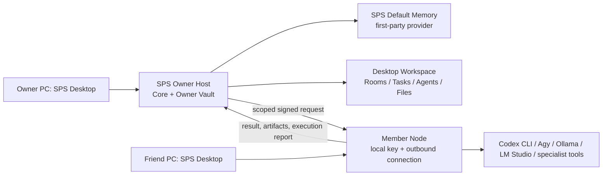

# SPS Desktop 다중 컴퓨터 운영 구조

> 상태: `111-sps-owner-host-and-memory-platform-architecture-ko.md`를 따르는 제품 구조

## 목표

SPS v1은 개인과 소규모 팀을 위한 Windows 데스크톱 제품이다. 메인 PC의 **SPS Desktop**은
SPS Owner Host와 암호화된 Owner Vault를 내부에서 관리하고, 팀원의 SPS Desktop은 자기
컴퓨터의 CLI와 로컬 AI를 실행하는 **Member Node**로 참여한다.

`redongames.com`은 회사 웹사이트다. `app.redongames.com`은 미래의 공용 게이트웨이나
외부 Host 주소로 사용할 수 있지만, 개인/소규모 팀의 기본 데이터 Host는 아니다.
사용자가 따로 `localhost:3100` 서버를 실행하거나 브라우저에서 관리할 필요가 없다.

## 제품 구성

하나의 SPS Desktop 설치 프로그램은 컴퓨터별로 다음 중 하나 또는 둘 다를 수행한다.

| 역할 | 책임 | 보관하는 데이터 |
| --- | --- | --- |
| Owner Host | 회사, 프로젝트, Rooms, Tasks, 권한, 감사 기록, 첨부파일, 기본 메모리, 백업을 권위 있게 보관 | 암호화된 Owner Vault |
| Member Node | 해당 PC에서 발견한 실행기와 사용자가 허용한 작업 폴더로 Agent 작업을 실행 | CLI 로그인, API 키, 로컬 모델, 작업 폴더 |
| Desktop Workspace | Owner Host 또는 초대받은 Team Host의 UI를 앱 창에서 표시 | 인증 세션과 최소 연결 설정 |

Node는 Agent가 아니라 **실행 가능한 컴퓨터**다. Agent는 역할과 AGENTS.md를 가진 논리적
직원이며, Node는 그 Agent가 실제로 실행될 수 있는 장소다.

## 연결 모드

| 모드 | 대상 | 연결 방식 | 원격 초대/Node |
| --- | --- | --- | --- |
| Local / offline | 한 대의 PC | Desktop 내부 Owner Host | 불가 |
| Private team | 친구와 소규모 팀 | 시스템 Tailscale의 HTTPS Serve | 가능 |
| Public HTTPS | 인터넷 협업 | Cloudflare Tunnel 등 인증된 HTTPS 게이트웨이 | 가능 |
| External Host | 기업/대규모 팀 | 같은 SPS Host 엔진을 서버 또는 Docker에 배포 | 후속 모드 |

Tailscale은 SPS에 내장하지 않는다. SPS Desktop은 이미 로그인된 시스템 Tailscale을 감지하고
`tailscale serve`로 loopback Owner Host만 사설 HTTPS 주소에 연결한다. 어느 모드에서도
Host는 Member PC에 포트를 열거나 원격 셸로 접속하지 않는다. Node가 Host로 아웃바운드
연결을 만들고, 허용된 요청만 가져간다.

## 초대와 계정 흐름

1. Owner는 Workspace의 회사 설정에서 역할, 만료, 사용 횟수를 정해 사람 초대를 만든다.
2. SPS는 짧은 코드, 브라우저 초대 링크, `sps://join` 딥링크를 제공한다. QR은 같은 초대 링크를
   전달하는 보조 수단이다.
3. Member는 SPS Desktop에서 코드를 입력하거나 딥링크를 연다. 딥링크에는 Team Host 주소와
   초대 코드가 함께 들어가므로 수동 주소 입력이 필요 없다.
4. 브라우저에서 Google 로그인을 완료하고 초대를 수락한다. 초대 코드는 가입 의사를 확인하는
   일회성 수단일 뿐, 계정이나 CLI 자격증명을 대신하지 않는다.
5. Desktop은 보호된 세션으로 회사와 프로젝트 목록을 읽고, 사용자가 원하면 그 PC를 Member
   Node로 등록한다.
6. Owner 또는 Admin이 Node를 승인한 뒤, Agent별 실행 권한과 기본 실행 Node를 설정한다.

## 권한과 실행

권한은 세 축으로 나뉜다.

| 축 | 질문 | 예시 |
| --- | --- | --- |
| 사람 -> Agent | 누가 보고, 대화하고, 설정하고, Task를 만들거나 검토할 수 있는가 | Lead만 Task 생성 가능 |
| Agent -> Node | 어떤 Agent가 어느 PC에서 실행될 수 있는가 | Image Worker는 친구 PC의 로컬 모델 사용 |
| Task -> 실행 범위 | 어떤 작업 폴더, 실행기, 첨부파일, 결과 업로드가 허용되는가 | 특정 프로젝트 폴더의 Codex 실행 |

Worker는 Task를 새로 만들거나 재할당하지 않는다. Lead Agent만 Worker에게 Task를 배정한다.
Node 실행 권한은 Agent별로 별도 부여하며, 사람에게 Agent 대화 권한이 있다고 해서 그
사람의 PC 또는 CLI 자격증명을 사용할 수 있는 것은 아니다.

각 Agent에는 기본 실행 Node와 추가 허용 Node를 둘 수 있다. 명시적으로 분리된 CLI 세션과
작업 폴더는 병렬 실행할 수 있으며, 로컬 AI Worker의 병렬성은 Node 자원 정책에 따라 제한한다.

## 실행 루프

1. 사용자 또는 Lead가 Room에서 목표를 정한다.
2. Lead가 Task를 만들고 Worker를 할당한다.
3. Host가 사람 권한, Agent-Node grant, 기본 Node, 작업 폴더, 실행기 종류를 검증한다.
4. 선택된 Node가 서명된 요청을 claim하고 자기 PC의 CLI 또는 로컬 모델을 실행한다.
5. Node는 로그, 결과, 필요한 산출물 메타데이터, 완료/차단 보고만 Host로 전송한다.
6. Core는 Task를 만든 Lead Room에 보고하고 Lead를 깨운다.
7. Lead 또는 사용자가 결과를 검토해 후속 Task, 수정, 완료를 판단한다.

Node가 오프라인이거나 권한이 취소되면 새 실행은 즉시 거절되며, 실행 중인 작업은 안전하게
취소 또는 실패 상태로 전환된다.

## 보안 경계

- CLI 로그인, API 키, 모델 파일, 실행 파일 경로와 로컬 프로젝트 파일은 Node 밖으로 보내지 않는다.
- Host에는 공개 capability, 버전, 동의한 작업 폴더의 식별 정보, 상태, 결과만 저장한다.
- Node 등록과 실행 요청은 기기별 Ed25519 키, nonce, 시간 제한, Agent-Node grant로 검증한다.
- Node 승인 취소, Agent grant 해제, 기본 Node 변경은 대기/실행 중 요청에도 다시 검사된다.
- Owner Vault의 기본 메모리는 Core 계약을 통해 범위와 권한을 확인한다. Provider 장애는 Room과
  Task의 원본 기록을 막지 않는다.

## 검증 기준

1. 새 Windows PC에서 SPS Desktop 설치, 초대 코드/딥링크, Google 로그인으로 회사에 참여한다.
2. Owner가 Node를 승인하고, Node가 공개 capability만 등록한다.
3. Owner가 Agent별로 해당 Node를 허용하면 친구 PC의 CLI가 친구의 로컬 계정으로 실행된다.
4. grant 또는 Node 승인을 취소하면 신규 실행과 진행 중 lease가 즉시 거절된다.
5. 완료/차단 보고가 Task를 만든 Lead Room으로 전달된다.
6. Owner Host 재시작과 PC 재부팅 뒤에도 Vault, Room 기억, Node 설정이 보존된다.
