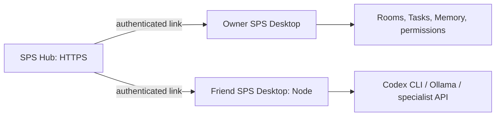

# SPS Desktop 멀티컴퓨터 운영 구조

## 목표

SPS는 사용자의 PC에 설치되는 데스크톱 앱으로 제공한다. 협업 데이터는 HTTPS 중앙 Hub에 보관하고, 각 사람의 PC는 자신이 보유한 CLI와 로컬 AI를 안전하게 실행한다.

## 권장 제품 구성

하나의 Windows 설치 프로그램은 두 역할을 제공한다.

1. **SPS Desktop workspace**: 중앙 Hub의 UI, 초대, 권한, Rooms, Tasks, 장기기억을 앱 창에서 연다. Google OAuth만 기본 브라우저를 잠깐 사용한다.
2. **SPS Node**: 같은 앱 안에서 동작하는 로컬 실행기다. PC에 설치된 Codex CLI, Agy, Ollama, LM Studio, 전문 API 도구를 탐지하고, 승인된 Agent의 작업만 해당 PC에서 실행한다.

SPS Hub는 항상 켜져 있는 HTTPS 중앙 서비스다. 기본 Hub는 `https://app.redongames.com`이며, 설치자는 필요하면 별도의 HTTPS SPS Hub를 운영할 수 있다. Desktop 설치 파일은 로컬 데이터베이스나 `localhost:3100` 서버를 기동하지 않는다.

## 권한 모델

한 Agent에는 다음 두 축의 권한을 분리한다.

| 축 | 의미 | 예시 |
| --- | --- | --- |
| 사람 접근 권한 | 누가 해당 Agent를 보고, 대화하고, Task를 만들고, 설정을 바꿀 수 있는가 | 친구는 Image Worker와 대화 가능, CTO 설정 변경 불가 |
| 실행 노드 권한 | 어느 컴퓨터가 해당 Agent를 실제로 실행할 수 있는가 | Image Worker는 친구 PC의 Ollama와 PixelLab만 사용 |

Agent마다 `view`, `chat`, `assign_task`, `review`, `configure`, `run_here` 권한을 독립적으로 둔다. Owner는 전체 권한을 가지며, Lead는 맡은 Agent에만 `assign_task` 권한을 갖는다. Worker는 Task 생성 권한을 기본적으로 갖지 않는다.

Agent에는 하나의 기본 실행 Node를 둘 수 있고, Owner는 필요하면 대기 Node를
추가할 수 있다. 기본값은 한 Agent의 동시 실행을 피하는 것이다. 다만 서로 다른
CLI 세션과 명시적으로 분리된 작업 폴더라면 Lead가 병렬 Task를 허용할 수 있다.
로컬 AI Worker의 병렬 실행 정책은 해당 Node의 자원과 모델 설정에 맞춰 보수적으로
정한다.

## 실행 흐름

1. Owner가 친구를 이메일 또는 일회용 초대 링크로 회사에 초대한다.
2. 친구는 SPS Desktop에서 로그인하고 초대를 수락한다.
3. 앱은 그 PC를 SPS Node로 등록한다. 등록 과정에서 기기 이름, OS, 사용 가능한 실행기만 서버에 공개한다.
4. 친구는 해당 PC의 Codex CLI 또는 로컬 AI를 연결한다. 로그인 토큰, API 키, 모델 파일 경로는 PC의 OS 보안 저장소에만 보관한다.
5. Owner가 Agent마다 사람 접근 권한과 실행 Node를 배정한다.
6. Lead가 Worker에게 Task를 배정하면 Hub가 권한과 충돌을 확인한 뒤, 지정 Node에 서명된 실행 요청을 보낸다.
7. Node가 로컬 CLI 또는 로컬 모델을 실행하고, 결과·작업 상태·필요한 산출물만 Hub에 보낸다.
8. Task 종료 보고는 Task를 만든 Lead Room으로 전달된다.

## 네트워크와 보안

공동 작업 Hub는 **로그인 필수**가 기본이다. Tailscale 같은 사설 네트워크를 쓰면
포트 공개 없이도 운영할 수 있고, 인터넷 공개를 선택하면 HTTPS·도메인·Google
OAuth·Docker 운영 체계를 함께 준비한다. 두 방식 모두 Node는 Hub로 아웃바운드
연결만 만들며, Hub가 협업자의 PC에 직접 접속하지 않는다.

필수 규칙:

- 현재의 `local_trusted` 서버를 그대로 외부에 열지 않는다. 멀티사용자는 `authenticated` 모드가 전제다.
- Node는 Hub에 아웃바운드 연결만 만든다. Hub가 친구 PC의 포트를 직접 열거나 임의 명령을 실행하지 않는다.
- Node 등록과 실행 요청은 기기별 키와 짧은 수명의 서명 토큰을 사용한다.
- Agent별 Node 배정과 권한이 바뀌거나 초대가 취소되면 즉시 연결 토큰과 실행 권한을 폐기한다.
- 첨부파일과 산출물은 Task/Project 권한을 다시 검사한 뒤에만 내려받는다.
- 각 Node는 허용된 작업 폴더와 도구 목록을 선언한다. 임의 경로, 임의 셸, 다른 사람의 CLI 자격증명에는 접근하지 않는다.

## 기존 SPS 기반의 활용 범위

현재 SPS Core에는 로그인 기반 배포 모드, 회사 초대, 회사 멤버십, Agent 권한, 프로젝트/Agent 개인 목록이 이미 있다. 이를 사용자 계정과 회사 초대의 기반으로 사용한다.

하지만 현재의 프로젝트/Agent 멤버십은 개인 UI 목록에 가까우며, “어느 PC가 어떤 Agent를 실행하는가”나 “사용자별 Agent 제어 권한”을 완성하는 모델은 아니다. SPS 전용으로 다음을 추가한다.

- `nodes`: PC 등록, 공개 키, 상태, 도구/모델 능력, 소유자
- `agent_node_bindings`: Agent의 기본 실행 Node와 대기 Node
- `user_agent_permissions`: 사용자별 Agent 제어 권한
- `node_execution_grants`: Node별 실행 가능 Agent와 작업 폴더 범위
- `node_runs`: Hub가 보낸 실행 요청, 실행 로그, 취소와 결과 수신 상태

이것들은 Core의 일반 권한·Task·Room API 위에 얹는 SPS 플러그인/확장 계층으로 둔다. 따라서 Core 업데이트를 계속 받을 수 있다.

## 데스크톱 앱 선택

Windows 우선 SPS Desktop은 Electron을 사용한다. 현재 SPS가 Node.js, React UI, CLI 실행기와 로컬 플러그인을 사용하므로, Electron의 메인 프로세스가 SPS Node를 별도 프로세스로 관리하는 구성이 가장 자연스럽다. Hub는 HTTPS로 접속하며, Desktop은 중앙 데이터베이스를 로컬에 포함하지 않는다.

렌더러 UI에는 파일 시스템·셸 권한을 주지 않는다. 앱 메인 프로세스가 제한된 IPC만 제공하고, 실제 CLI/로컬 AI 실행은 별도 Node 프로세스에서 수행한다. 자동 업데이트는 설치 프로그램과 코드 서명을 갖춘 뒤 활성화한다.

## 구현 순서

1. **SPS Hub 멀티사용자 기반**: 로그인 모드, 초대, 역할, 사설 네트워크 연결.
2. **SPS Node 프로토콜**: PC 등록, 기기 인증, 상태 화면, Node 폐기.
3. **원격 실행**: 한 개의 Codex CLI Agent를 친구 PC Node에서 실행하고 Room/Task 보고까지 연결.
4. **권한 UI**: 사용자 x Agent x Node 권한 매트릭스와 감사 기록.
5. **로컬 AI**: Ollama/LM Studio 탐지와 Worker 전용 실행 정책.
6. **SPS Desktop 패키징**: 설치, 업데이트, 진단 로그, 복구 화면.

## 구현 전 확정할 결정

- 첫 공개 대상은 Windows만 지원한다.
- Hub는 사설 네트워크 또는 공인 HTTPS 배포 중 설치자가 선택한다. 인터넷 공동 작업에는 Google 로그인과 초대가 필수다.
- Agent는 기본 Node를 갖고, 병렬 실행은 Lead가 분리된 작업 공간과 실행기 조건을 확인한 뒤 허용한다.
