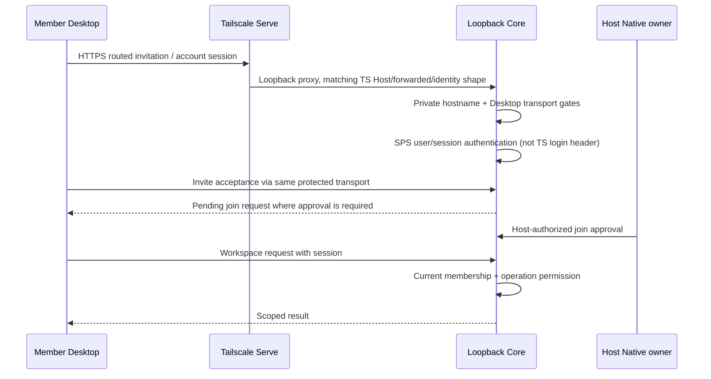

# Windows Native Connectivity: Stage 0 Audit

Date: 2026-10-25 KST. Read-only source audit; accompanying changes are documents only.
Source `b1c4b244734e9fbbd627ad5d2953d9d790775678`, Core
`0ba417ad9b0e26ae1cf598edca524b82059d04de`, public SDK
`d4d69208480fc618b2055378b85d183aea422d50` were clean at audit start.
These are inspected revisions, not a new signed installer tuple.

Three bounded Luna xhigh audits covered Desktop/Node, Core authentication, and the
public SDK. The coordinator independently inspected the critical guards, SDK scope
wrapper, Native sender checks, and WebSocket upgrade path. No runtime, database,
key, certificate, firewall, installed application, or deployment was changed.
No Fast/service-tier override was exposed by the delegation API.

## Findings

1. Native LAN transport and a public approved-Connection facade do not exist in
   the inspected contract. Current product support remains Tailscale.
2. Existing SPS Identity, Workspace membership, Host-only authority, signed Node
   requests, current grants/leases, and restore sanitization are reuse candidates.
   They are not interchangeable identities or permissions.
3. Tailscale dependencies include API routing, a private-team Owner recovery path,
   and separate SMB Source sharing. Replacing only HTTPS routing is insufficient.
4. HTTP middleware is not automatically applied to WebSocket upgrades. The live
   event path has separate session/key checks and long-lived subscriptions; native
   device revocation and current Workspace/Plugin checks require explicit coverage.
5. Generic SDK invocation scope checking does not universally reject absent scope.
   New Connection reads must require an authenticated Host-issued Workspace scope;
   copying generic gating alone would not meet the new contract.

These are migration requirements, not evidence of a newly demonstrated remote
exploit. The same-OS-user local-process trust limitation remains explicit.

## Code map and transition risks

Paths are repository-relative and functions are from the pinned revisions. Source
paths start at this repository; `external/sps-core` and `external/sps-plugin-sdk`
are the pinned private Core and public SDK checkouts. All native changes below are
proposals, not implemented features.

| Area | Current implementation / authority | Reuse and native owner | Risk / required test / rollback |
| --- | --- | --- | --- |
| 1 Host lifecycle | `sps-server/desktop/src/main.mjs`: `startOwnerHost`, `bootstrapOwnerHost`; `owner-host-config.mjs`: `createSpsOwnerHostConfig`, loopback authenticated Host | Desktop Host manager, existing startup error isolation | P1: new mode must not repair Serve implicitly. Test no TS CLI in native mode and intact old startup; opt-in off preserves old config |
| 2 Serve/config | `desktop/src/team-access.mjs`: `enableSpsTailscaleServe`, version/route ownership; main `enablePrivateTeamAccess`; stored `state.teamAccess` | Additive transport config, explicit Native choice | P1: no overwriting existing Serve/userData, no automatic migration of invites/keys. Keep old records until explicit retirement |
| 3 Header provenance | Core `server/src/middleware/request-hostname.ts`: `requestHostIdentity`; `private-hostname-guard.ts`; `desktop-local-access.ts` | Preserve TS compatibility; new authenticated TLS ingress context belongs to Core | P0 for new transport: headers/hostname/remote peer are not device auth. Fake TS/forwarded/direct Host tests; never broaden tokenless exception |
| 4 HTTP/WS | Core `server/src/app.ts`: `createApp`; `middleware/auth.ts`: `actorMiddleware`; `realtime/live-events-ws.ts`: `authorizeUpgrade`, `setupLiveEventsWebSocketServer` | Existing user/session and route access; separate trusted transport enforcement on HTTP and WS | P0: upgrade bypasses Express chain; test pre-upgrade and post-revoke delivery, A/B, no inherited instance-admin bypass. Keep current loopback listener unchanged |
| 5 Login/invites/Workspace | Core `auth/sps-identity.ts`: `verifyAccessToken`, `resolveSessionFromHeaders`; `routes/access.ts`: invite accept/join approval; `routes/authz.ts`: `hasSpsCoreHostAuthority`, `assertCompanyAccess` | Existing SPS user and technical membership; add device pairing separately | P0: SPS login is not Host/device approval; invite acceptance can create pending join. Fake user/device/Workspace tests; retain local Owner proof and existing invites |
| 6 Node execution | `desktop/src/main.mjs`: `ensureIdentity`, `connectNode`, `pollNodeCommands`; `desktop-node/src/identity.mjs`, `hub-client.mjs`; Core `routes/sps-nodes.ts`: `assertSignedNodeRequest`, `commandHasCurrentAuthority` | Ed25519 nonce/time checks, account binding, active Node, grants/lease | P0: Member connectivity must not grant execution; new Member key purpose separate. Pending/revoked Node and replay tests; preserve Node identity |
| 7 Vault/restore | Desktop `core-recovery-store.mjs`, main startup recovery, `owner-vault-transfer.mjs`; Core `packages/db/src/post-restore-sanitizer.ts`: `sanitizePostRestoreDatabaseWithExecutor` | Fresh-Host restore and explicit credential/grant invalidation | P1: future device/session material must join sanitizer; do not equate Vault with Desktop userData migration. Restore cannot resurrect remote approval |
| 8 Listener/Source/firewall | `desktop/src/owner-host-config.mjs` loopback; `host-project-share.mjs`: `spsHostProjectSharePath`, share worker; `desktop-node/src/host-project-share.mjs`: `openSpsWorkspaceSourceRoute` | Existing Host Source ownership, per-Node sealed credentials and Source grants | P0 for new exposure: SMB UNC requires `.ts.net`, TCP445 rule uses `100.64.0.0/10`. API PoC does not qualify file access; no LAN-wide firewall widening. Preserve current sharing |
| 9 Plugin/Native boundary | Desktop `window-security.mjs`: `createSpsWorkspaceWindowPreferences`; `core-settings-controller.mjs`: `assertSender`; main Workspace/preload setup | Separate Native window, exact sender/mainFrame/file, remote Workspace without Desktop bridge | P0: never proxy Host launch proof into Member renderer/Plugin. Test hidden admin IPC, UI hang, zero Agents/Plugins; Native recovery remains reachable |
| 10 Setup/support/update | `desktop/src/workspace-url.mjs`: `requireSpsHubOrigin`; `invite.mjs`: `createSpsRoutedInviteCode`; `desktop/renderer`, `release/support-matrix.json`, `scripts/current-candidate-doc.mjs` | HTTPS validation, routed invites, feature discovery and generated support docs | P1: do not relax HTTPS, advertise native support, or clear teamAccess before qualification. Additive migration + unknown old Host tests; no installer replacement |
| 11 Evidence | `desktop/test/team-access.test.mjs`, `owner-host-config.test.mjs`, `member-access.test.mjs`, `node-activation.test.mjs`, `core-settings-controller.test.mjs`; existing acceptance and Serve evidence scripts | Existing isolated Electron harness/fixture patterns and byte-bound evidence | P1: source mock/old installed Serve is not native two-PC evidence. Record actual process/port/TLS/revisions; regenerate signed-byte evidence separately |

In rows 2-11, `desktop/` and `desktop-node/` abbreviate `sps-server/desktop/` and
`sps-server/desktop-node/`. Risk is the priority for implementing the new path,
not a claim that the current TS product has a demonstrated bypass.

## Current sequences (not the proposed native protocol)

### Local Host

```mermaid
sequenceDiagram
    participant N as Native Desktop main
    participant H as Loopback Core
    participant I as SPS Identity
    N->>H: Start authenticated Host, per-launch Desktop token
    N->>I: Existing sign-in/session flow
    I-->>N: Validated account credentials
    N->>H: Narrow Owner bootstrap, two launch proofs + account session
    H->>H: Resolve user/membership, local Host authority
    Note over N,H: Optional TS mode reconciles Serve; local Host is not a LAN listener
```

### Remote Member over Tailscale



### Node execution and Source are separate

```mermaid
sequenceDiagram
    participant N as Member Node
    participant H as Core
    participant O as Host
    N->>H: Account-bound Node registration + public keys
    H-->>N: Pending until approved
    O->>H: Explicit Node/Runner/Agent grants
    N->>H: Signed heartbeat/claim, timestamp + nonce
    H->>H: Signature, nonce, active user/Node, current grant/lease
    H-->>N: Authorized command only
    O->>H: Separate Workspace Source grant
    H-->>N: Node-sealed source route when authorized
    Note over N,H: Source transport currently SMB over TS; connection alone grants neither
```

## Public SDK reuse and missing contract

- Canonical `external/sps-plugin-sdk/package.json` exports runtime/worker/platform.
  `runtime/index.d.ts` has optional `PluginSpsRuntime.connection`; it is cached
  Node approval/heartbeat metadata, not a TLS connection or readiness probe.
- `runtime/host-support.mjs` `readSpsHostSupport` reads registered known methods
  from optional initialization metadata. Unknown/old reports remain unknown;
  method registration is not capability, authentication, or backend health.
- Core `packages/plugins/sdk/src/host-client-factory.ts` has authoritative
  capability checks. `requireInvocationCompanyScope` rejects invalid/mismatched
  provided scope but returns when no invocation company is present. Models use
  separate stricter `requireModelScope`; new connection reads need equivalent
  mandatory Host-authenticated context, not model-specific semantics.
- `executionGrants.revoke` is not Member device/session revocation. No approved
  Windows-native connection API exists in the pinned public operation union.
- First facade should read bounded current-Workspace status only. Native
  pairing/device admin remains outside Plugin control. Details are in the
  [RFC](../current/WINDOWS-NATIVE-CONNECTIVITY-RFC-ko.md).

## Validation scope

This audit inspected source and previously recorded evidence. It did not rerun
the earlier 535 Desktop / 174 SDK / 387 targeted Core suites and does not claim a
new whole-Core or two-PC result. A bounded existing Desktop contract subset was
run for this documentation checkpoint:

```powershell
# Working directory: sps-server/desktop
node --test test/team-access.test.mjs test/owner-host-config.test.mjs test/invite.test.mjs test/window-security.test.mjs test/core-settings-controller.test.mjs test/core-recovery-store.test.mjs test/member-access.test.mjs
node scripts/current-candidate-doc.mjs --check
```

Results: **45/45**, zero failures/skips; generated candidate check passed.
`git diff --check` passed. All 80 local Markdown links in the nine changed/new
documents resolve; code pins and the Tailscale support tuple are unchanged.
The link/pin check is a local audit helper, not a new product/CI contract.
An additional bounded Luna xhigh read-only review found no material mismatch
between the plan/RFC and the handoff. It is internal review, not independent
GitHub approval or physical verification. D1 remains undecided: the user asked
for the difference between fingerprint-bearing invitations and customer-managed
certificates before selecting either approach.

No real Tailscale invocation, paid provider, customer identity key, Native LAN
listener, or installed application was used for a new smoke test. The tests use
existing temporary fixtures/mocked OS calls; they do not qualify native transport.

Existing [model broker acceptance](MODEL-BROKER-ACCEPTANCE-2026-10-25.md), No-AI
and Runtime acceptance records retain their original revisions and limitations.
UI token and Zod High failures are not waived. Exact-current full CI, Identity
production, signing, two-PC signed-byte evidence and independent approval remain
separate gates in the [release baseline](../current/RELEASE-BASELINE-ko.md).

## Next boundary

Stage 0 is documentation only. Resolve D1-D3 and review the narrow protocol before
introducing TLS listener/device credentials or broadening any network exposure.
Do not remove TS requirements until API, Owner recovery and Host Source access
are independently qualified. Follow the [plan](../current/WINDOWS-NATIVE-CONNECTIVITY-PLAN-ko.md)
for small PRs, denial tests, Source migration, and rollback.
